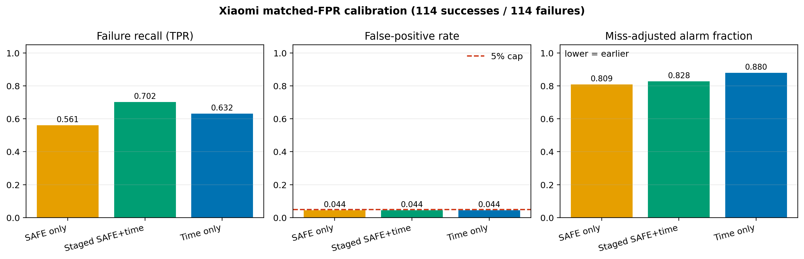
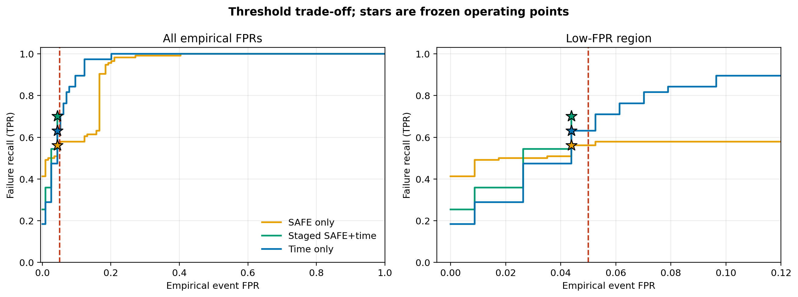
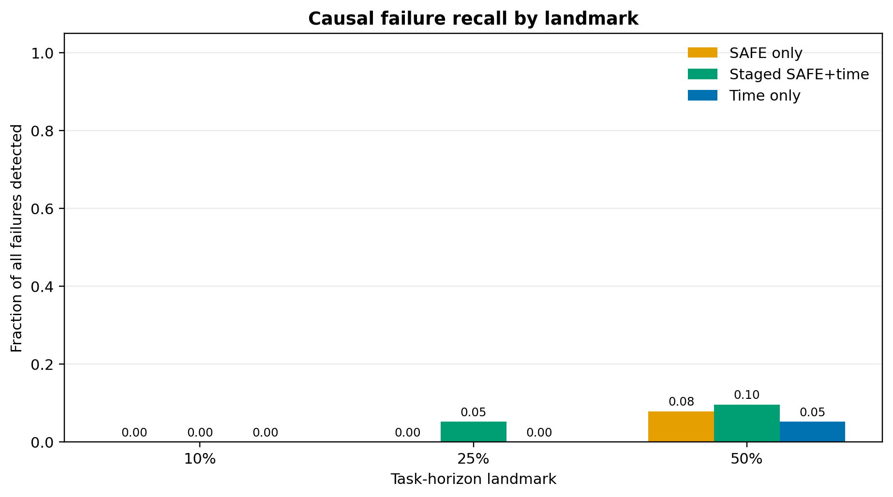
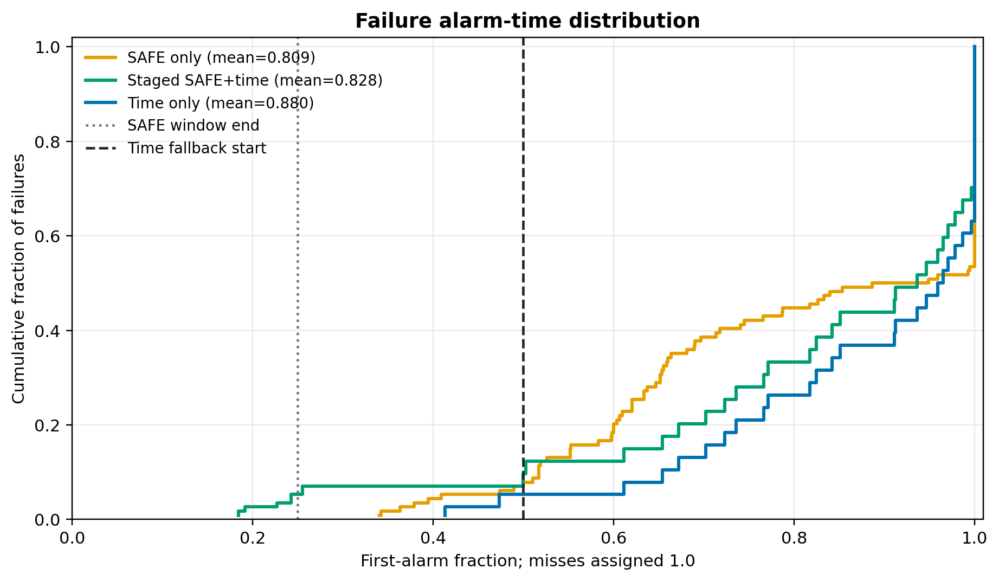

# SAFE on RoboCasa: Complete Experimental Report

**Status:** technical research record
**Period covered:** July 13–August 23, 2026
**Models covered:** π0 RoboCasa, RLDX-1, Xiaomi-Robotics-1, and the engineering-only ABot-M0.5 adapter
**Primary task:** predict eventual rollout failure from policy-internal features, following the official SAFE method as closely as possible

## Executive summary

We built and validated an end-to-end SAFE pipeline for RoboCasa:

1. capture the correct policy-internal feature once per genuine policy inference;
2. collect success and failure rollouts without storing repeated features for cached actions;
3. export data in the official SAFE `env_records` / `policy_records` format;
4. train the official independent MLP and LSTM detectors;
5. select hyperparameters without touching the held-out outer test set;
6. evaluate ROC-AUC and PRC-AUC, test duration-only leakage, calibrate conformal operating points, and render score trajectories over videos.

The main scientific result is not that atomic and composite tasks require separate global detectors. Training separate atomic-only and composite-only rollout detectors did **not** improve matched held-out performance relative to the mixed detector. Instead, atomic rollouts were much easier to classify:

- mixed RLDX MLP, task-normalized discrimination:
  - atomic ROC-AUC: **0.827**
  - composite ROC-AUC: **0.667**
- at conformal \(\alpha=0.15\):
  - atomic: TPR **0.275**, FPR **0.027**, balanced accuracy **0.624**
  - composite: TPR **0.167**, FPR **0.067**, balanced accuracy **0.550**

This supported the hypothesis that a single terminal success/failure label is too coarse for long-horizon composite tasks. We therefore implemented **Subtask-SAFE**, whose target is: “does the active natural-language subtask eventually fail before completion?” Semantic stage boundaries were derived from ordered RoboCasa task decompositions, duplicate-predicate stages were merged, and train/test splitting was performed by parent rollout before segment extraction.

Subtask-SAFE produced a promising retrospective segment-level result but failed the stricter causal test:

- 150 parent rollouts yielded 426 usable segments: 341 successful and 85 failed;
- independent MLP held-out segment ROC-AUC: **0.734 ± 0.002**;
- LSTM held-out segment ROC-AUC: **0.601 ± 0.041**;
- after training-only task/subtask normalization and parent-aware bootstrap, MLP ROC-AUC fell to **0.558**, 95% CI **[0.428, 0.676]**;
- at the first online inference of each active segment, MLP ROC-AUC was **0.389**, while the task-conditioned elapsed-time baseline was **0.742**;
- conformal MLP operation at \(\alpha=0.15\) achieved TPR **0.121**, FPR **0.119**, and balanced accuracy **0.501**.

The raw segment ROC therefore overstates deployable early-warning performance. Subtask identity, duration, and unequal stage priors explain much of the apparent discrimination. The current RLDX features contain useful retrospective information, especially for atomic tasks, but do not yet provide a reliable causal early-failure signal at composite subtask onset.

The best current RLDX result is the independent MLP trained on 25 successes and 25 failures for each of ten tasks:

- raw pooled ROC-AUC: **0.575 ± 0.004**
- training-only task-normalized ROC-AUC: **0.713 ± 0.017**
- macro per-task ROC-AUC: **0.715 ± 0.020**

The LSTM was consistently weaker. A controlled natural-prevalence experiment also showed that neither natural outcome sampling nor the paper's inverse-frequency loss weighting materially changed MLP performance. The dominant limitations are therefore representation, temporal target alignment, task/stage score offsets, and sparse failure support—not the original 25/25 balancing choice alone.

The Xiaomi-Robotics-1 study extended original binary-outcome SAFE to a much
broader natural-outcome dataset. The released policy was evaluated on the 39
official RoboCasa365 tasks whose published Xiaomi success count lay inclusively
between 5 and 45 out of 50. A fresh collection produced 1,950 valid rollouts,
and merging it with 692 earlier Xiaomi rollouts produced a 2,642-rollout source
pool. A deterministic seed-0 selection retained exactly 50 rollouts per task:
1,105 successes and 845 failures. One task with only one retained failure was
excluded from model development, leaving 38 tasks, 1,824 outer-training
rollouts, and a fixed 76-rollout outer test with one success and one failure per
task.

The leakage-free 810-fit Xiaomi grid selected an independent MLP and an LSTM
without scoring the outer test. On the final three-seed refits, raw pooled
ROC-AUC was **0.532 ± 0.016** for the MLP and **0.628 ± 0.008** for the
LSTM, while completed-rollout duration alone reached **0.804**. Training-only
task normalization changed the scientific ranking: normalized MLP ROC-AUC
rose to **0.692 ± 0.013** with average precision **0.733**, outperforming the
normalized LSTM at **0.646 ± 0.017**. In causal trajectory replay, the MLP
SAFE score achieved task-macro ROC-AUC **0.671** at 10% and **0.626** at 25%
of the training-derived task horizon, while task-conditioned elapsed time was
exactly **0.500** within task at both landmarks. At the validation-selected
event threshold, MLP SAFE detected 98.3% of failures at an adjusted mean
detection fraction of 0.668, earlier than time-only at 0.820, but its false
positive rate was also higher: 13.2% versus 5.3%. This is the first evidence in
the report of useful early within-task SAFE signal beyond elapsed time, but it
is post-hoc and did not itself compare detectors at a matched false-positive
rate.

The matched-FPR protocol is now complete. Calibration retained 454 valid
rollouts and froze all thresholds before prospective collection. The disjoint
prospective shadow test then retained 1,643 valid rollouts across 38 tasks; its
primary balanced cohort contained 380 successes and 380 failures. At the
frozen operating points, staged SAFE plus time achieved TPR **0.668** at FPR
**0.050**, versus **0.632** at **0.047** for time-only. Balanced accuracy
improved from **0.792** to **0.809**, but miss-adjusted detection moved only
from **0.880** to **0.854**, a **0.026-task-horizon** gain whose task/rollout
bootstrap 95% interval, **[-0.068, 0.004]**, included zero. Only **11/380 =
2.9%** of failures were detected by 25% of the horizon, far below the frozen
25% criterion. The preregistered overall claim therefore failed. The useful
signal was concentrated in atomic tasks: staged SAFE plus time detected 54%
of atomic failures versus 40% for time-only and alarmed 0.110 horizons earlier;
on composites, recall was identical and staged timing was slightly later.

The next five-task development experiment preserved complete Xiaomi parent
trajectories instead of exporting each semantic stage as an independent
pseudo-rollout. On the original 170 development parents, 96 parents were used
for fitting, 37 for model/regularization selection, and 37 for calibration;
the previously opened 80-parent outer set was explicitly not scored. Four
causal MLP arms, a success-prototype baseline, and a stage-conditioned
elapsed-time baseline were compared on task/stage-macro ROC-AUC at the first
one and two genuine inferences of the active stage. The strongest arm combined
full-parent SAFE summaries, stage-anchor change, causal progress variables,
task/stage embeddings, terminal and active-stage targets, and 4/8/16-inference
failure-horizon heads. It achieved selection ROC-AUC **0.696**, versus
**0.592** for terminal-label SAFE and **0.500** for time-only. It beat terminal
SAFE on all five tasks and time-only on four. This is encouraging developmental
evidence, not a held-out result: the same 37-parent partition selected the
regularization, and only 18 successful calibration parents made the nominal
5% conformal threshold degenerate and maximally conservative.

An offline baseline study (Section 15.10) then reused the recorded exports
for a single post-hoc evaluation on the already-opened 760-rollout cohort,
after reproducing every frozen threshold and result exactly. Inside the staged
wrapper, standard success-only scores (Mahalanobis, cosine k-NN, PCA-KMeans,
RND) matched staged SAFE: recall differences ranged from −0.002 to −0.029, with
every bootstrap interval reaching zero. Removing the staging helped instead.
An unstaged SAFE-or-time detector reached recall **0.955** at FPR **0.058**,
+0.287 over staged SAFE (95% CI [+0.156, +0.426]), and detected 0.038 task
horizons earlier. No detector exceeded 3% recall by 25% of the horizon.
The same fusion with each success-only baseline in place of SAFE reached
recall 0.905–0.947 at FPR 0.061–0.068. No recall difference from fused SAFE
was significant: the pre-declared rule for a SAFE-specific contribution failed
for all four baselines. Fused cosine k-NN alarmed slightly earlier than fused
SAFE. The supported conclusion is therefore time-aware fusion of a
policy-internal score with elapsed time, not SAFE specifically. The
preregistered staged SAFE + time detector remains as reported in Section 15.6:
a modest recall gain over time-only without the required earlier warning.
Every fused detector was defined after the cohort was opened, and their test
FPRs (0.058–0.068) exceeded calibration's 0.044. STAC-Single is undefined for
XR-1, whose 16-step chunks are executed in full.

A preregistered confirmatory test (Section 15.11) then evaluated the frozen
fused detectors once on a fresh, identity-disjoint 760-rollout cohort
(380/380), with no refit or recalibration. Both preregistered hypotheses
passed all three criteria. `fused_safe_time` against `time_only`: recall
**0.955** versus 0.632, gain +0.324 (bootstrap 95% CI [+0.179, +0.468]), at
FPR **0.039** (Wilson [0.024, 0.064]). The label-free `fused_knn_cosine_time`:
gain +0.313 ([+0.136, +0.492]) at FPR 0.058. Time-aware fusion of a
policy-internal score with elapsed time is therefore prospectively confirmed
on XR-1 at the frozen operating point. Descriptively, fused SAFE was the
strongest instantiation, detecting 100/100 atomic failures with 1/100 false
alarm. The preregistered staged detector (0.692 recall) and the post-hoc
history above remain as reported. Fusion still gives no early warning: recall
by 25% of the horizon stayed at most 0.050.

Because every failure runs to the time limit, the paper's endpoint is now
warning lead over a per-task quantile timer P, against which SAFE + P adds
only 0.007 of lead on the opened cohort. An exploratory go/no-go check
(Section 15.12) asked whether progress information could add more. On 250
traced parents of five composite tasks, an *oracle* stage-overdue detector
fused with P raised the mean lead from 0.149 to 0.220 (+0.071) at FPR 0.041.
The task-then-rollout CI was [−0.021, +0.129], so the pre-declared rule gave
**NO-GO**. The oracle reads privileged simulator stage predicates. A
progress-detector methods paper is not pursued now.

The preregistered lead-time test (Section 15.13; Amendment 1) then compared
SAFE + P with P on the confirmatory cohort, using a new 760-rollout calibration
cohort.
- **H1 was not supported.** SAFE + P added **+0.030** of the time limit in mean
  warning lead (0.255 against 0.225), with a decision-bootstrap CI of
  [+0.007, +0.093] at FPR 0.061. The CI lies above zero, but the point gain falls
  short of the registered 0.05 margin.
- **H2 was supported.** Null scores fused with P added at most +0.009.
- **Descriptively:**
  - P leads a global timer by 0.10;
  - the original fused SAFE + time-risk design gives 0.035 *less* lead than P;
  - the SAFE gain is concentrated in atomic tasks (+0.081 against +0.012 on
    composites).

An exploratory follow-up (Section 15.14) fused the four frozen success-only
baselines with P.
- They gain +0.020 to +0.034, similar to SAFE.
- All five scores gain more on atomic tasks than on composites.
- Length-matched AUC does not predict which score or stratum gains.
- A fresh atomic-only test passed its pre-declared gate (SAFE + P +0.089, CI
  [+0.005, +0.195]) but is underpowered with 10 atomic tasks. It is not run.

An offline replication on RLDX-1 (Section 15.15) found the same pattern:
- every failure runs to the time limit;
- the per-task timer dominates the global timer;
- the stronger SAFE model adds +0.034 lead over P at unchanged FPR, all of it on
  atomic tasks.

The sample is small, and noise matched that gain only by spending more FPR, so
this is preliminary.

Point-of-no-return labels on 48 XR-1 failures (Section 15.17) found 79% still
recoverable when the time limit was reached. On this benchmark, failure mostly
means not finishing in time, which is why elapsed time is so informative. The
recoverable call was reproduced by a second labeler (11 of 12 videos, kappa
0.80). The timing of the point of no return was not, so it should be read as
rough.

On FIPER's released rollouts (Section 15.18), length alone separates failures
almost perfectly in four of five tasks. A timer calibrated like FIPER matches
its accuracy but alarms about twice as late: the published benchmark has the
same duration confound, and earliness is where a detector must earn its place.
SAFE's real-robot release (Section 15.19) is the boundary case. Every rollout
of a task stops at the same T regardless of outcome, so length carries no
information there.

One published supervised baseline breaks the pattern so far (Section 15.20).
Hide-and-Seek, an LSTM trained with failure labels on SAFE's features, adds
+0.083 [+0.022, +0.143] lead over P at matched FPR on the August cohort, where
SAFE adds +0.008. An LSTM could learn a per-task duration rule by itself, so
the same model was retrained on zero inputs and on same-task, same-step
features of other rollouts. Both controls gain about 0, and Hide-and-Seek beats
each by +0.08 (CIs exclude 0). Elapsed time explains how well a learned score
separates failures, but rollout-specific features explain the extra warning
lead.

The preregistered test (Section 15.21, Amendment 2) confirmed it on the E1
cohorts, which Hide-and-Seek had never scored. Hide-and-Seek + P adds +0.071
[+0.022, +0.157] lead over the per-task timer, at the same FPR as SAFE + P,
whose gain is +0.030. This clears the 0.05 margin that SAFE missed. A control
that sees only each rollout's first inference adds nothing (+0.001), so the
warning develops during the rollout and is not a difficulty prior. The direct
Hide-and-Seek − SAFE contrast (+0.041) has a CI that includes 0. The
conclusion is that elapsed time explains how well detectors separate failures,
while a sequence model trained for early separation on the policy's internal
features warns earlier than duration alone.

An exploratory offline replication on RLDX-1 (Section 15.22), planned before scoring,
found the same:
- Hide-and-Seek + P adds +0.083 [+0.033, +0.138] lead over P, against +0.034 for SAFE.
  This meets the Amendment 2 margin rule, which the plan had predicted it would not.
- It uses one extra false alarm (4 of 100, against 3). With P matched to that budget the
  gain is +0.052 [+0.002, +0.106].
- The first-inference, zero-input and shuffle controls gain 0.02 or less.
- The gain is on atomic tasks (+0.115; composites +0.010).

## 1. Scope, labels, and evaluation rules

### 1.1 Raw SAFE target

The primary target remained the official binary rollout label:

- `success`: the RoboCasa task success predicate became true;
- `failure`: the rollout reached its horizon without success.

Ordered subtask annotations were not used for the rollout-level baselines. They were later introduced as a separate Subtask-SAFE target; raw rollout-level and subtask-level claims are kept distinct throughout this report.

### 1.2 Unit of observation

One SAFE feature record is stored per **real policy inference**. If an action chunk is reused for several simulator steps, the cached action consumption does not create duplicate SAFE feature records.

### 1.3 Models

The rollout-level experiments used the detector families in the official SAFE
repository:

- `indep`: independent MLP detector;
- `lstm`: temporal LSTM detector.

The detector input is derived from the policy-internal feature tensor with SAFE’s horizon and diffusion selectors.

Later causal experiments add explicitly named models rather than silently
changing the official detector:

- **segmented Subtask-SAFE:** the same official MLP/LSTM families, but each
  semantic stage is exported as an independent sequence and labeled by that
  stage's eventual outcome;
- **full-parent stage-aware MLP:** a report-specific causal MLP that retains
  prefix summaries from the complete parent rollout and optionally adds
  active-stage targets, near-failure heads, task/stage embeddings, causal
  progress variables, stage-anchor feature changes, and observation/state
  context;
- **prototype:** distance from successful-stage feature prototypes, without a
  learned classifier;
- **time-only:** a task/stage-conditioned elapsed-time hazard containing no
  policy-internal SAFE feature.

These families are not treated as interchangeable. Every result section states
its prediction unit, target, causal inputs, split unit, selection metric,
baseline, and whether the reported identities were used for selection. This
same reporting contract was checked across the π0, RLDX rollout-level,
Subtask-SAFE, Xiaomi broad, prospective matched-FPR, segmented five-task, and
full-parent stage-aware sections. Shared official SAFE settings are defined
here and the experiment-specific departures are restated where results appear.

### 1.4 Selection and held-out evaluation

The final π0 and RLDX experiments used:

- an outer train/test split fixed across model seeds;
- inner three-fold cross-validation on the outer training set;
- hyperparameter selection from inner validation ROC-AUC only;
- final refits with seeds 0, 1, and 2;
- no use of the outer test set during model selection;
- rollout-duration baseline checks;
- task-normalized analysis using statistics fitted from training data only.

Reported `±` values are population standard deviations across the three model seeds unless stated otherwise.

### 1.5 Important metric distinction

Three different aggregation views appear in this report:

- **raw pooled ROC/PRC:** all held-out rollouts pooled with their raw detector scores;
- **training-only task-z pooled ROC/PRC:** scores normalized per task with center and scale estimated from training data only;
- **macro task ROC:** ROC-AUC calculated per task and averaged.

Raw pooled results can be depressed by task-specific score offsets even when the detector ranks success and failure reasonably within each task. The task-normalized and macro metrics diagnose that effect, but they do not replace the operational calibration experiment.

## 2. SAFE feature implementations

### 2.1 π0 RoboCasa

The π0 integration follows the official SAFE `pre_velocity` feature:

- action-expert suffix hidden states;
- captured immediately before `action_out_proj`;
- one tensor per genuine inference;
- `float32`;
- expected inference shape:
  \[
  (10\ \text{flow steps}, 50\ \text{action tokens}, 1024\ \text{channels}).
  \]

Relevant versions:

- official SAFE repository commit: `b6036abe07b2b2bb9996afb2c07f13d6a9f507c0`
- official SAFE OpenPI reference commit: `9c99ed53f6a0c9be93a1c63cee5792620777d96b`
- pinned RoboCasa OpenPI commit: `5a6beda9ff99da30b4e1b59320f6a32971d7c397`
- companion patch: `patches/openpi_safe_features_5a6beda.patch`

The collector also records the executed actions and can record videos. Rollout metadata contains the task, environment seed, reset seed, split, horizon, model/checkpoint provenance, feature layer, and artifact paths.

### 2.2 RLDX-1

RLDX-1 has no module literally named `action_expert`, but its action model contains an equivalent action-token stream. The selected feature is:

- `ao[:, -action_horizon:]`;
- immediately before the embodiment-specific action decoder;
- layer identifier:
  `action_model_msat_action_suffix_pre_action_decoder`;
- stored as `float32`;
- observed tail shape:
  \[
  (4\ \text{diffusion steps}, 16\ \text{action tokens}, 1024\ \text{channels}).
  \]

Relevant versions:

- RLDX repository commit: `ef05cd4ae634ff97d672d42275febbc0b92cc192`
- checkpoint: `RLWRLD/RLDX-1-FT-RC365`
- companion patch: `patches/rldx1_safe_features_ef05cd4.patch`

The simulator-facing client uses ZeroMQ and preserves the same “one feature per real inference” rule. A language batching mismatch was also corrected:

- flat request fields: `[instruction]`;
- nested direct-policy `language`: `[[instruction]]`.

π0 calibration parameters were never reused for RLDX; each model family was trained and calibrated from its own captured features.

### 2.3 ABot-M0.5

An ABot-M0.5 SAFE adapter was implemented on the separate branch:

- branch: `codex/safe-abot-m05`
- commit: `99801d0`
- feature: normalized action-stream tokens immediately before `action_proj_out`;
- expected feature shape:
  \[
  (50\ \text{diffusion steps}, 32\ \text{action tokens}, 768\ \text{channels}).
  \]

This work is an **engineering integration only** in the present report. No completed ABot SAFE collection, detector training, calibration, or scientific result was recorded, so ABot is excluded from all performance comparisons.

### 2.4 Xiaomi-Robotics-1

The Xiaomi integration preserves the original SAFE binary final-rollout label
and does not use Subtask-SAFE supervision. XR-1 generates each action chunk
with a five-step flow-matching DiT. At every genuine policy inference, the
integration records the final-layer action-token hidden states immediately
before `action_output_layer`:

- feature identifier: `dit_action_tokens_pre_action_output_layer`;
- inference shape: `(5, 16, 1024)` with a `(16, 12)` action chunk, fully
  executed at `replan_steps=16` (verified on the prospective calibration
  export; earlier drafts stated `(5, 30, 1024)`);
- stored dtype: `float32`;
- stored rollout shape:
  `(num_policy_inferences, flow_steps, action_horizon, feature_dim)`.

The hidden-state copy is converted to `float32` only after the unchanged BF16
tensor has passed through the action-output layer, so feature capture does not
alter policy actions. Feature capture, environment stepping, and video storage
remain one record per genuine inference rather than one record per cached
action.

Pinned artifacts:

- official SAFE repository:
  `b6036abe07b2b2bb9996afb2c07f13d6a9f507c0`;
- Xiaomi source:
  `4da1db0a4deefa6de7ebb4ef0b8754017290f5f7`;
- checkpoint: `XiaomiRobotics/Xiaomi-Robotics-1-RoboCasa365`;
- checkpoint revision:
  `0d1aa76d0d82debc9b611e4d1e231096434d5be4`;
- Transformers: `4.57.1`;
- RoboCasa integration branch: `codex/safe-xiaomi-robotics-1`;
- pooled-data implementation commit: `5190c96e`.

The clean Xiaomi source and checkpoint were preserved. SAFE used an isolated
source worktree, a derived hard-linked checkpoint with an independently
patched `modeling_mibot.py`, and explicit server-side socket closure between
tasks. The socket lifecycle fix was required for reliable task transitions in
long resumable collections.

## 3. Chronology and operational validation

### 3.1 Initial π0 feature-server failure

The first atomic smoke produced no valid rollouts because the OpenPI server did not return `safe_features`. The client correctly raised:

> SAFE feature collection was requested, but the OpenPI server did not return `safe_features`.

The running server was using an incompatible checkout. Applying the companion patch to the pinned OpenPI commit and restarting the server fixed the protocol.

### 3.2 Corrected π0 sink smoke

Dataset:

```text
/gs/bs/tga-shinoda/felid/robocasa_rollouts/safe/safe_sink_corrected_smoke_20260713_175820
```

Result:

- 3 valid rollouts;
- 2 successes, 1 failure;
- seeds 0, 1, and 2;
- rollout lengths 600, 342, and 242 simulator steps;
- official SAFE loader compatible.

This established that the patched server, collector, feature records, labels, and loader were working together. The 600-step horizon came from the then-current official RoboCasa evaluation configuration. Differences between 26-second and 52-second videos were attributable to recording stride/FPS rather than a different simulator horizon.

### 3.3 Incorrect first five-task collection

Dataset:

```text
/gs/bs/tga-shinoda/felid/robocasa_rollouts/safe/safe_atomic_seen5_10x10_pi0_74999_20260713_172407
```

It stopped after collecting ten `OpenCabinet` failures and no successes. This was not accepted as a detector dataset. The collection protocol was corrected to match the official split, task set, reset/seed procedure, and task horizons.

### 3.4 Healthy π0 five-task collection

Source dataset:

```text
/gs/bs/tga-shinoda/felid/robocasa_rollouts/safe/safe_atomic_seen5_10x10_official_seed7_20260713_212804
```

Tasks:

- `CloseFridge`
- `OpenDrawer`
- `PickPlaceCounterToCabinet`
- `PickPlaceCounterToStove`
- `TurnOnSinkFaucet`

Audit:

| Task | Successes | Failures |
|---|---:|---:|
| CloseFridge | 18 | 10 |
| OpenDrawer | 10 | 14 |
| PickPlaceCounterToCabinet | 10 | 13 |
| PickPlaceCounterToStove | 10 | 11 |
| TurnOnSinkFaucet | 12 | 10 |
| **Total** | **60** | **58** |

Additional checks:

- 118 valid rollouts;
- 0 errors;
- official seed protocol with base seed 7;
- 382 skipped outcomes after quotas were met;
- no missing tasks;
- no duplicate rollout IDs;
- no duplicate task/seed/reset episodes;
- all requested artifacts present;
- official SAFE loader compatible.

### 3.5 Balanced π0 export

Official-format export:

```text
/gs/bs/tga-shinoda/felid/robocasa_rollouts/safe/safe_atomic_seen5_10x10_official_seed7_20260713_212804_official_balanced_10x10_seed0
```

It contains 100 rollouts: exactly ten successes and ten failures per task. This deterministic balanced subset was used to make the small-data comparison interpretable. The original naturally imbalanced 118-rollout source remains preserved.

Export log:

```text
/gs/bs/tga-shinoda/felid/robocasa_logs/eval/safe_atomic_seen5_10x10_official_seed7_20260713_212804_official_balanced_10x10_seed0_export.log
```

### 3.6 Attempted π0 expansion to 17 atomic tasks

We prepared a broader π0 collection for all 17 atomic-seen tasks with nonzero measured policy success, excluding `NavigateKitchen` because its measured success rate was 0%. The target was 20 successes and 20 failures per task, or 680 retained rollouts.

The collector was extended to:

- retain only the requested class quotas;
- discard excess majority-class outcomes;
- preserve skipped counts;
- merge hard-linked shards;
- mark unmet quotas as partial;
- stop after a configurable error ceiling.

The initial broad run:

```text
safe_atomic17_incremental_20x20_seed8_20260717_224824
```

was intentionally stopped and not used. Both top-up shards had zero valid rollouts and accumulated 713 errors because:

1. the dedicated SAFE worktree was missing ignored RoboCasa object assets, including `Stool015/model.xml`;
2. neither patched OpenPI server was running.

The failure motivated the `--max-errors` guard and explicit dual-server/asset preflight. A corrected relaunch root was prepared with the pattern:

```text
/gs/bs/tga-shinoda/felid/robocasa_rollouts/safe/safe_atomic17_incremental_20x20_seed8_fixed_*
```

No healthy 680-rollout merged audit or detector result from that expansion was recorded before work shifted to RLDX. It must therefore be treated as an incomplete collection attempt, not as a completed experiment.

### 3.7 Official evaluator environment repair

The first attempt to evaluate completed SAFE grid checkpoints inside the minimal `vla_safe` environment failed with:

```text
ModuleNotFoundError: No module named 'robosuite'
```

The offline evaluator did not actually require a simulator, but importing `robocasa` pulled RoboSuite at package import time. The evaluator was refactored so simulator-independent SAFE evaluation could run without RoboSuite. The repaired grid subsequently completed all 810 evaluations with zero failures.

### 3.8 RLDX dual-server smoke

Dataset:

```text
/gs/bs/tga-shinoda/felid/robocasa_rollouts/safe/rldx1_dual_safe_smoke_fixed_20260726_190445
```

Each of ports 20100 and 20101 produced one valid, loader-compatible failed rollout. This was an infrastructure smoke, not a success-rate or detector-quality result.

### 3.9 Healthy RLDX ten-task, 10/10-per-task dataset

Dataset root:

```text
/gs/bs/tga-shinoda/felid/robocasa_rollouts/safe/rldx1_safe_mixed10_10x10_20260726_190751
```

Merged dataset:

```text
/gs/bs/tga-shinoda/felid/robocasa_rollouts/safe/rldx1_safe_mixed10_10x10_20260726_190751/merged_10x10
```

Official export:

```text
/gs/bs/tga-shinoda/felid/robocasa_rollouts/safe/rldx1_safe_mixed10_10x10_20260726_190751/official_safe_10x10
```

The five atomic tasks were:

- `CloseToasterOvenDoor`
- `CoffeeSetupMug`
- `PickPlaceCounterToStove`
- `PickPlaceDrawerToCounter`
- `TurnOnSinkFaucet`

The five composite tasks were:

- `LoadDishwasher`
- `PreSoakPan`
- `ScrubCuttingBoard`
- `StackBowlsCabinet`
- `WashLettuce`

Audit:

- 200 rollouts;
- 100 successes and 100 failures;
- exactly 10 successes and 10 failures per task;
- 23,395 policy records;
- 200 video links, none broken;
- no missing tasks, duplicate IDs, duplicate task/seed/reset episodes, or missing artifacts;
- 5.74 GiB of materialized feature data;
- official SAFE loader compatible.

### 3.10 RLDX expansion to 25/25 per task

The second collection added 15 new successes and 15 new failures for every task. Both five-task shards completed with:

- 150 retained rollouts per shard;
- 75 successes and 75 failures per shard;
- no errors;
- all per-task quotas reached.

Merged dataset:

```text
/gs/bs/tga-shinoda/felid/robocasa_rollouts/safe/rldx1_safe_mixed10_extra15x15_20260727_163929/merged_25x25
```

Official export:

```text
/gs/bs/tga-shinoda/felid/robocasa_rollouts/safe/rldx1_safe_mixed10_extra15x15_20260727_163929/official_safe_25x25
```

Audit:

- 500 rollouts;
- 250 successes and 250 failures;
- exactly 25 successes and 25 failures per task;
- 58,834 policy records;
- complete conversion report;
- approximately 15 GiB on disk.

An early inspection script printed `INVALID` because it expected legacy summary keys such as `environment_records` and `labels`. The conversion itself was complete; the report schema, not the export, caused that false alarm.

## 4. π0 experiments

### 4.1 Training smoke and duration leakage

Independent MLP smoke:

```text
/gs/bs/tga-shinoda/felid/robocasa_checkpoints/safe/safe_pi0_indep_smoke_20260716_145732
```

LSTM smoke:

```text
/gs/bs/tga-shinoda/felid/robocasa_checkpoints/safe/safe_pi0_lstm_smoke_20260716_145834
```

Both official models trained and saved checkpoints. The duration-only baseline reached:

- train ROC-AUC: 0.969;
- seen validation ROC-AUC: 1.000;
- unseen validation ROC-AUC: 1.000.

This is evidence of strong episode-length leakage in termination-time evaluation. Failures often run to the full horizon while successful episodes terminate earlier. Consequently, matched-earliest or otherwise time-controlled evaluation is necessary before attributing performance to policy features.

### 4.2 Two-run grid pilot

Root:

```text
/gs/bs/tga-shinoda/felid/robocasa_checkpoints/safe/safe_pi0_grid_pilot_2gpu_20260716_152847
```

The 1,000-epoch MLP fit took roughly 3 seconds and the LSTM roughly 9 seconds. This was expected: the dataset was small and batch size 512 reduced each epoch to approximately one optimization batch. Fast execution was not evidence that training had been skipped.

### 4.3 Full official 810-fit grid

Root:

```text
/gs/bs/tga-shinoda/felid/robocasa_checkpoints/safe/safe_pi0_official_grid_2gpu_20260716_153526
```

Audit:

- 810/810 evaluations;
- 270 hyperparameter configurations;
- three model seeds per configuration;
- zero failures.

Selected configurations:

| Model | Horizon selector | Diffusion selector | Learning rate | Regularization | Train ROC | Seen ROC | Unseen ROC |
|---|---|---|---:|---:|---:|---:|---:|
| MLP | 1.0 | 0.0 | 3e-4 | 1e-3 | 0.9990 | 0.7989 ± 0.0807 | 0.4533 ± 0.0368 |
| LSTM | 1.0 | concat-2 | 1e-3 | 1e-2 | 0.9866 | 0.7917 ± 0.0694 | 0.5808 ± 0.0796 |

Interpretation:

- policy features contained substantial seen-task discrimination;
- cross-task transfer was weak;
- the near-perfect train scores indicated considerable overfitting;
- the small dataset and task-dependent distributions made a single global detector difficult;
- unseen-task results were diagnostic, not the target deployment condition.

### 4.4 Official-grid conformal operating points

Final report root:

```text
/gs/bs/tga-shinoda/felid/robocasa_checkpoints/safe/safe_pi0_official_grid_2gpu_20260716_153526/final_report
```

Matched-earliest conformal results:

| Model | Alpha | TPR | FPR | Balanced accuracy | Relative detection time |
|---|---:|---:|---:|---:|---:|
| MLP | 0.05 | 0.267 | 0.333 | 0.467 | 0.791 |
| MLP | 0.10 | 0.267 | 0.350 | 0.458 | 0.787 |
| MLP | 0.15 | 0.300 | 0.383 | 0.458 | 0.765 |
| MLP | 0.20 | 0.317 | 0.383 | 0.467 | 0.748 |
| LSTM | 0.05 | 0.117 | 0.133 | 0.492 | 0.890 |
| LSTM | 0.10 | 0.133 | 0.150 | 0.492 | 0.872 |
| LSTM | 0.15 | 0.183 | 0.150 | 0.517 | 0.827 |
| LSTM | 0.20 | 0.200 | 0.183 | 0.508 | 0.810 |

Neither model supplied a strong operating point: the MLP generated too many false alarms, while the LSTM reduced false alarms at the cost of detecting few failures and detecting them late.

### 4.5 Initial all-five-seen experiment

Root:

```text
/gs/bs/tga-shinoda/felid/robocasa_checkpoints/safe/safe_all5_seen_7x7_train_3x3_test_20260717_010030
```

Split:

- 70 training rollouts: 7 successes and 7 failures per task;
- 30 test rollouts: 3 successes and 3 failures per task.

Results:

| Model | Test ROC-AUC | Test PRC-AUC |
|---|---:|---:|
| MLP | 0.506 ± 0.009 | 0.541 ± 0.019 |
| LSTM | 0.702 ± 0.031 | 0.675 ± 0.025 |

This was an exploratory result using frozen hyperparameters. It was superseded by the leakage-free inner-CV experiment below.

Score-overlay videos for the initial LSTM experiment:

```text
/gs/bs/tga-shinoda/felid/robocasa_checkpoints/safe/safe_all5_seen_7x7_train_3x3_test_20260717_010030/lstm_seed0/score_videos/*.mp4
```

### 4.6 Leakage-free all-five-seen inner CV and final refit

The timestamped CV root was not printed in the retained terminal output. It can be located with:

```text
/gs/bs/tga-shinoda/felid/robocasa_checkpoints/safe/safe_all5_seen_innercv_*/
```

Audit:

- 810/810 inner-CV fits;
- 270 configurations;
- zero failures;
- outer test set never scored during selection.

Selected hyperparameters:

| Model | Horizon selector | Diffusion selector | Learning rate | Regularization | Inner validation ROC |
|---|---|---|---:|---:|---:|
| MLP | 1.0 | concat-2 | 3e-5 | 1e-3 | 0.7193 ± 0.0209 |
| LSTM | 0.0 | 0.0 | 1e-3 | 1e-2 | 0.8170 ± 0.0341 |

Final refit directory:

```text
<PI0_INNER_CV_ROOT>/final_refits
```

Final results on the common 30-rollout held-out set:

| Model | Test ROC-AUC | Test PRC-AUC |
|---|---:|---:|
| MLP | 0.600 ± 0.004 | 0.605 ± 0.002 |
| LSTM | 0.599 ± 0.039 | 0.637 ± 0.031 |

The large inner-CV-to-test gaps show that model selection remained noisy at this sample size. Neither detector provided robust held-out discrimination.

## 5. RLDX-1 experiments

### 5.1 Ten-task experiment with 10 successes and 10 failures per task

CV root:

```text
/gs/bs/tga-shinoda/felid/robocasa_checkpoints/safe/safe_rldx1_seen10_official_cv_2gpu_20260727_135354
```

Final root:

```text
/gs/bs/tga-shinoda/felid/robocasa_checkpoints/safe/safe_rldx1_seen10_final_refit_20260727_155824
```

Split:

- 140 training rollouts: 70 successes and 70 failures;
- 60 test rollouts: 30 successes and 30 failures;
- six held-out rollouts per task.

Selected inner-CV configurations:

| Model | Horizon selector | Diffusion selector | Learning rate | Regularization | Inner validation ROC |
|---|---|---|---:|---:|---:|
| MLP | concat-2 | 1.0 | 1e-3 | 1e-3 | 0.5482 ± 0.0066 |
| LSTM | 1.0 | 0.0 | 3e-4 | 1e-2 | 0.6220 ± 0.1099 |

Final results:

| Model | Raw pooled ROC | Raw pooled PRC | Task-z pooled ROC | Task-z pooled PRC | Macro task ROC |
|---|---:|---:|---:|---:|---:|
| MLP | 0.543 ± 0.007 | 0.566 ± 0.012 | 0.674 ± 0.023 | 0.708 ± 0.016 | 0.670 ± 0.037 |
| LSTM | 0.520 ± 0.025 | 0.522 ± 0.044 | 0.537 ± 0.026 | 0.558 ± 0.026 | 0.522 ± 0.036 |

Interpretation:

- raw pooled performance was close to chance;
- within-task MLP ranking was meaningfully better after training-only task normalization;
- score scale and offset varied strongly by task;
- the MLP was more stable and effective than the LSTM;
- only six held-out rollouts per task made individual task estimates very uncertain.

### 5.2 Ten-task experiment with 25 successes and 25 failures per task

The timestamped CV root was not printed in the retained output. It can be found with:

```text
/gs/bs/tga-shinoda/felid/robocasa_checkpoints/safe/safe_rldx1_25x25_cv_2gpu_*/
```

The CV sweep completed:

- 810/810 fits;
- 405 MLP and 405 LSTM fits;
- zero failures.

Final root:

```text
/gs/bs/tga-shinoda/felid/robocasa_checkpoints/safe/safe_rldx1_25x25_final_2gpu_20260730_104400
```

Split:

- 340 training rollouts: 170 successes and 170 failures;
- 160 test rollouts: 80 successes and 80 failures;
- 16 held-out rollouts per task;
- identical test identities across all six final runs.

Selected configurations:

| Model | Horizon selector | Diffusion selector | Learning rate | Regularization |
|---|---|---|---:|---:|
| MLP | concat-2 | concat-2 | 1e-3 | 1e-3 |
| LSTM | concat-2 | concat-2 | 1e-4 | 1e-2 |

Final aggregate results:

| Model | Raw pooled ROC | Raw pooled PRC | Task-z pooled ROC | Task-z pooled PRC | Macro task ROC |
|---|---:|---:|---:|---:|---:|
| MLP | 0.575 ± 0.004 | 0.573 ± 0.005 | 0.713 ± 0.017 | 0.723 ± 0.031 | 0.715 ± 0.020 |
| LSTM | 0.554 ± 0.006 | 0.581 ± 0.014 | 0.547 ± 0.010 | 0.551 ± 0.017 | 0.576 ± 0.007 |

An earlier aggregate summary reported MLP PRC-AUC `0.565 ± 0.007`; the table above uses the later direct recalculation from saved held-out scores (`0.573 ± 0.005`). The ROC conclusions are unchanged.

MLP per-task ROC-AUC:

| Task | Type | ROC-AUC |
|---|---|---:|
| CloseToasterOvenDoor | atomic | 0.792 ± 0.091 |
| CoffeeSetupMug | atomic | 0.719 ± 0.013 |
| LoadDishwasher | composite | 0.578 ± 0.013 |
| PickPlaceCounterToStove | atomic | 0.786 ± 0.070 |
| PickPlaceDrawerToCounter | atomic | 0.807 ± 0.032 |
| PreSoakPan | composite | 0.620 ± 0.037 |
| ScrubCuttingBoard | composite | 0.573 ± 0.087 |
| StackBowlsCabinet | composite | 0.776 ± 0.060 |
| TurnOnSinkFaucet | atomic | 0.771 ± 0.052 |
| WashLettuce | composite | 0.724 ± 0.019 |

LSTM per-task ROC-AUC:

| Task | Type | ROC-AUC |
|---|---|---:|
| CloseToasterOvenDoor | atomic | 0.448 ± 0.045 |
| CoffeeSetupMug | atomic | 0.672 ± 0.056 |
| LoadDishwasher | composite | 0.667 ± 0.070 |
| PickPlaceCounterToStove | atomic | 0.615 ± 0.103 |
| PickPlaceDrawerToCounter | atomic | 0.656 ± 0.089 |
| PreSoakPan | composite | 0.469 ± 0.068 |
| ScrubCuttingBoard | composite | 0.500 ± 0.026 |
| StackBowlsCabinet | composite | 0.526 ± 0.065 |
| TurnOnSinkFaucet | atomic | 0.620 ± 0.032 |
| WashLettuce | composite | 0.589 ± 0.027 |

Scaling from 10/10 to 25/25 per task improved the MLP:

- task-z pooled ROC: 0.674 → 0.713;
- macro task ROC: 0.670 → 0.715;
- smaller uncertainty from 16 rather than six held-out rollouts per task.

It did not make the LSTM competitive. The MLP remained the preferred detector.

## 6. RLDX task-normalized conformal calibration

Calibration report root:

```text
/gs/bs/tga-shinoda/felid/robocasa_checkpoints/safe/safe_rldx1_25x25_final_2gpu_20260730_104400_calibration_20260730_113807
```

Data partition:

- 340 training rollouts;
- 30 calibration successes;
  - 9 reference successes;
  - 21 nonconformity successes;
- 130 evaluation rollouts;
  - 50 successes;
  - 80 failures;
- train, calibration, and evaluation identities all disjoint.

Global MLP operating points:

| Alpha | TPR | FPR | Balanced accuracy | Relative detection time |
|---:|---:|---:|---:|---:|
| 0.05 | 0.133 | 0.033 | 0.550 | 0.769 |
| 0.10 | 0.142 | 0.033 | 0.554 | 0.766 |
| 0.15 | 0.196 | 0.040 | 0.578 | 0.716 |
| 0.20 | 0.337 | 0.080 | 0.629 | 0.766 |

At the preselected \(\alpha=0.15\):

| Task | TPR | FPR | Balanced accuracy |
|---|---:|---:|---:|
| CloseToasterOvenDoor | 0.708 | 0.200 | 0.754 |
| CoffeeSetupMug | 0.250 | 0.067 | 0.592 |
| LoadDishwasher | 0.000 | 0.067 | 0.467 |
| PickPlaceCounterToStove | 0.333 | 0.067 | 0.633 |
| PickPlaceDrawerToCounter | 0.042 | 0.000 | 0.521 |
| PreSoakPan | 0.000 | 0.000 | 0.500 |
| ScrubCuttingBoard | 0.083 | 0.000 | 0.542 |
| StackBowlsCabinet | 0.167 | 0.000 | 0.583 |
| TurnOnSinkFaucet | 0.083 | 0.000 | 0.542 |
| WashLettuce | 0.292 | 0.000 | 0.646 |

Interpretation:

- calibration controlled false alarms reasonably well;
- failure recall remained low;
- detection was generally late;
- performance varied sharply by task;
- a single rollout-level operating point is not sufficient for reliable composite-task intervention.

## 7. Atomic-versus-composite ablation

The timestamped root was not printed in the retained terminal record. Locate it with:

```text
/gs/bs/tga-shinoda/felid/robocasa_checkpoints/safe/safe_rldx1_25x25_type_ablation_*/
```

Its structure is:

```text
<SAFE_TYPE_ROOT>/
├── mixed_calibration/{atomic,composite}/
├── cv/{atomic,composite}/
├── final/{atomic,composite}/
└── split_calibration/{atomic,composite}/
```

### 7.1 Mixed detector evaluated separately by task type

At \(\alpha=0.15\):

| Task type | Task-z ROC | Task-z PRC | TPR | FPR | Balanced accuracy | Relative detection time |
|---|---:|---:|---:|---:|---:|---:|
| Atomic | 0.827 | 0.891 | 0.275 | 0.027 | 0.624 | 0.650 |
| Composite | 0.667 | 0.773 | 0.167 | 0.067 | 0.550 | 0.954 |

Atomic rollouts were substantially easier to rank and failures were detected earlier. Composite detections occurred very near the end of the rollout.

### 7.2 Separate model selection

Inner-CV selections:

| Type | Horizon selector | Diffusion selector | Learning rate | Regularization | Inner validation ROC |
|---|---|---|---:|---:|---:|
| Atomic | concat-2 | 1.0 | 1e-3 | 1e-3 | 0.6665 ± 0.0116 |
| Composite | concat-2 | concat-2 | 1e-3 | 1e-2 | 0.6601 ± 0.0219 |

Final raw held-out results:

| Type-specific detector | Test ROC-AUC | Test PRC-AUC | Train | Test |
|---|---:|---:|---:|---:|
| Atomic MLP | 0.741 ± 0.018 | 0.707 ± 0.022 | 170 | 80 |
| Composite MLP | 0.586 ± 0.005 | 0.578 ± 0.013 | 170 | 80 |

Both tests used 40 successes and 40 failures. Their identities were exact atomic/composite subsets of the original mixed-model test split.

### 7.3 Matched mixed-versus-split calibration

Using identical calibration and evaluation identities:

| Type | Model | Task-z ROC | Task-z PRC | TPR | FPR | Balanced accuracy | Relative detection time |
|---|---|---:|---:|---:|---:|---:|---:|
| Atomic | Mixed | 0.827 | 0.891 | 0.275 | 0.027 | 0.624 | 0.650 |
| Atomic | Split | 0.821 | 0.880 | 0.217 | 0.133 | 0.542 | 0.229 |
| Composite | Mixed | 0.667 | 0.773 | 0.167 | 0.067 | 0.550 | 0.954 |
| Composite | Split | 0.668 | 0.777 | 0.192 | 0.107 | 0.543 | 0.928 |

Differences, split minus mixed:

- atomic:
  - ROC −0.007;
  - PRC −0.011;
  - balanced accuracy −0.083;
- composite:
  - ROC +0.001;
  - PRC +0.004;
  - balanced accuracy −0.007.

### 7.4 Interpretation

The ablation rejects the simple explanation that mixed atomic/composite training confused the detector:

- the separate atomic model did not improve ranking or calibrated operation;
- the separate composite model was effectively tied in ranking and slightly worse in balanced accuracy;
- the mixed model therefore already benefited from the additional cross-type data.

However, the experiment strongly supports a different diagnosis:

- atomic tasks have a relatively coherent action objective and terminal label;
- composite tasks contain several semantically different phases;
- the same rollout-level failure label combines failures at different stages;
- early composite features can be healthy for the current subtask even when a later subtask eventually fails;
- failure evidence for some composites only appears near the end, explaining the 0.954 relative detection time.

The evidence therefore motivates **composite decomposition**, not separate global task-type models.

## 8. Natural-prevalence and inverse-frequency-loss experiment

The original SAFE work trains on naturally imbalanced policy outcomes and uses inverse-frequency loss weighting. To test whether our balanced 25/25 design hid the RLDX signal, we constructed immutable natural-rate subsets from all genuine observed outcomes while preserving the same 160-rollout held-out test set.

Experiment root:

```text
/gs/bs/tga-shinoda/felid/robocasa_checkpoints/safe/safe_rldx1_natural_rate_screen_20260730_161528
```

The evidence pool contained 689 genuine outcomes. Each of five subset seeds contributed 23 training rollouts per task. Across all model and subset seeds, 90 runs completed without failure.

Observed policy outcome rates ranged from 0.294 success for `LoadDishwasher` to 0.731 for `PickPlaceCounterToStove`. Three matched regimes were compared:

- balanced/matched with official inverse-frequency weighting: 110 successes, 110 failures;
- natural prevalence without weighting: 113 successes, 107 failures;
- natural prevalence with official inverse-frequency weighting: 113 successes, 107 failures.

### 8.1 Aggregate results

| Model/regime | Raw ROC | Task-z ROC | Macro task ROC | Raw AP | Task-z AP | Macro task AP |
|---|---:|---:|---:|---:|---:|---:|
| MLP, matched weighted | 0.566 ± 0.006 | 0.691 ± 0.012 | 0.694 ± 0.019 | 0.572 ± 0.012 | 0.713 ± 0.010 | 0.743 ± 0.014 |
| MLP, natural unweighted | **0.573 ± 0.004** | **0.700 ± 0.008** | 0.714 ± 0.018 | 0.568 ± 0.005 | 0.721 ± 0.006 | 0.748 ± 0.017 |
| MLP, natural weighted | 0.571 ± 0.004 | 0.699 ± 0.004 | **0.715 ± 0.007** | 0.563 ± 0.005 | **0.726 ± 0.009** | **0.751 ± 0.013** |
| LSTM, matched weighted | **0.546 ± 0.021** | **0.538 ± 0.028** | **0.556 ± 0.026** | **0.579 ± 0.024** | **0.556 ± 0.030** | 0.645 ± 0.026 |
| LSTM, natural unweighted | 0.525 ± 0.020 | 0.522 ± 0.017 | 0.553 ± 0.016 | 0.564 ± 0.017 | 0.532 ± 0.015 | **0.647 ± 0.014** |
| LSTM, natural weighted | 0.532 ± 0.023 | 0.529 ± 0.020 | 0.554 ± 0.020 | 0.569 ± 0.020 | 0.531 ± 0.014 | 0.645 ± 0.015 |

Paired effects were small relative to variation across subset seeds. For the MLP, natural minus matched was +0.008 ± 0.012 in task-z ROC and +0.021 ± 0.013 in macro-task ROC. Official weighting minus unweighted natural training was −0.001 ± 0.007 and +0.001 ± 0.013, respectively. The LSTM remained weak under all regimes.

### 8.2 Interpretation

- Balanced selection was not the main cause of weak raw pooled performance.
- Natural prevalence produced, at most, a small MLP improvement.
- The official inverse-frequency loss neither materially helped nor harmed the MLP at this mild global imbalance.
- Task-aware aggregation remained far more consequential than sampling or loss weighting.
- Atomic MLP macro ROC reached 0.770 in the natural-weighted condition, versus 0.660 for composites.

The controlled conclusion is therefore not that class weighting is unnecessary in general. It is that, for these available outcomes and fixed test identities, weighting could not overcome the representation and stage-alignment limitations.

### 8.3 Supported-20 natural RLDX expansion

To evaluate normal rollout-level SAFE more broadly, the later 35-task natural collection was filtered with a predeclared minimum-support gate of 13 observed successes and 10 observed failures per task. Twenty tasks passed. This result must therefore be described as a **support-filtered SAFE20 benchmark**, not as a complete SAFE35 evaluation and not as Subtask-SAFE.

Official export:

```text
/gs/bs/tga-shinoda/felid/robocasa_rollouts/safe/rldx1_original_safe35_natural50_20260808_203158/official_safe_supported20_natural50
```

Training and calibration root:

```text
/gs/bs/tga-shinoda/felid/robocasa_checkpoints/safe/rldx1_safe20_natural_weighted_20260815_162530
```

Dataset and protocol:

- 20 supported tasks, 50 rollouts per task;
- 1,000 total rollouts: 562 successes and 438 failures;
- 87,373 official SAFE policy records;
- 740 training rollouts: 402 successes and 338 failures;
- 260 held-out rollouts, never used for hyperparameter selection;
- three-fold inner CV with official inverse-frequency weighting;
- 810 fits total: 405 MLP and 405 LSTM;
- three final model seeds per family;
- 60 held-out successes reserved for calibration, three per task;
- final evaluation: 200 rollouts, exactly five successes and five failures per task;
- train, calibration, and evaluation identities disjoint.

Selected configurations and discrimination:

| Model | Selected configuration | Inner-CV ROC | Raw ROC/AP on 260 | Task-normalized ROC/AP on final 200 |
|---|---|---:|---:|---:|
| MLP | h=concat-2, d=concat-2, lr=1e-3, reg=1e-3 | 0.649 ± 0.047 | 0.506 / 0.390 | 0.532 / 0.547 |
| LSTM | h=0.0, d=1.0, lr=3e-5, reg=1e-2 | **0.722 ± 0.015** | **0.570 / 0.411** | **0.613 / 0.608** |

The raw and normalized columns are not a strictly paired normalization ablation: raw discrimination used all 260 held-out rollouts, whereas normalized discrimination used the final 200-rollout evaluation partition. Task normalization itself was fitted from training data only by centering and scaling each known task's early-maximum score using that task's training mean and standard deviation.

LSTM conformal operating points:

| Alpha | TPR | FPR | Balanced accuracy | Normalized detection time |
|---:|---:|---:|---:|---:|
| 0.05 | 0.057 | 0.020 | 0.518 | 0.750 |
| 0.10 | 0.113 | 0.050 | 0.532 | 0.680 |
| **0.15** | **0.273** | **0.117** | **0.578** | **0.453** |
| 0.20 | 0.320 | 0.177 | 0.572 | 0.426 |
| 0.25 | 0.387 | 0.213 | 0.587 | 0.344 |
| 0.30 | 0.420 | 0.250 | 0.585 | 0.357 |
| 0.35 | 0.450 | 0.283 | 0.583 | 0.356 |
| 0.40 | 0.543 | 0.347 | 0.598 | 0.414 |
| 0.50 | 0.663 | 0.493 | 0.585 | 0.317 |

At the preselected alpha 0.15, normalized LSTM SAFE achieved TPR 0.273, FPR 0.117, and balanced accuracy 0.578. The task-conditioned elapsed-time hazard on the same identities achieved TPR 0.200, FPR 0.200, and balanced accuracy 0.500. SAFE therefore improved balanced accuracy by 7.8 percentage points while detecting more failures and producing fewer false alarms.

The gain was concentrated in atomic tasks:

| Type | ROC | AP | TPR | FPR | Balanced/ordinary accuracy |
|---|---:|---:|---:|---:|---:|
| Atomic | 0.636 | 0.714 | 0.371 | 0.152 | **0.610** |
| Composite | 0.467 | 0.544 | 0.044 | 0.033 | 0.506 |

Every task contributed five successes and five failures to final evaluation, so ordinary and balanced accuracy coincide in the overall and task-type aggregates. Strong atomic examples included `OpenCabinet` and `TurnOnMicrowave` at about 0.77 balanced accuracy, and `PickPlaceCounterToCabinet` at about 0.73. Most composite tasks remained near chance.

Figures:

```text
/gs/bs/tga-shinoda/felid/robocasa_checkpoints/safe/rldx1_safe20_natural_weighted_20260815_162530/calibration/lstm/conformal_tradeoff.png
/gs/bs/tga-shinoda/felid/robocasa_checkpoints/safe/rldx1_safe20_natural_weighted_20260815_162530/calibration/lstm/per_task_balanced_accuracy.png
```

The archived per-task figure labels the blue detector `Subtask-SAFE`; this is a plotting-label error. It is the **normal rollout-level SAFE LSTM**, without subtask segmentation or subtask labels.

Conclusion: broader natural-data training plus training-only task normalization provides modest information beyond elapsed time for several atomic tasks, but it does not solve composite failure detection. This strengthens, rather than weakens, the motivation for semantically aligned subtask targets on long-horizon tasks.

## 9. Subtask-SAFE implementation and dataset

### 9.1 Prediction target and semantic segmentation

Subtask-SAFE changes the binary unit from a full rollout to the active ordered natural-language subtask:

> Does the active subtask eventually fail before completion?

A successful parent rollout contributes one successful sample for every observed completed subtask. A failed parent rollout contributes successful samples for its completed prefix and one failed sample for the active subtask that never completed. Unattempted later subtasks are excluded. Completed stages without an observed active interval, optional bypasses, and segments without policy inference are recorded but excluded from model training.

The first predicate-level decomposition was rejected because predicates are not equivalent to natural-language subtasks. The corrected schema:

- uses the ordered high-level task decomposition;
- associates each natural-language instruction with its completion predicates;
- merges adjacent stages that reuse the same completion predicate;
- removes stages already satisfied at reset;
- preserves source-stage provenance for every merge.

For example, `LoadDishwasher` was reduced to the five effective online stages: pick cup, place cup on rack, pick bowl, place bowl on rack, and close dishwasher.

### 9.2 Collection and coverage

Source dataset:

```text
/gs/bs/tga-shinoda/felid/robocasa_rollouts/safe/rldx1_composite_subtask_seed8_9_10_150_20260803_210535
```

Official Subtask-SAFE export:

```text
/gs/bs/tga-shinoda/felid/robocasa_rollouts/safe/rldx1_subtask_safe_official_20260803_212413
```

Collection covered five composite tasks and 150 parent rollouts:

| Quantity | Count |
|---|---:|
| Successful parent rollouts | 65 |
| Failed parent rollouts | 85 |
| Semantic task/subtask identities | 18 |
| Usable successful segments | 341 |
| Usable failed segments | 85 |
| Total usable segments | 426 |
| Official policy records | 27,420 |
| Segments without inference | 3 |
| Completed without activation | 12 |
| Optional bypasses excluded | 1 |

Failure support was highly nonuniform. Some early or mechanically easy stages had zero or one observed failure, while `ScrubCuttingBoard::cutting_board_scrubbed` and `StackBowlsCabinet::larger_bowl_placed_in_cabinet` had 15 and 17 failures. This is a natural consequence of prefix completion: every failed rollout contributes at most one failed segment but may contribute several successful prefix segments.

### 9.3 Leakage-free parent split

Parent rollouts were split before segment extraction:

| Split | Parent rollouts | Segments | Success segments | Failure segments |
|---|---:|---:|---:|---:|
| Outer training | 100 | 292 | 236 | 56 |
| Held-out test | 50 | 134 | 105 | 29 |

All segments from one parent remain in exactly one split. Inner CV also uses parent-rollout groups. The outer test set was not used for hyperparameter selection.

## 10. Subtask-SAFE training and retrospective evaluation

### 10.1 Inner cross-validation

Grid root:

```text
/gs/bs/tga-shinoda/felid/robocasa_checkpoints/safe/rldx1_subtask_safe_cv_2gpu_20260803_222020
```

All 810 fits completed: 270 configurations across two model families and three folds.

| Model | Horizon selector | Diffusion selector | Learning rate | Regularization | Inner ROC |
|---|---|---|---:|---:|---:|
| MLP | concat-2 | concat-2 | 1e-3 | 1e-3 | **0.749 ± 0.037** |
| LSTM | concat-2 | 1.0 | 3e-5 | 1e-2 | 0.722 ± 0.009 |

### 10.2 Final refits

Final root:

```text
/gs/bs/tga-shinoda/felid/robocasa_checkpoints/safe/rldx1_subtask_safe_final_2gpu_20260804_150002
```

All six final refits completed. The inverse-frequency class weights were `[5.1228, 1.2321]` because only 56 of the 292 training segments were failures.

| Model | Held-out ROC-AUC | Held-out PRC-AUC | Inner-CV ROC |
|---|---:|---:|---:|
| MLP | **0.734 ± 0.002** | **0.433 ± 0.012** | 0.749 ± 0.037 |
| LSTM | 0.601 ± 0.041 | 0.328 ± 0.056 | 0.722 ± 0.009 |

These are retrospective full-segment metrics: a detector may use all inferences collected before the segment completes or times out. They show that the independent detector ranks full failed versus successful segments, but do not establish an online early-warning capability.

## 11. Parent-aware causal controls and calibration

### 11.1 Task/subtask normalization and hierarchical bootstrap

Evaluation that respects task/subtask identity and parent-rollout dependence changes the conclusion:

| Model/method | ROC-AUC | Average precision |
|---|---:|---:|
| MLP raw SAFE | 0.734 ± 0.002 | 0.446 ± 0.013 |
| MLP training-only task/subtask-z SAFE | 0.561 ± 0.025 | 0.251 ± 0.010 |
| LSTM raw SAFE | 0.601 ± 0.041 | 0.345 ± 0.053 |
| LSTM training-only task/subtask-z SAFE | 0.463 ± 0.047 | 0.237 ± 0.025 |
| Task-conditioned elapsed time | 0.742 | 0.431 |

Parent-rollout hierarchical bootstrap estimates were:

- MLP SAFE: mean ROC 0.558, 95% CI [0.428, 0.676];
- LSTM SAFE: mean ROC 0.466, 95% CI [0.317, 0.625];
- elapsed time: mean ROC 0.740, 95% CI [0.646, 0.827].

The raw MLP ROC is inflated by between-stage score offsets and stage-specific failure prevalence. Training-only z-normalization removes this cross-stage shortcut but cannot fix weak within-stage ranking.

### 11.2 Causal prefix evaluation

For each active segment, scores were truncated after the first \(k\) genuine policy inferences. The eligible sample count falls with \(k\), so later-prefix results refer to progressively longer segments.

| Prefix inferences | Active segments | MLP SAFE ROC | LSTM SAFE ROC | Elapsed-time ROC |
|---:|---:|---:|---:|---:|
| 1 | 134 | 0.389 | 0.340 | **0.742** |
| 2 | 127 | 0.347 | 0.363 | **0.723** |
| 4 | 120 | 0.330 | 0.380 | **0.704** |
| 8 | 102 | 0.322 | 0.397 | **0.685** |
| 16 | 68 | 0.374 | 0.463 | **0.668** |
| 32 | 25 | 0.426 | 0.478 | **0.614** |

No segment contained 64 genuine policy inferences. The current SAFE score is below chance at the earliest prefixes, whereas elapsed time remains informative. This is the most deployment-relevant negative result in the study.

### 11.3 Parent-disjoint conformal calibration

Calibration used 15 parent rollouts and evaluation used 35 different parent rollouts. Reference and nonconformity calibration parents were also disjoint. Failure segments were excluded from success-only conformal fitting.

| Method | Alpha | TPR | FPR | Balanced accuracy | Lead environment steps among detections |
|---|---:|---:|---:|---:|---:|
| SAFE | 0.05 | 0.030 | 0.040 | 0.495 | 1516.0 |
| SAFE | 0.10 | 0.061 | 0.080 | 0.491 | 1522.0 |
| SAFE | 0.15 | 0.121 | 0.119 | 0.501 | 1661.0 |
| SAFE | 0.20 | 0.167 | 0.204 | 0.481 | 1642.9 |
| Elapsed time | 0.05 | 0.409 | 0.090 | 0.660 | 1758.2 |
| Elapsed time | 0.10 | 0.500 | 0.149 | 0.675 | 1715.3 |
| Elapsed time | 0.15 | 0.500 | 0.149 | 0.675 | 1715.3 |
| Elapsed time | 0.20 | 0.591 | 0.239 | 0.676 | 1645.8 |

Lead time is conditional on detected failures and must be read together with TPR. At \(\alpha=0.15\), SAFE's apparently large lead applies to only 12.1% of failures; balanced accuracy is essentially chance.

### 11.4 Scientific interpretation

Subtask decomposition corrected the semantic label problem and produced a valid, leakage-free dataset. It did **not** establish that current RLDX action features predict active-subtask failure early enough for intervention. The retrospective MLP result mainly reflects information accumulated late in the segment plus cross-stage score structure. The correct next step is not a larger repetition of the same experiment; it is to improve the causal representation and sampling design.

## 12. Figure and result artifact index

### 12.1 π0 official grid report

Root:

```text
/gs/bs/tga-shinoda/felid/robocasa_checkpoints/safe/safe_pi0_official_grid_2gpu_20260716_153526/final_report
```

Files:

```text
conformal_tradeoff.png
detection_times_seed0.png
per_task_balanced_accuracy.png
roc_pr_seed0.png
score_trajectories_threshold.png
selected_auc.png
selected_conformal_summary.csv
final_report.json
```

### 12.2 π0 leakage-free all-seen figures

Root:

```text
<PI0_INNER_CV_ROOT>/final_refits/result_plots
```

Files, each generated as PNG and PDF:

```text
test_auc_summary.{png,pdf}
per_seed_test_auc.{png,pdf}
cv_to_test_gap.{png,pdf}
safe_vs_duration_baseline.{png,pdf}
test_score_trajectories_seed0.{png,pdf}
```

Supporting files:

```text
per_seed_metrics.csv
summary_metrics.csv
plot_manifest.json
```

### 12.3 π0 score-overlay videos

```text
/gs/bs/tga-shinoda/felid/robocasa_checkpoints/safe/safe_all5_seen_7x7_train_3x3_test_20260717_010030/lstm_seed0/score_videos/*.mp4
```

### 12.4 RLDX rollout-level and natural-rate figures

Root:

```text
/gs/bs/tga-shinoda/felid/robocasa_checkpoints/safe/safe_rldx1_25x25_final_2gpu_20260730_104400_calibration_20260730_113807
```

Figures:

```text
conformal_tradeoff.png
per_task_balanced_accuracy.png
```

Configured video output path:

```text
/gs/bs/tga-shinoda/felid/robocasa_checkpoints/safe/safe_rldx1_25x25_final_2gpu_20260730_104400_calibration_20260730_113807/videos_indep_seed0_alpha0p15/*.mp4
```

Natural-rate figures:

```text
/gs/bs/tga-shinoda/felid/robocasa_checkpoints/safe/safe_rldx1_natural_rate_screen_20260730_161528/detailed_analysis/roc_aggregation_comparison.{png,pdf}
/gs/bs/tga-shinoda/felid/robocasa_checkpoints/safe/safe_rldx1_natural_rate_screen_20260730_161528/detailed_analysis/per_task_roc_indep.{png,pdf}
```

### 12.5 Atomic/composite calibration figures

Mixed detector:

```text
<SAFE_TYPE_ROOT>/mixed_calibration/atomic/conformal_tradeoff.png
<SAFE_TYPE_ROOT>/mixed_calibration/atomic/per_task_balanced_accuracy.png
<SAFE_TYPE_ROOT>/mixed_calibration/composite/conformal_tradeoff.png
<SAFE_TYPE_ROOT>/mixed_calibration/composite/per_task_balanced_accuracy.png
```

Type-specific detectors:

```text
<SAFE_TYPE_ROOT>/split_calibration/atomic/conformal_tradeoff.png
<SAFE_TYPE_ROOT>/split_calibration/atomic/per_task_balanced_accuracy.png
<SAFE_TYPE_ROOT>/split_calibration/composite/conformal_tradeoff.png
<SAFE_TYPE_ROOT>/split_calibration/composite/per_task_balanced_accuracy.png
```

The confirmed ablation root is:

```text
/gs/bs/tga-shinoda/felid/robocasa_checkpoints/safe/safe_rldx1_25x25_type_ablation_20260730_115819
```

### 12.6 Subtask-SAFE figures and videos

Final figures:

```text
/gs/bs/tga-shinoda/felid/robocasa_checkpoints/safe/rldx1_subtask_safe_final_2gpu_20260804_150002/figures/
```

Parent-aware causal analysis:

```text
.../parent_causal_analysis/per_subtask_support.{png,pdf}
.../parent_causal_analysis/per_subtask_roc.{png,pdf}
.../parent_causal_analysis/causal_prefix_roc.{png,pdf}
.../parent_causal_analysis/parent_bootstrap_roc.{png,pdf}
```

Parent-disjoint calibration:

```text
.../parent_calibration/conformal_tradeoff.png
.../parent_calibration/per_task_balanced_accuracy.png
.../parent_calibration/detection_events.csv
```

The artifact bundle contains 64 MP4 files, including parent-calibrated overlays under `parent_calibration/indep_seed0/alpha_0p15/parent_videos/`.

## 13. Xiaomi-Robotics-1 original SAFE experiments

### 13.1 Scope and collection lineage

All Xiaomi experiments in this section use the original binary SAFE target:
eventual official RoboCasa task success or natural failure. They do not use
subtask labels, progress predicates, recovery annotations, or failure-onset
supervision.

The first collection covered ten tasks chosen near the policy's 50% success
region:

- atomic: `CoffeeSetupMug`, `TurnOnMicrowave`, `TurnOffStove`,
  `CloseBlenderLid`, and `SlideDishwasherRack`;
- composite: `DeliverStraw`, `ArrangeTea`, `WashFruitColander`,
  `GarnishPancake`, and `WaffleReheat`.

The first 500-rollout batch retained every rollout and contained 266 successes
and 234 failures. Additional natural rollouts were collected only until every
task had at least 25 examples of both outcomes, while still retaining every
rollout. This produced a 692-rollout ten-task pool with 419 successes and 273
failures. A deterministic seed-0 selection then created the balanced
500-rollout training export with exactly 25 successes and 25 failures per task:

```text
/gs/bs/tga-shinoda/felid/robocasa_rollouts/safe/xr1_safe_balanced_25x25_seed0_20260807_122434/official_safe_25x25_seed0
```

The export contained 40,160 policy records, loaded with the pinned official
SAFE loader, and preserved Xiaomi feature provenance separately from the
loader-compatibility field named `pre_velocity`.

### 13.2 Initial ten-task detector results

The complete 810-fit grid searched three horizon selectors, three diffusion
selectors, five learning rates, three regularization values, and three inner
folds. The outer split remained untouched during selection.

| Model | Horizon | Diffusion | Learning rate | Regularization | Inner ROC-AUC |
|---|---|---|---:|---:|---:|
| MLP | 1.0 | 1.0 | 1e-4 | 1e-3 | 0.5345 ± 0.0085 |
| LSTM | concat-2 | 1.0 | 1e-3 | 1e-2 | 0.5947 ± 0.0288 |

Three final refits used a common 340-rollout training pool and a fixed
160-rollout outer test with eight successes and eight failures per task.

| Model | Outer ROC-AUC | Outer AUPRC | Completed-duration ROC-AUC |
|---|---:|---:|---:|
| MLP | 0.5170 ± 0.0012 | not retained in the terminal summary | 0.7431 |
| LSTM | 0.5499 ± 0.0241 | not retained in the terminal summary | 0.7431 |

Training-only task normalization and functional conformal evaluation at the
preselected `alpha=0.15` yielded:

| Model | ROC-AUC | AUPRC | TPR | FPR | Balanced accuracy |
|---|---:|---:|---:|---:|---:|
| MLP | 0.6156 ± 0.0316 | 0.7222 ± 0.0209 | 0.1042 ± 0.0664 | 0.1067 ± 0.0618 | 0.4988 ± 0.0140 |
| LSTM | 0.5489 ± 0.0313 | 0.6724 ± 0.0180 | 0.3042 ± 0.0948 | 0.2600 ± 0.0566 | 0.5221 ± 0.0383 |

The elapsed-time baseline had balanced accuracy 0.5 in this calibrated
evaluation view, but completed rollout duration remained a strong retrospective
ranker. This discrepancy motivated explicit causal duration controls.

### 13.3 Initial duration-controlled and causal-prefix studies

Two original-SAFE-only transformations were evaluated without Subtask-SAFE:

- `matched_success_length` paired and truncated failures to successful rollout
  lengths within task and split;
- `fixed_landmark_0p25` retained rollouts still active at a training-derived
  25% task landmark.

| Treatment | Model | Selected configuration `(h,d,lr,reg)` | Outer ROC-AUC | Outer AUPRC | Duration ROC-AUC |
|---|---|---|---:|---:|---:|
| Matched success length | MLP | `(1.0,1.0,3e-4,1e-3)` | 0.5456 ± 0.0029 | 0.5689 ± 0.0024 | 0.5000 |
| Matched success length | LSTM | `(concat-2,0.0,1e-3,1e-1)` | 0.4733 ± 0.0275 | 0.5039 ± 0.0162 | 0.5000 |
| Fixed landmark 0.25 | MLP | `(1.0,1.0,3e-4,1e-3)` | 0.5002 ± 0.0039 | 0.5519 ± 0.0069 | 0.4709 |
| Fixed landmark 0.25 | LSTM | `(0.0,1.0,1e-5,1e-2)` | 0.5298 ± 0.0060 | 0.5423 ± 0.0092 | 0.4709 |

The natural-duration hybrid analysis used only causal current-prefix SAFE,
task identity, current inference index, and training-derived time risk. On the
160-rollout outer test, the MLP event-level comparison was:

| Detector | ROC-AUC | TPR | FPR | Balanced accuracy | Mean detected-failure fraction |
|---|---:|---:|---:|---:|---:|
| Time only | 0.9844 | 1.0000 | 0.0500 | 0.9750 | 0.7645 |
| SAFE only | 1.0000 | 0.9875 | 0.0000 | 0.9938 ± 0.0051 | 0.9043 ± 0.0007 |
| SAFE + time + task | 1.0000 | 0.9792 ± 0.0212 | 0.0000 | 0.9896 ± 0.0106 | 0.9187 ± 0.0144 |

The LSTM SAFE-only and hybrid ROC-AUC values were 0.9097 ± 0.0436 and
0.9218 ± 0.0375, but their false-positive rates were 0.1500 ± 0.0568
and 0.1292 ± 0.0482. High event AUC did not imply early recovery utility:
the time-only detector usually alarmed earlier.

An outcome-only causal-prefix residual experiment therefore optimized fixed
10%, 25%, 50%, and 75% prefixes and selected thresholds at a 5% validation FPR
target. Its event-level results were:

| Detector | ROC-AUC | TPR | FPR | Balanced accuracy | Detection fraction |
|---|---:|---:|---:|---:|---:|
| Prefix SAFE | 0.7583 ± 0.0146 | 0.2417 | 0.0667 | 0.5875 ± 0.0184 | 0.5307 |
| Residual SAFE + time | 0.9840 ± 0.0066 | 0.9667 | 0.0292 | 0.9688 ± 0.0051 | 0.7794 |
| Time only | 0.9869 | 1.0000 | 0.0250 | 0.9875 | 0.7946 |

Prefix SAFE's task-macro ROC-AUC was 0.6104 at 10%, 0.6082 at 25%,
0.5260 at 50%, and 0.7153 at 75%; the last value had very sparse at-risk
support. A staged early-SAFE/late-time cascade then achieved event ROC-AUC
0.9661, TPR 1.0, FPR 0.0458, and adjusted detection fraction 0.7901. The
time-only comparator achieved ROC-AUC 0.9869, FPR 0.0250, and adjusted
detection fraction 0.7946. Across three seeds and 240 failed predictions, the
early SAFE stage alarmed before time-only only twice and increased false
alarms. The original ten-task dataset was therefore insufficient for a useful
early cascade.

### 13.4 Official-result task selection and 39-task collection

The broader study used the official Xiaomi RoboCasa365 release results rather
than the earlier ten-episode pilot. The inclusive eligibility rule was an
official success count between 5 and 45 out of 50. This selected 39 tasks and
excluded tasks reported at 0/50 or 50/50. Every newly collected rollout was
retained; no online balancing or deletion was performed.

| Task | Type | Official success | Fresh success | Fresh failure |
|---|---|---:|---:|---:|
| CategorizeCondiments | composite | 5 | 7 | 43 |
| PrepareCoffee | composite | 8 | 9 | 41 |
| PortionHotDogs | composite | 10 | 8 | 42 |
| SearingMeat | composite | 13 | 15 | 35 |
| PackIdenticalLunches | composite | 14 | 14 | 36 |
| WeighIngredients | composite | 14 | 15 | 35 |
| BreadSelection | composite | 15 | 17 | 33 |
| CuttingToolSelection | composite | 17 | 22 | 28 |
| RecycleBottlesByType | composite | 17 | 9 | 41 |
| CloseBlenderLid | atomic | 18 | 17 | 33 |
| GetToastedBread | composite | 18 | 20 | 30 |
| MakeIceLemonade | composite | 19 | 19 | 31 |
| StirVegetables | composite | 19 | 24 | 26 |
| WaffleReheat | composite | 21 | 29 | 21 |
| ArrangeTea | composite | 23 | 27 | 23 |
| DeliverStraw | composite | 23 | 18 | 32 |
| CoffeeSetupMug | atomic | 25 | 20 | 30 |
| WashFruitColander | composite | 27 | 31 | 19 |
| TurnOnMicrowave | atomic | 28 | 33 | 17 |
| GarnishPancake | composite | 29 | 31 | 19 |
| ArrangeBreadBasket | composite | 30 | 25 | 25 |
| RinseSinkBasin | composite | 30 | 35 | 15 |
| TurnOffStove | atomic | 30 | 30 | 20 |
| SteamInMicrowave | composite | 32 | 35 | 15 |
| LoadDishwasher | composite | 36 | 36 | 14 |
| SetUpCuttingStation | composite | 36 | 32 | 18 |
| StackBowlsCabinet | composite | 36 | 40 | 10 |
| KettleBoiling | composite | 37 | 29 | 21 |
| PreSoakPan | composite | 38 | 38 | 12 |
| ScrubCuttingBoard | composite | 40 | 35 | 15 |
| SlideDishwasherRack | atomic | 40 | 42 | 8 |
| StoreLeftoversInBowl | composite | 42 | 43 | 7 |
| TurnOnSinkFaucet | atomic | 42 | 38 | 12 |
| WashLettuce | composite | 42 | 36 | 14 |
| PickPlaceCounterToCabinet | atomic | 43 | 44 | 6 |
| PickPlaceSinkToCounter | atomic | 44 | 49 | 1 |
| CloseToasterOvenDoor | atomic | 45 | 44 | 6 |
| OpenCabinet | atomic | 45 | 46 | 4 |
| PickPlaceCounterToStove | atomic | 45 | 44 | 6 |

Collection root:

```text
/gs/bs/tga-shinoda/felid/robocasa_rollouts/safe/xr1_safe_official_5to45_50each_20260808_215640
```

The two resumable shards produced exactly 1,950 unique valid rollouts:
1,106 successes and 844 failures. Deep validation found no missing artifacts,
duplicate rollout IDs, duplicate task/seed/reset identities, or official-loader
incompatibility. Twelve retained historical error records documented recovered
attempts but did not invalidate any of the 1,950 accepted rollouts. The two
shards occupied approximately 36 GiB.

### 13.5 Pooling, deterministic selection, and fixed split

The 1,950 fresh rollouts were merged with the complete earlier 692-rollout
ten-task pool. The resulting immutable source pool contained 2,642 rollouts:

```text
/gs/bs/tga-shinoda/felid/robocasa_rollouts/safe/xr1_safe_pooled_39tasks_50each_seed0_20260812_221815/source_pool_all_2642
```

A deterministic within-task, within-outcome seed-0 selection retained exactly
50 rollouts per task while preserving the source pool's natural outcome rate as
closely as possible. The selected 1,950-rollout export contained 1,105
successes and 845 failures and passed the official SAFE loader.

The fixed seen-task split required at least four examples of each outcome:
three for inner-fold support and one untouched outer-test example. The selected
`PickPlaceSinkToCounter` group had 49 successes and one failure and was excluded
from model development but preserved in the immutable export. The final split
was therefore:

| Split property | Value |
|---|---:|
| Included tasks | 38 |
| Excluded tasks | 1 |
| Outer training rollouts | 1,824 |
| Outer training successes | 1,018 |
| Outer training failures | 806 |
| Outer test rollouts | 76 |
| Outer test successes | 38 |
| Outer test failures | 38 |
| Held-out support per task | 1 success, 1 failure |

All six final refits used identical train and test identities. This split is
adequate for pooled and equal-task ranking metrics, but not for per-task
conformal calibration or precise per-task performance estimates.

### 13.6 Hyperparameter selection and final refits

The full grid used the pinned official SAFE objective with official
inverse-frequency class weighting:

- models: independent MLP and LSTM;
- horizon selectors: `0.0`, `1.0`, `concat-2`;
- diffusion selectors: `0.0`, `1.0`, `concat-2`;
- learning rates: `1e-5`, `3e-5`, `1e-4`, `3e-4`, `1e-3`;
- regularization: `1e-3`, `1e-2`, `1e-1`;
- inner folds: 3;
- epochs per fit: 1,000;
- configurations: 270;
- completed fits: 810/810;
- failure records: 0;
- outer test used for selection: false.

| Model | Horizon | Diffusion | Learning rate | Regularization | Inner ROC-AUC |
|---|---|---|---:|---:|---:|
| MLP | 1.0 | 1.0 | 1e-4 | 1e-3 | 0.6542 ± 0.0245 |
| LSTM | concat-2 | concat-2 | 3e-4 | 1e-1 | 0.7415 ± 0.0123 |

Each selected configuration was refitted on all 1,824 outer-training rollouts
with seeds 0, 1, and 2 and then evaluated once on the common 76-rollout test.

| Model | Seed ROC-AUC values | Raw ROC-AUC | Official AUPRC | Duration ROC-AUC |
|---|---|---:|---:|---:|
| MLP | 0.5440, 0.5433, 0.5087 | 0.5320 ± 0.0165 | 0.5108 ± 0.0069 | 0.8040 |
| LSTM | 0.6226, 0.6399, 0.6226 | 0.6283 ± 0.0082 | 0.6329 ± 0.0234 | 0.8040 |

The inner-to-outer gaps were approximately 0.122 for the MLP and 0.113 for the
LSTM. Completed duration remained substantially more discriminative than raw
SAFE.

Final-refit root:

```text
/gs/bs/tga-shinoda/felid/robocasa_checkpoints/safe/xr1_pooled_39tasks_final_refits_20260814_231508
```

### 13.7 Training-only normalization and task-type comparison

For every detector seed and task, the maximum early SAFE score was centered and
scaled using the 1,824-rollout training split only. The frozen transformation
was then applied to all 76 outer-test rollouts. This is a post-hoc ranking
diagnostic, not a test-fitted threshold.

| Model | Raw ROC-AUC | Task-z ROC-AUC | Raw average precision | Task-z average precision | Macro task ROC-AUC |
|---|---:|---:|---:|---:|---:|
| MLP | 0.5320 ± 0.0165 | **0.6924 ± 0.0133** | 0.5282 | **0.7334** | **0.6886** |
| LSTM | 0.6283 ± 0.0082 | 0.6457 ± 0.0168 | 0.6400 | 0.6632 | 0.6404 |

Normalization reversed the raw model ordering: the MLP was the strongest
within-task detector, while the raw LSTM benefited more from between-task score
offsets.

The included set contained ten atomic and 28 composite tasks. Each contributed
one held-out success and failure.

| Model | Type | Tasks | Raw ROC-AUC | Task-z ROC-AUC | Task-z AP | Macro task ROC-AUC | Duration ROC-AUC |
|---|---|---:|---:|---:|---:|---:|---:|
| MLP | Atomic | 10 | 0.5733 ± 0.0450 | **0.7300 ± 0.0535** | **0.7917 ± 0.0531** | 0.6000 | 1.0000 |
| MLP | Composite | 28 | 0.5393 ± 0.0175 | **0.6801 ± 0.0250** | **0.7286 ± 0.0152** | **0.7202 ± 0.0168** | 0.9120 |
| LSTM | Atomic | 10 | 0.6267 ± 0.0981 | 0.6300 ± 0.1225 | 0.7267 ± 0.0978 | 0.6333 ± 0.1247 | 1.0000 |
| LSTM | Composite | 28 | 0.6599 ± 0.0266 | 0.6505 ± 0.0208 | 0.6471 ± 0.0189 | 0.6429 ± 0.0505 | 0.9120 |

For the MLP, atomic minus composite task-z pooled ROC-AUC was
`+0.0499 ± 0.0781`, but the equal-task macro difference was
`-0.1202 ± 0.0168`. A 20,000-sample task bootstrap gave a 95% interval
`[-0.4155, +0.1655]`. For the LSTM, the macro difference was
`-0.0095 ± 0.1662`, with bootstrap interval `[-0.2643, +0.2452]`.
Neither architecture therefore supports a reliable atomic-versus-composite
performance difference at the present test size.

### 13.8 Causal online replay on the broad test

This experiment was a post-hoc causal shadow replay, not a policy intervention:
the detector never stopped, retried, recovered, or otherwise changed the Xiaomi
policy. It asked whether an alarm would have fired using only information
available by the current policy inference. The frozen score trajectories were
replayed one inference at a time. Available
inputs were limited to the current SAFE prefix, current inference index, known
task identity, training-derived task horizon, and whether the rollout remained
active. Forbidden inputs were final rollout duration, future SAFE scores,
subtask progress, and failure onset.

The 1,824-rollout source training split was divided deterministically before
prefix expansion:

- meta-fit: 1,748 rollouts;
- threshold validation: 76 rollouts, one per task and outcome;
- fixed outer test: 76 rollouts;
- split seed: 0;
- model seeds: 0, 1, 2;
- hybrid regularization candidates: `0.01`, `0.1`, `1.0`, `10.0`;
- landmarks: 10%, 25%, 50%, 75%, and 100%;
- threshold rule: maximum validation balanced accuracy.

The detector names mean:

- `time_only`: a monotone, task-conditioned estimate of
  `P(failure | still active at inference t, task)` fitted on meta-fit rollouts.
  It receives no SAFE features and is deterministic across the MLP/LSTM rows.
- `safe_only`: the running maximum of the current SAFE score, standardized by
  task using location and scale fitted on the meta-fit rollouts. It receives no
  elapsed-time risk.
- `safe_time_task`: a validation-fitted logistic head using the current
  normalized SAFE score, task-conditioned time risk, normalized causal
  progress, prespecified interactions, and known task identity. It receives no
  future or completed-duration feature.

Each detector selected its own threshold by validation balanced accuracy, with
ties resolved toward lower FPR and then higher TPR. The rows below are therefore
**not matched at a common FPR**. Event ROC-AUC ranks rollouts by the maximum
causal score reached over the completed trajectory; it is retrospective event
ranking, not an early-warning metric. TPR and FPR are failure recall and
successful-rollout false-alarm rate at the selected threshold. Balanced
accuracy weights those two classes equally. `Detected-failure fraction` is the
mean first-alarm task-horizon fraction among detected failures only; lower is
earlier, but misses disappear. `Miss-adjusted fraction` is the stricter timing
metric: it averages over every failure and assigns a fraction of 1.0 to misses.
Learned-detector values are mean ± population SD across three seeds.

**Table 13.8a — Post-hoc causal event replay on the fixed 76-rollout outer
test.**

| Model | Detector | Event ROC-AUC | TPR | FPR | Balanced accuracy | Detected-failure fraction | Miss-adjusted fraction |
|---|---|---:|---:|---:|---:|---:|---:|
| MLP | Time only | 0.9647 | 0.8421 | 0.0526 | 0.8947 | 0.7863 | 0.8200 |
| MLP | SAFE only | 0.9513 ± 0.0109 | **0.9825 ± 0.0248** | 0.1316 | 0.9254 ± 0.0124 | **0.6623 ± 0.0206** | **0.6677 ± 0.0282** |
| MLP | SAFE + time + task | **0.9675 ± 0.0069** | 0.9649 ± 0.0248 | 0.0526 | **0.9561 ± 0.0124** | 0.8423 ± 0.0125 | 0.8481 ± 0.0084 |
| LSTM | Time only | 0.9647 | 0.8421 | 0.0526 | 0.8947 | 0.7863 | 0.8200 |
| LSTM | SAFE only | 0.8142 ± 0.0322 | 0.8947 ± 0.0568 | 0.3772 ± 0.0541 | 0.7588 ± 0.0328 | 0.3464 ± 0.0315 | 0.4152 ± 0.0486 |
| LSTM | SAFE + time + task | 0.8633 ± 0.0190 | 0.7807 ± 0.0895 | 0.2719 ± 0.0447 | 0.7544 ± 0.0224 | 0.4345 ± 0.0402 | 0.5559 ± 0.0739 |

Table 13.8a shows that the MLP SAFE-only detector alarmed approximately 15.2
percentage points of the task horizon earlier than time-only after missed
failures were counted at the end, but it also produced five false alarms among
38 successes instead of two. The MLP hybrid matched time-only's observed
false-positive rate and improved recall, but alarmed later. Because thresholds
were selected independently, this replay supports a SAFE signal but does not
establish an operating policy superior to time-only.

At fixed causal landmarks, task-conditioned time gives the same score to the
active success and failure within a task and consequently has task-macro
ROC-AUC 0.5. SAFE showed earlier within-task ranking signal:

**Table 13.8b — Causal at-risk ROC-AUC at fixed task-horizon landmarks.**

| Model | Detector | 10% pooled / macro | 25% pooled / macro | 50% pooled / macro | 75% pooled / macro |
|---|---|---:|---:|---:|---:|
| MLP | SAFE only | 0.502 / **0.671** | 0.552 / **0.626** | 0.632 / 0.556 | 0.800 / 0.417 |
| MLP | SAFE + time + task | 0.519 / 0.536 | 0.502 / 0.505 | 0.523 / 0.556 | 0.208 / 0.417 |
| MLP | Time only | 0.513 / 0.500 | 0.494 / 0.500 | 0.518 / 0.500 | 0.145 / 0.500 |
| LSTM | SAFE only | 0.574 / **0.667** | 0.585 / **0.616** | 0.648 / 0.778 | 0.741 / 0.500 |
| LSTM | SAFE + time + task | 0.627 / 0.667 | 0.591 / 0.616 | 0.637 / 0.778 | 0.487 / 0.500 |
| LSTM | Time only | 0.513 / 0.500 | 0.494 / 0.500 | 0.518 / 0.500 | 0.145 / 0.500 |

Table 13.8b separates pooled ROC, which can include cross-task score offsets,
from task-macro ROC, which computes within-task ROC before equal-task averaging.
Task-level AUC support across three seeds corresponded to approximately 37
tasks at 10%, 33 at 25%, nine at 50%, and only two at 75%. The 50% and 75%
values are therefore descriptive only. The preregistered next comparison should
focus on 10% and 25%.

Artifact roots:

```text
/gs/bs/tga-shinoda/felid/robocasa_checkpoints/safe/xr1_pooled_39tasks_final_refits_20260814_231508/task_normalized_outer_test
/gs/bs/tga-shinoda/felid/robocasa_checkpoints/safe/xr1_pooled_39tasks_final_refits_20260814_231508/task_normalized_outer_test/by_task_type
/gs/bs/tga-shinoda/felid/robocasa_checkpoints/safe/xr1_pooled_39tasks_final_refits_20260814_231508/causal_online_replay_20260815_003121
```

### 13.9 Xiaomi conclusion

The broad Xiaomi experiment changes the conclusion drawn from the initial
ten-task study. The initial data did not support a useful early SAFE cascade;
the 38-task development set does contain early within-task signal. The
training-normalized MLP is the best SAFE candidate even though the raw LSTM has
higher pooled ROC-AUC. At 10% and 25% of task horizon, MLP SAFE ranks failures
above successes more often than task-conditioned time within task. The frozen
matched-FPR prospective test confirms a modest classification benefit for the
staged detector—14 more failures detected for one additional false alarm—but
does not confirm material early-warning superiority over elapsed time. The
mean miss-adjusted gain was only 0.026 task horizons and its bootstrap interval
included zero.

The earlier online replay remains explicitly post-hoc because the 76-rollout
outer test had already been opened by the raw, normalized, and task-type
analyses. The later 760-rollout primary shadow cohort is a valid prospective
test because checkpoints, normalization, time-risk curves, thresholds, stage
windows, task list, and success criteria were frozen first. It is still a
shadow evaluation, not evidence that detector-triggered recovery improves task
success.

## 14. Overall interpretation

### 14.1 What worked

- Correct official-style policy features can be captured from π0 and an architecturally analogous RLDX action stream.
- The collection/export pipeline is reproducible and loader-compatible.
- Leakage-free inner CV and fixed held-out tests are operational.
- RLDX MLP features contain useful within-task failure information.
- More data improved RLDX MLP discrimination and reduced uncertainty.
- Training-only task normalization recovered a substantial amount of signal hidden by task-specific offsets.
- Conformal calibration produced low-FPR operating points with explicitly separated train, calibration, and evaluation sets.
- Score-over-video tooling makes detection timing inspectable.
- Natural-language ordered subtask segmentation and parent-rollout-grouped splitting are operational.
- Subtask-SAFE has a complete official-loader-compatible export and reproducible 810-fit selection protocol.
- Parent-aware bootstrap, causal-prefix evaluation, and parent-disjoint calibration prevent an optimistic retrospective metric from being mistaken for deployable performance.
- Xiaomi-Robotics-1 feature capture, resumable multi-task collection, official-loader export, pooled selection, and six final runs with three seeds per architecture are operational over 39 tasks.
- Training-only task normalization exposed substantially stronger Xiaomi MLP discrimination than raw pooled evaluation.
- The broad Xiaomi MLP contains early within-task signal at 10% and 25% causal landmarks where task-conditioned elapsed time alone cannot rank the two outcomes.
- The frozen Xiaomi prospective pipeline preserved disjoint training,
  calibration, and test identities and held staged SAFE plus time to an
  observed 5% false-positive rate without test-time retuning.
- In the prospective atomic stratum, staged SAFE plus time recovered 54% of
  failures versus 40% for time-only and improved miss-adjusted timing by 0.110
  task horizons.
- Preserving full parent trajectories and conditioning on active stage,
  progress, and near-failure horizons raised five-task development prefix-1/2
  ROC-AUC from 0.592 for terminal SAFE to 0.696. The improvement was positive
  on all five tasks relative to terminal SAFE.

### 14.2 What did not work

- π0 results on 100 rollouts were unstable and did not yield a useful conformal operating point.
- RLDX raw pooled scores remained only modestly above chance.
- The LSTM did not outperform the independent MLP in the larger RLDX experiment.
- A single global threshold was inadequate without task-aware normalization.
- Rollout duration was a severe leakage source in naïve termination-time evaluation.
- Separate atomic-only and composite-only training did not improve matched performance.
- Composite failure detection was weak and late.
- Natural prevalence and inverse-frequency loss weighting did not materially improve discrimination.
- Subtask-SAFE's raw segment ROC did not survive task/subtask normalization and parent-aware resampling.
- RLDX Subtask-SAFE did not beat the elapsed-time baseline at any causal prefix or calibrated operating point.
- Xiaomi staged SAFE plus time did not meet the preregistered prospective
  early-warning criteria: only 2.9% of failures were detected by 25% of the
  horizon, the mean timing gain was 0.026 rather than 0.10, and the bootstrap
  interval included zero.
- On composite tasks, staged SAFE plus time had the same 71.4% failure recall
  as time-only and was 0.004 task horizons later after misses were charged at
  the horizon.
- The full-parent stage-aware result is still selection-set evidence. Its
  nominal 5% conformal calibration had only 18 successful parents, forcing a
  rank above the available sample and zero empirical FPR for every detector.

### 14.3 Scientific conclusion

The present evidence supports the following hierarchy of conclusions:

1. **Strongly supported:** atomic failure prediction is materially easier than composite failure prediction in the current RLDX SAFE setup.
2. **Supported:** task-dependent score offsets harm pooled evaluation and calibration.
3. **Supported:** the independent MLP is preferable to the LSTM for these RLDX features and sample sizes.
4. **Rejected by the ablation:** simply training separate atomic and composite global detectors solves the problem.
5. **Supported:** semantic subtask decomposition fixes label validity and enables clean parent-grouped evaluation.
6. **Rejected for the current representation:** subtask decomposition alone yields a reliable early-warning detector.
7. **Strongly supported:** retrospective full-segment ROC is insufficient; causal-prefix, elapsed-time controls, and parent-aware uncertainty are mandatory.
8. **Supported for Xiaomi:** broad training-only task-normalized MLP scores contain early within-task failure information at 10% and 25% of task horizon.
9. **Supported prospectively for Xiaomi classification:** at approximately 5%
   FPR, staged SAFE plus time improved failure recall by 3.68 percentage points
   and balanced accuracy by 1.71 points relative to time-only.
10. **Rejected for overall Xiaomi early warning:** the prospective timing gain
    was 0.026 task horizons, recall by 25% was 2.9%, and the paired bootstrap
    interval did not exclude no gain.
11. **Promising but secondary:** the atomic stratum showed a 14-point recall
    gain and a 0.110-horizon timing gain, whereas composites showed no recall
    gain. This task-type interaction now requires a new frozen confirmatory
    experiment rather than post-hoc threshold adjustment.
12. **Promising development evidence:** full-parent stage-aware conditioning
    beat terminal SAFE on all five composites and time-only on four, but this
    0.696 ROC-AUC was used for regularization selection and is not a held-out
    performance estimate.
13. **Not supported (post-hoc):** a SAFE-specific early-window contribution.
    Inside the staged wrapper, standard success-only baseline scores matched
    staged SAFE within bootstrap intervals that reach zero (Section 15.10).
14. **Supported post-hoc, later confirmed (item 16):** time-aware fusion of a
    policy-internal score with elapsed time. Unstaged SAFE-or-time fusion raised
    prospective recall from 0.668 (staged) to 0.955 and detected earlier after
    misses were charged. Fusing a success-only baseline instead gave 0.905–0.947
    with no significant difference from fused SAFE, so the pre-declared
    SAFE-specific rule failed. All fused detectors were defined after the cohort
    was opened and had test FPR 0.058–0.068 against 0.044 on calibration; a
    fresh prospective collection with one frozen fused detector is required.
    The preregistered staged result (items 9–10) stands as reported.
15. **Unchanged:** no evaluated detector provides meaningful early warning. The
    best recall by 25% of the task horizon was 2.9% post hoc and 5.0% in the
    confirmatory cohort.
16. **Confirmed prospectively (Section 15.11):** time-aware fusion of a
    policy-internal score with elapsed time beats elapsed time alone on XR-1 at
    the frozen ~5% FPR operating point. On a fresh, identity-disjoint cohort,
    `fused_safe_time` (primary) and label-free `fused_knn_cosine_time`
    (secondary) passed every preregistered criterion: recall gains of +0.324
    and +0.313 with bootstrap intervals above zero, and test FPR 0.039 and
    0.058. SAFE was the strongest fused instantiation descriptively, but no
    SAFE-specific advantage was tested or established. The result is a shadow
    evaluation on an outcome-balanced cohort, not a recovery benefit.
17. **Exploratory NO-GO (Section 15.12):** an oracle stage-overdue detector
    fused with the per-task timer P added +0.071 of mean warning lead over P
    on five traced composite tasks, at FPR 0.041. The task-level bootstrap CI
    [−0.021, +0.129] includes 0, so the pre-declared go rule failed. Because
    the oracle reads privileged stage predicates, it is an upper bound for any
    deployable progress detector. The detection paper keeps the evaluation
    framing: warning lead over P at matched FPR.
18. **Confirmatory lead test (Section 15.13): H1 not supported, H2 supported.**
    Against the per-task timer P, SAFE + P added +0.030 of mean warning lead.
    The decision CI [+0.007, +0.093] lies above zero, but the gain is below the
    registered 0.05 margin. Fused null scores added at most +0.009. The policy's
    hidden state therefore carries a small, real warning signal beyond per-task
    duration; whether it reaches the declared practical margin was not shown.
    Per-task timing provides most of the lead: P is 0.10 above a global timer,
    and the original fused SAFE + time-risk design is 0.035 below P. The SAFE gain
    is concentrated in atomic tasks (+0.081, descriptive).
19. **Exploratory follow-up (Section 15.14).** Each frozen success-only
    baseline fused with P gains +0.020 to +0.034 over P, similar to SAFE's
    +0.030. Every score gains more on atomic tasks (+0.045 to +0.081) than on
    composites (+0.008 to +0.027). Length-matched AUC does not explain this:
    across detectors and strata its association with the gain is negative. With
    atomic-only calibration, SAFE + P gains +0.089 on atomic tasks (decision CI
    [+0.005, +0.195]). That passes the pre-declared gate, but no feasible size
    for a fresh 10-task atomic test reaches 80% power, so that test remains a
    candidate preregistered follow-up and has not been run.
20. **Second policy, offline (Section 15.15).** RLDX-1 failures also all run to
    the time limit, and the per-task timer P again dominates the global timer
    (0.271 against 0.032 lead). SAFE (LSTM) + P adds +0.034 [+0.008, +0.067] at
    the same FPR as P (0.03), all of it on atomic tasks (+0.049; composite +0.000).
    The weaker MLP adds nothing. Noise + P matched the gain only at a higher FPR
    (2 of 20 draws, both at 0.08). This is preliminary evidence for H3, not a test.
21. **Point of no return (Section 15.17, exploratory).** In 38 of 48 labeled XR-1
    failures, the robot was still recoverable when the time limit was reached.
    Only 10 failures became irreversible earlier, all before 75% of H_k. On
    this benchmark failure mostly means "did not finish in time". The timer
    alarmed after the point of no return in all 10 decided failures. SAFE + P
    was pre-emptive on 2 of the 3 decided atomic failures and on none of the
    7 composite ones. A second labeler on 12 videos agreed on the recoverable
    call in 11 of 12 (kappa 0.80), but not on when decided failures were decided.
22. **Published evaluation (Section 15.18, exploratory).** On FIPER's released
    rollouts, length alone separates failures with ROC-AUC 0.92–1.00 in four of
    five tasks. A timer calibrated like FIPER reaches higher mean accuracy than
    FIPER's published value (0.83 against 0.78) but alarms later (DT 0.63
    against 0.30). FIPER's advantage is earliness, which is what a lead-over-timer
    evaluation credits.
23. **Boundary case (Section 15.19).** SAFE's real-robot evaluation stops every
    rollout of a task at the same T regardless of outcome, so length carries no
    outcome information there. Whether elapsed time is a strong baseline is
    decided by the termination rule: it is strong wherever successes stop at
    completion. SAFE's failure-time annotations are not in its release.
24. **Supervised published baselines (Section 15.20, exploratory).**
    Hide-and-Seek, an LSTM trained with failure labels on the same DiT
    features as SAFE, adds +0.083 [+0.022, +0.143] lead over P at matched FPR,
    about ten times SAFE's +0.008 and above every noise draw. ActProbe, limited
    to chunk magnitude on XR-1, matches SAFE. The same LSTM on zero inputs or on
    same-task, same-step features of other rollouts gains about 0 at matched
    FPR; Hide-and-Seek minus either control is +0.08 (CIs exclude 0). Elapsed
    time explains the separation, not the earlier warning: rollout-specific
    features carry lead beyond P. Exploratory (opened cohort).
25. **Confirmatory test, Amendment 2 (Section 15.21, preregistered).** On the
    E1 cohorts, Hide-and-Seek + P adds +0.071 lead over P (decision CI
    [+0.022, +0.157], FPR 0.061); H1-HS and H2-HS are supported. SAFE + P on the
    same cohorts adds +0.030 and missed the margin. The first-inference control
    adds +0.001, so the warning develops during the rollout; the learned-timer
    controls replicate. Hide-and-Seek − SAFE is +0.041 with a CI that includes 0.
26. **Second policy, offline (Section 15.22, exploratory).** On the opened RLDX-1
    SAFE20 cohorts, with a plan pushed before scoring, Hide-and-Seek + P adds +0.083
    [+0.033, +0.138] lead over P (SAFE + P: +0.034), at 4 false alarms of 100 against
    P's 3. The pre-written replication rule is met; the plan had predicted it would not
    be. With P matched to that budget the gain is +0.052 [+0.002, +0.106]. Every control
    gains 0.02 or less, and the gain is atomic (+0.115; composites +0.010).

## 15. Recommended next experiments

### 15.1 Preserve the validated baselines

Do not replace the raw SAFE result. Preserve:

- the rollout-level success/failure target;
- the 500-rollout RLDX official export;
- the fixed outer split;
- the selected mixed MLP;
- raw, task-z, macro-task, conformal, duration, and detection-time metrics.

Preserve both the 500-rollout RLDX baseline and the 426-segment Subtask-SAFE export. Future claims should always include raw, task/subtask-normalized, macro, parent-bootstrap, causal-prefix, conformal, and elapsed-time results.

### 15.2 Collect for failure-stage support

Do not collect an equal number of additional parent rollouts blindly. Collect toward deficient active failure stages, while retaining natural successes. Stages with fewer than 10 test failures should remain exploratory or be merged only when semantically defensible.

### 15.3 Improve the causal representation

Evaluate:

- stage-conditioned heads or learned task/subtask embeddings instead of post-hoc z-normalization;
- a discrete-time hazard objective with explicit exposure time;
- short causal windows sampled at matched within-subtask progress;
- state/proprioception and progress features alongside the action-token representation;
- leave-one-layout or leave-one-seed-family validation to test robustness.

Any candidate must be compared against task/subtask-conditioned elapsed time and evaluated at inference 1, 2, 4, 8, and 16—not only after the complete segment.

### 15.4 Required comparisons

Use the same composite held-out identities and compare:

- mixed raw rollout-level SAFE;
- composite-only raw rollout-level SAFE;
- the current Subtask-SAFE MLP;
- task/subtask-conditioned or hierarchical Subtask-SAFE;
- episode-duration and time-within-subtask baselines;
- oracle stage boundaries versus boundaries available online.

Report:

- ROC-AUC and PRC-AUC per subtask and macro averaged;
- conformal TPR/FPR at \(\alpha \in \{0.05,0.10,0.15,0.20\}\);
- detection time relative to active-subtask duration and whole-rollout duration;
- lead time before the first irreversible or terminal subtask failure;
- calibration coverage by task and subtask;
- score-over-video overlays with stage boundaries.

### 15.5 Data recommendation

The current 150-parent dataset is enough to reject the claim that decomposition alone solves early warning, but not to train well-powered stage-specific heads. A practical target is:

- at least 25 successful stage transitions per stage;
- at least 25 failures attributed to each stage used for evaluation;
- a minimum of 10–15 held-out examples of each class per evaluated stage after all splitting.

If a stage is rare, merge scientifically equivalent stages or treat it as exploratory rather than leaking test examples into training.

### 15.6 Prospective Xiaomi matched-FPR shadow evaluation: complete

The two-phase Xiaomi experiment was frozen before collecting or inspecting any
new outcomes. Its purpose is not another retrospective AUC comparison; it is
to determine whether normalized MLP SAFE alarms materially earlier than a
causal task-conditioned elapsed-time detector at the same false-positive
budget. Calibration and the disjoint prospective-test phase are both complete;
the frozen thresholds were not changed after test outcomes became visible.

#### Frozen detector candidates

Use only the already selected MLP configuration and preserve all three final
model seeds. Do not select a seed from the opened 76-rollout test. At each real
XR-1 policy inference:

1. calculate each seed's current SAFE score;
2. apply that seed's training-only task normalization;
3. take the running maximum independently for each seed;
4. average the three normalized running maxima to form the MLP ensemble score.

Compare three preregistered detectors:

- `time_only`: task-conditioned causal survival risk fitted from the original
  outer-training trajectories;
- `safe_only`: the three-seed normalized MLP ensemble;
- `staged_safe_time`: SAFE eligible from rollout start through the 25%
  training-derived task landmark, followed by a time-only fallback eligible
  from 50% onward.

The previous unrestricted `safe_time_task` logistic hybrid remains a secondary
diagnostic because it improved final classification but alarmed later than
time-only. The LSTM is also secondary because its early alarms were accompanied
by an unacceptable false-positive rate.

#### Independent calibration collection

The first phase required a new calibration batch before the prospective test,
with non-overlapping environment/reset seed ranges and every rollout retained,
including quota overshoot and errors. It targeted at least three successes and
three failures for each of the 38 included tasks: 228 primary calibration
rollouts. The target was outcome coverage, not a deployment-prevalence
estimate. The complete sequential stream was retained, but quota-based
stopping means its class ratio is only a stopping-cost and sensitivity
diagnostic, not an unbiased prevalence estimate.

The protocol prohibited refitting the SAFE networks on this batch and allowed
only:

- the final task normalization if the training-frozen transformation is being
  checked for drift; the primary analysis must keep the original
  transformation unchanged;
- global event thresholds;
- the staged detector's SAFE and time thresholds.

Threshold selection used the same empirical calibration constraint:
`FPR <= 0.05`. Among feasible thresholds, maximize failure recall; break ties
by lower miss-adjusted detection fraction and then by the more conservative
threshold. With 114 successful calibration rollouts, FPR resolution is about
0.88 percentage points. Record the entire feasible threshold curve rather than
only the winner.

For the staged detector, threshold pairs were searched jointly under the same overall
5% rollout-level FPR cap. A rollout is a false positive if either the early SAFE
stage or late time stage alarms. No task, task-type, landmark, threshold, or
fallback time may be changed after prospective test collection begins.

#### Completed frozen calibration (August 16, 2026)

The calibration run used the already selected original-SAFE independent MLP
(`indep`) checkpoints for seeds 0, 1, and 2. It did not train or select another
SAFE network and did not use Subtask-SAFE supervision. The policy and feature
contract remained Xiaomi-Robotics-1 with one pre-`action_output_layer` feature
per genuine model inference. The official SAFE repository was pinned at
`b6036abe07b2b2bb9996afb2c07f13d6a9f507c0`.

| Setting | Frozen value |
|---|---|
| Population | 38 development tasks; `PickPlaceSinkToCounter` excluded before calibration |
| Experiment code | isolated worktree at `5f23b2ef6841b0de0f6e801a0171a27710f2bcb5` |
| SAFE implementation | official SAFE commit `b6036abe07b2b2bb9996afb2c07f13d6a9f507c0` |
| Frozen detector fit | original-SAFE MLP; horizon selector 1.0; diffusion selector 1.0; learning rate 0.0001; regularization 0.001; seeds 0/1/2 |
| Split / seed protocol | RoboCasa `pretrain`; official Xiaomi seed protocol; base seed 500007 |
| Collection allocation | two H100 workers and two Xiaomi SAFE servers on ports 10106 and 10107 |
| Rollout recording | `replan_steps=16`; raw SAFE features and actions; 256×384 video at stride 2; no subtask traces |
| Outcome quota | first 3 successes and first 3 failures per task; maximum 250 attempts per task |
| Primary calibration cohort | 228 rollouts: 114 successes and 114 failures |
| All-retained cohort | 454 rollouts: 254 successes and 200 failures; zero collection errors |
| Export | 454 rollouts, 38 tasks, 38,403 policy records; official SAFE loader compatible |
| SAFE ensemble | frozen normalized MLP seeds 0/1/2; per-seed running maximum, then mean |
| Stage windows | SAFE eligible at 0–25%; no staged alarm at 25–50%; time fallback from 50% |
| Threshold objective | maximize calibration TPR subject to event-level FPR ≤ 0.05 |
| Timeliness endpoint | miss-adjusted first-detection fraction; missed failures assigned 1.0; lower is earlier |

All 38 tasks reached both class quotas. The 454 records had unique rollout IDs,
the merged dataset and official export completed, all three frozen MLP
checkpoints scored all 454 rollouts, and the checksummed runtime bundle was
written before any prospective-test collection.


| Detector | Frozen threshold(s) | TP / 114 | FP / 114 | TPR | FPR | Miss-adjusted detection fraction |
|---|---:|---:|---:|---:|---:|---:|
| `safe_only` | SAFE 0.647629 | 64 | 5 | 0.5614 | 0.0439 | **0.8090** |
| `staged_safe_time` | early SAFE 0.026111; late time 0.972222 | **80** | 5 | **0.7018** | 0.0439 | 0.8281 |
| `time_only` | time 0.972222 | 72 | 5 | 0.6316 | 0.0439 | 0.8796 |





At exactly the same five false positives, staged SAFE plus time detected eight
additional failures relative to time-only and alarmed 0.0515 task horizons
earlier after misses were charged at the horizon. SAFE-only was 0.0705 horizons
earlier than time-only but detected eight fewer failures. This makes the staged
detector the strongest calibration trade-off, not a confirmed winner. Its
0.0515 timing gain is only about half of the preregistered 0.10 success margin,
and calibration was explicitly used to choose thresholds. The first conclusion
is therefore to preserve the frozen runtime bundle and proceed unchanged to the
disjoint prospective shadow test; no recovery intervention or efficacy claim
is justified yet.






The companion visualization bundle retains all six raw representative rollouts
and adds six synchronized 1280×720 annotated MP4s. Each annotated video shows
the normalized SAFE ensemble score, task-conditioned elapsed-time risk, frozen
thresholds, causal stage windows, moving inference cursor, and first-alarm
source. Synchronization uses the recorded inference environment steps and
`video_frame_stride`, so the plots advance only when a genuine policy inference
occurs.

Calibration artifacts:

```text
/gs/bs/tga-shinoda/felid/robocasa_rollouts/safe/xr1_prospective_matched_fpr_20260815_163700/calibration_collection
/gs/bs/tga-shinoda/felid/robocasa_checkpoints/safe/xr1_prospective_matched_fpr_20260815_163700_calibration
/gs/bs/tga-shinoda/felid/robocasa_checkpoints/safe/xr1_prospective_matched_fpr_20260815_163700_calibration/runtime_bundle.json
/gs/bs/tga-shinoda/felid/robocasa_checkpoints/safe/report_bundles/xr1_matched_fpr_calibration_visuals_latest.zip
```

#### Completed prospective shadow test (August 17, 2026)

The frozen bundle was evaluated without threshold updates on a disjoint Xiaomi
shadow collection. Development and calibration rollout IDs were disjoint from
the test IDs, and calibration versus test collection identities were also
disjoint by seed and reset. The balanced primary cohort contains 760 rollouts
from 38 tasks (380 successes and 380 failures). All 1,643 valid retained
attempts (973 successes and 670 failures) form a prespecified secondary
sensitivity cohort. Four interrupted temporary artifacts were quarantined;
the raw collection was preserved and the manifest-backed merged view passed
the official loader audit with unique rollout and task/seed/reset identities.

| Detector | TP / 380 | FP / 380 | ROC-AUC | AUPRC | TPR | FPR | Balanced accuracy | Miss-adjusted detection |
|---|---:|---:|---:|---:|---:|---:|---:|---:|
| `safe_only` | 215 | 15 | 0.9128 | 0.9064 | 0.5658 | 0.0395 | 0.7632 | **0.8101** |
| `staged_safe_time` | **254** | 19 | **0.9545** | 0.9275 | **0.6684** | 0.0500 | **0.8092** | 0.8536 |
| `time_only` | 240 | 18 | 0.9522 | **0.9321** | 0.6316 | 0.0474 | 0.7921 | 0.8796 |

The staged detector gained 14 detected failures and one false alarm over
time-only, improving balanced accuracy by 0.0171. Its miss-adjusted detection
was only 0.0259 task horizons earlier, not the preregistered 0.10. Across the
380 paired failures it alarmed earlier 14 times, at the same time 346 times,
and later 20 times. The task/rollout bootstrap interval for the adjusted timing
difference included zero (mean staged minus time -0.0259; 95% CI -0.0677 to
+0.0037). Recall by the 25% landmark was just 2.9% for staged SAFE plus time,
versus 0% for time-only; it reached only 6.3% by the 50% landmark.


The pooled result hides a sharp task-type interaction:

| Scope | Detector | TPR | FPR | Balanced accuracy | Miss-adjusted detection |
|---|---|---:|---:|---:|---:|
| Atomic (10 tasks) | `safe_only` | **0.8000** | 0.0800 | **0.8600** | **0.6419** |
| Atomic (10 tasks) | `staged_safe_time` | 0.5400 | 0.0400 | 0.7500 | 0.8320 |
| Atomic (10 tasks) | `time_only` | 0.4000 | **0.0200** | 0.6900 | 0.9422 |
| Composite (28 tasks) | `safe_only` | 0.4821 | **0.0250** | 0.7286 | 0.8701 |
| Composite (28 tasks) | `staged_safe_time` | **0.7143** | 0.0536 | **0.8304** | 0.8613 |
| Composite (28 tasks) | `time_only` | **0.7143** | 0.0571 | 0.8286 | **0.8572** |

On atomic tasks, SAFE-only detected 80% of failures and alarmed 0.3003 task
horizons earlier than time-only, albeit with six additional false alarms among
100 successful rollouts. On composite tasks, staged SAFE plus time and
time-only detected exactly the same number of failures; staging removed one
false alarm but was 0.0042 horizons later. This supports the user's label-
mismatch hypothesis: a terminal failure label is plausible for a single
atomic attempt, but it assigns failure to correct early work in a long
composite trajectory.

Only two of five preregistered gates passed: FPR remained compatible with 5%,
and staged TPR was not more than 0.05 below time-only. The required 0.10 timing
gain, 25% recall by the quarter-horizon landmark, and bootstrap evidence for
earlier detection all failed. No detector-triggered recovery experiment is
therefore justified from this model. The all-retained secondary cohort showed
higher staged recall (0.8119) but also stronger time-only ROC (0.9869 versus
0.9723); because outcome-quota stopping shaped this cohort, it documents
collection cost and sensitivity rather than deployment prevalence.

Prospective artifacts:

```text
/gs/bs/tga-shinoda/felid/robocasa_rollouts/safe/xr1_prospective_matched_fpr_20260815_163700/prospective_test_collection
/gs/bs/tga-shinoda/felid/robocasa_checkpoints/safe/xr1_prospective_matched_fpr_20260815_163700_prospective_test
```

Implementation entry points added for this protocol:

- `robocasa.recovery.safe.score_seen_checkpoint_external` applies one frozen
  final-refit checkpoint to a new official SAFE export without training or
  calibration and preserves full causal score trajectories plus seed/reset
  provenance;
- `robocasa.recovery.safe.run_prospective_matched_fpr calibrate` fits only the
  frozen training-derived normalization, time-risk curves, and matched-FPR
  thresholds, then writes checksummed runtime artifacts;
- `robocasa.recovery.safe.run_prospective_matched_fpr evaluate` verifies those
  checksums and calibration/test disjointness, applies the frozen thresholds,
  and reports Wilson intervals, landmark recall, paired timing, task-type
  strata, and task/rollout bootstrap differences.

### 15.7 Five-task terminal-versus-subtask-label experiment: complete

The first follow-up tested active-subtask labels on five Xiaomi composite
tasks: `ArrangeBreadBasket`, `ArrangeTea`, `BreadSelection`,
`CuttingToolSelection`, and `GarnishPancake`. Replay was rejected for the final
dataset because it was slower than fresh collection and sometimes changed the
terminal outcome. The replacement live collection recorded semantic predicate
state at collection time and retained exactly 50 parent rollouts per task, 250
parents total.

The semantic export contained 17 trainable task/stage identities. Parent IDs
were frozen before model selection into 170 development and 80 outer-test
parents. Terminal-label and subtask-label treatments used the same parent
folds. The terminal treatment trained original SAFE on the complete parent's
terminal task outcome. The subtask treatment split the observed parent into
semantic-stage sequences and trained each sequence on its eventual stage
outcome: completed stages were positive and the active terminally failed stage
was negative. Both retained the genuine within-stage inference samples, but
the subtask treatment reset context at stage boundaries.

Hyperparameter selection used three parent-grouped folds and a
`3 horizon × 3 diffusion × 5 learning-rate × 3 regularization` grid. Each
architecture therefore completed 405 fits; the two treatments completed 1,620
fits total, with no failures and no outer-test scoring. The selection metric
was hierarchical task/stage ROC-AUC averaged across fixed inference prefixes 1
and 2. Eight stages had both labels in every deterministic validation fold and
were frozen as the common evaluation catalog. ROC was calculated within stage
before hierarchical averaging; no z-score normalization was applied, and a
positive affine stage-wise z-score would not change these AUCs.

| Training label | Model | Selected `(h,d,lr,reg)` | Inner prefix-1/2 ROC-AUC | Frozen outer prefix-1/2 ROC-AUC |
|---|---|---|---:|---:|
| Terminal parent | MLP | `(0.0,0.0,0.0003,0.01)` | 0.6290 ± 0.1088 | **0.6532 ± 0.0047** |
| Terminal parent | LSTM | `(1.0,0.0,0.00001,0.01)` | **0.6612 ± 0.0228** | 0.5027 ± 0.0261 |
| Active subtask | MLP | `(1.0,1.0,0.0003,0.1)` | 0.6269 ± 0.0358 | 0.4906 ± 0.0040 |
| Active subtask | LSTM | `(concat-2,concat-2,0.001,0.01)` | 0.5811 ± 0.0879 | 0.4942 ± 0.0225 |

All 12 final refits—four treatment/architecture combinations and three seeds—
were evaluated once on the 80 frozen outer parents. Thresholds were not fitted.
The stage-conditioned elapsed-time baseline was exactly 0.5 at prefixes 1 and
2 because all examples in one stage were observed at the same inference count.

| Training label | Model | Prefix 1 SAFE / time / delta | Prefix 2 SAFE / time / delta | Prefix 4 SAFE / time / delta | Prefix 8 SAFE / time / delta |
|---|---|---|---|---|---|
| Terminal parent | MLP | 0.6608 / 0.5000 / **+0.1608** | 0.6456 / 0.5000 / **+0.1456** | 0.5615 / 0.5000 / +0.0615 | 0.5700 / 0.4833 / +0.0867 |
| Terminal parent | LSTM | 0.4933 / 0.5000 / -0.0067 | 0.5121 / 0.5000 / +0.0121 | 0.5493 / 0.5000 / +0.0493 | 0.5694 / 0.4833 / +0.0860 |
| Active subtask | MLP | 0.4825 / 0.5000 / -0.0175 | 0.4986 / 0.5000 / -0.0014 | 0.4790 / 0.5000 / -0.0210 | 0.4052 / 0.4833 / -0.0781 |
| Active subtask | LSTM | 0.4919 / 0.5000 / -0.0081 | 0.4965 / 0.5000 / -0.0035 | 0.4852 / 0.5000 / -0.0148 | 0.5074 / 0.4833 / +0.0240 |

The terminal-label MLP is the only treatment that transferred materially above
chance at the primary prefixes. Its inner value of 0.629 transferred to 0.653,
whereas the subtask-label MLP fell from 0.627 to 0.491 and the inner-selected
terminal LSTM fell from 0.661 to 0.503. This rejects the current segmented
subtask-label realization, not active-subtask supervision in general. Failure
support is sparse within stages, the segmented export discards preceding parent
context, and the LSTM state resets at each stage boundary. The terminal MLP may
instead be detecting a parent-level execution-quality signature that predicts
the active stage outcome; its mechanism is not established.

The reported `±` values are population SD over three folds or three model
seeds, not parent/task/stage sampling uncertainty. Per-stage results and a
parent-grouped hierarchical bootstrap remain required. The outer identities
are now opened and cannot be reused to tune and confirm the next architecture.
The next model should retain the complete parent sequence, attach active-stage
outcome, stage identity, and within-stage time to every genuine inference, and
balance loss by parent and stage instead of treating semantic stages as
independent rollouts.

Durable evidence pointers:

```text
/gs/bs/tga-shinoda/felid/robocasa_rollouts/safe/xr1_dense_subtask_live_5tasks_50each_20260817_195216
/gs/bs/tga-shinoda/felid/robocasa_checkpoints/safe/xr1_subtask_label_full_grid_latest.env
/gs/bs/tga-shinoda/felid/robocasa_checkpoints/safe/xr1_subtask_label_final_refits_latest.env
```

### 15.8 Full-parent stage-aware development experiment: complete

#### Scientific question and common protocol

The segmented result in Section 15.7 left two explanations confounded: the
subtask target may be unhelpful, or resetting the representation at every
semantic boundary may destroy useful parent-level evidence. The follow-up
therefore retained each complete parent trajectory and constructed one causal
row per genuine Xiaomi policy inference. For an attempted stage, the binary
failure target was `0` when that stage completed and `1` only for the terminal
active stage of a failed parent. Future unattempted stages were censored and
created no training rows. The terminal parent outcome was retained as an
auxiliary or baseline target.

The experiment reused only the 170 development parents from the existing
five-task collection. The already opened 80-parent outer set remained locked
and unscored. Task/outcome-stratified allocation, performed before inference
rows were constructed, produced:

| Partition | Parents | Purpose |
|---|---:|---|
| Fit | 96 | Feature scaling, stage support, model fitting and training-only time/prototype baselines |
| Selection | 37 | Early-prefix epoch and regularization selection only |
| Calibration | 37 | Success-parent score normalization and nominal 5% FPR thresholds |
| Locked previous outer | 80 | Not loaded or scored in this experiment |

Ten task/stage identities met the fit-only support gate of at least three
successful and two failed stages. All learned arms used the same causal
full-parent SAFE summary: a short-window trajectory summary plus cumulative
mean, computed using only features available through the current inference.
The neural architecture was a two-layer MLP with a 128-dimensional hidden
representation, layer normalization, GELU activations, dropout 0.1, learning
rate 3e-4, parent/stage/outcome-balanced sample weights, and three seeds.
Regularization was selected from `{1e-5, 1e-4, 1e-3, 1e-2}`. Four neural arms,
four regularizers, and three seeds produced 48 candidate fits; the selected
arm/regularizer combinations produced 12 refits. No LSTM was included in this
follow-up.

#### Models tested

| Arm | Causal input and supervised target |
|---|---|
| `terminal` | Full-parent SAFE summary; predicts the final parent failure label at every inference. |
| `stage` | Same SAFE summary; primary head predicts eventual failure of the active stage, with an auxiliary terminal head. |
| `multihorizon` | Stage and terminal heads plus heads predicting whether active-stage failure occurs within 4, 8, or 16 genuine inferences. Its score is a fixed probabilistic OR of stage risk and the maximum near-failure risk. |
| `conditioned` | `multihorizon` plus the SAFE change from stage onset, normalized stage/task progress variables, and learned task and stage embeddings. |
| `prototype` | Non-neural distance from successful-stage prototypes fitted on successful fit-stage examples. |
| `time_only` | Non-neural stage-conditioned hazard from elapsed inference count; it receives no SAFE feature. |

The raw collection predates observation/state-history capture, so the proposed
`context` arm was correctly unavailable. The primary selection metric was
task/stage-macro ROC-AUC averaged at exact active-stage inference prefixes 1
and 2. ROC was calculated within task/stage before equal-task averaging. At an
exact prefix, elapsed inference count is fixed and time-only must therefore
score 0.5; this is a causal early-ranking control rather than a full-trajectory
duration comparison.

#### Development selection results

| Arm | Selected regularization | Prefix-1/2 selection ROC-AUC |
|---|---:|---:|
| Conditioned | 1e-3 | **0.6962** |
| Stage | 1e-5 | 0.6310 |
| Multihorizon | 1e-3 | 0.6256 |
| Terminal | 1e-5 | 0.5919 |
| Time only | n/a | 0.5000 |
| Prototype | n/a | 0.4075 |

The conditioned arm improved on terminal SAFE for every task and on time-only
for four of five tasks:

| Task | Terminal | Stage | Multihorizon | Conditioned | Prototype | Time only | Conditioned - terminal |
|---|---:|---:|---:|---:|---:|---:|---:|
| ArrangeBreadBasket | 0.5556 | 0.7222 | 0.5833 | **0.7778** | 0.5000 | 0.5000 | +0.2222 |
| ArrangeTea | 0.7981 | 0.7130 | 0.7870 | **0.8815** | 0.2556 | 0.5000 | +0.0833 |
| BreadSelection | 0.4005 | 0.3727 | 0.4375 | **0.5347** | 0.6597 | 0.5000 | +0.1343 |
| CuttingToolSelection | 0.3056 | 0.4306 | 0.3704 | **0.3704** | 0.4722 | **0.5000** | +0.0648 |
| GarnishPancake | 0.9000 | 0.9167 | **0.9500** | 0.9167 | 0.1500 | 0.5000 | +0.0167 |

The mean conditioned-minus-terminal difference was +0.1043 and the
conditioned-minus-time difference was +0.1962. This was not a single-task
artifact, although uncertainty remains substantial: conditioned population SD
across seeds and prefixes was 0.2291 on ArrangeBreadBasket, compared with
0.0637-0.0729 on four other tasks. CuttingToolSelection remained below chance
for every learned arm and is the clearest diagnostic failure case.

#### Calibration limitation and evidentiary status

Threshold calibration used a successful **parent** as the conformal unit: one
alarm in any completed stage makes that successful parent a false positive.
Only 18 of the 37 calibration parents were successful. At target FPR 0.05 the
finite-sample rank is `ceil((18+1)*0.95)=19`, which exceeds the 18 available
scores. The implementation therefore placed each threshold strictly above the
maximum successful-parent score. Every detector necessarily obtained 0
empirical calibration FPR. The corresponding failed-stage TPRs - 0.158 for
conditioned, 0.105 for terminal/stage/prototype, 0.053 for multihorizon, and
0.526 for time-only - are measurements at an excessively conservative and
coarse operating point, not evidence that time-only ranks early failure better.

The scientific conclusion is consequently bounded: full-parent stage-aware
conditioning improves **developmental early ranking**, with a broad five-task
advantage over terminal SAFE. It has not yet been tested on new held-out
parents, and its 5% FPR operating point is not estimable with useful resolution
from 18 successful calibration units.

Durable development root:

```text
/gs/bs/tga-shinoda/felid/robocasa_checkpoints/safe/xr1_stage_aware_parent_5tasks_20260823_162943
```

### 15.9 Recommended confirmation after stage-aware development

The next experiment should validate the frozen ranking result on **new data
before adding another architecture**. Collect 50 new identity-disjoint parent
rollouts per task for the same five composites, retaining every rollout and
recording the newly available observation/state history. Before any outcomes
are inspected, freeze the task list, seed/reset family, stage catalog, current
runtime bundle, and primary metric. Apply the existing terminal, conditioned,
prototype, and time-only models without refitting.

The primary confirmatory endpoint should remain prefix-1/2 task/stage-macro
ROC-AUC. Predeclare continuation gates of conditioned ROC-AUC at least 0.60,
conditioned-minus-terminal at least +0.05, conditioned above terminal on at
least four of five tasks, and conditioned above time-only on at least four of
five tasks. Report a parent-grouped task/stage bootstrap rather than only seed
SD. CuttingToolSelection and ArrangeBreadBasket are mandatory diagnostics
because the former is below chance and the latter has high variability.

Only if that frozen confirmation passes should the context-enabled cohort be
used to develop the observation/state-history `context` arm. That new model
then requires another identity-disjoint test. Calibration is a separate data
requirement: the final 5% successful-parent FPR claim should use at least 100
successful calibration parents, balanced for task coverage. The mathematical
minimum for a nontrivial strict-crossing 5% threshold is 39 successes, but that
would still provide an unstable operating-point estimate.

### 15.10 Offline baselines on the opened prospective cohort: complete

#### Question and evidentiary status

This study asks two questions about the frozen staged SAFE + time detector.
First, does the early-window score need SAFE's learned head, or would a
standard failure score do as well? Second, does the staging (SAFE only before
25%, time only after 50%) help? It reuses the recorded Section 15.6 exports
and frozen runtime bundle; no rollout was collected and no policy was run. The
760-rollout primary prospective cohort had already been opened for the frozen
detectors. These results are therefore a single post-hoc evaluation of
detectors frozen before scoring it. They do not change the frozen Section 15.6
result and cannot support a confirmatory claim on their own.

#### Protocol

The runbook is [`xr1_offline_detector_baselines.md`](xr1_offline_detector_baselines.md).
The run used code commit `d71b6d27` in a dedicated detached worktree.

1. **Features.** Each export was read with the pinned official SAFE loader
   and the frozen MLP configuration, so every embedding baseline sees the
   same per-inference vector as SAFE: the last flow step and last of the 16
   action positions of the pre-`action_output_layer` DiT state.
2. **Development.** Only the 1,824 outer-training rollouts of the final-refit
   split were used. Each task/outcome group was split 70/30 into
   reference-fit and meta-validation partitions before any fitting. Baselines
   were fitted on reference-fit successes only. A configuration and a causal
   aggregation (running maximum, running mean, or cumulative sum) were
   selected on meta-validation. The criterion was mean task-macro at-risk
   ROC-AUC at the 10% and 25% landmarks, the window in which a staged
   baseline acts. Task normalization (median/robust scale, as for SAFE) was
   fitted on meta-validation. No calibration or prospective outcome was read.
3. **Calibration.** Thresholds came from the frozen 228-rollout primary
   calibration cohort under the frozen event-level `FPR <= 0.05` cap and
   ranking. The run first re-selected the three frozen detectors and
   reproduced their thresholds exactly.
4. **Evaluation.** One evaluation was run on the 760-rollout primary cohort
   (380/380). It stops unless it reproduces the frozen `overall`,
   all-retained, paired-timing, and bootstrap results. All three reproduced.
   The interpretation plan (`interpretation_plan.md`) was written before
   evaluation, and the frozen-input checksums verified after it. Each detector
   was paired against `staged_safe_time` and `time_only` with the frozen
   task/rollout bootstrap (2,000 replicates, seed 0).

Detectors: `<baseline>_only` uses the baseline for the whole rollout;
`staged_<baseline>_time` keeps the frozen staged wrapper and swaps only the
early score; `fused_safe_time` makes normalized SAFE and time both eligible
for the whole rollout, with a jointly searched threshold pair (the staging
ablation).

| Cache | Rollouts (success / failure) | Inferences | Tasks |
|---|---:|---:|---:|
| Development (export) | 1,950 (1,105 / 845) | 174,521 | 39 |
| Calibration | 454 (254 / 200) | 38,403 | 38 |
| Prospective | 1,643 (973 / 670) | 132,009 | 38 |

Every cache recorded `pred_horizon` 16, `exec_horizon` 16, and no irregular
inference gaps. XR-1 records `(5, 16, 1024)` features with `(16, 12)` action
chunks and executes every predicted action. Consecutive chunks therefore do
not overlap, so the official STAC-Single action-consistency baseline is
undefined here and was skipped.

Development selections (all chose `cumulative_sum` aggregation):

| Baseline | Selected configuration | Meta-validation selection score |
|---|---|---:|
| Mahalanobis | per-task Gaussian in 256-d pooled PCA space | 0.628 |
| PCA-KMeans | 64-d PCA, 32 clusters per task | 0.579 |
| RND | hidden 512, output 128 | 0.562 |
| Cosine k-NN | `k=5`, per-task reference | 0.542 |

On calibration every detector sat at 5/114 false positives (0.044). Its
in-sample recall was: `fused_safe_time` 0.965, `mahalanobis_only` 0.711,
`staged_safe_time` 0.702, `staged_knn_cosine_time` 0.684,
`staged_pca_kmeans_time` 0.684, `staged_rnd_time` 0.675,
`staged_mahalanobis_time` 0.658, `rnd_only` 0.649, `time_only` 0.632,
`pca_kmeans_only` 0.605, `knn_cosine_only` 0.596, `safe_only` 0.561.

#### Prospective results

**Table 15.10a — Primary prospective cohort (380 successes, 380 failures).**
Deltas are detector minus reference with the paired task/rollout bootstrap
95% CI. For miss-adjusted detection, negative means earlier.

| Detector | TPR | FPR | Balanced accuracy | Miss-adjusted | Recall by 25% | ΔTPR vs staged SAFE | ΔMiss-adj vs staged SAFE | ΔTPR vs time |
|---|---:|---:|---:|---:|---:|---|---|---|
| `staged_safe_time` (frozen) | 0.668 | 0.050 | 0.809 | 0.854 | 0.029 | — | — | +0.037 [+0.000, +0.090] |
| `time_only` (frozen) | 0.632 | 0.047 | 0.792 | 0.880 | 0.000 | −0.037 [−0.090, +0.000] | +0.026 [−0.004, +0.068] | — |
| `safe_only` (frozen) | 0.566 | 0.039 | 0.763 | 0.810 | 0.000 | −0.101 [−0.376, +0.166] | −0.044 [−0.127, +0.039] | −0.065 [−0.354, +0.215] |
| `fused_safe_time` | **0.955** | 0.058 | **0.949** | **0.816** | 0.000 | +0.287 [+0.156, +0.426] | −0.038 [−0.070, −0.006] | +0.324 [+0.178, +0.469] |
| `staged_knn_cosine_time` | 0.666 | 0.061 | 0.803 | 0.857 | 0.011 | −0.002 [−0.045, +0.034] | +0.003 [−0.024, +0.037] | +0.035 [+0.000, +0.097] |
| `staged_mahalanobis_time` | 0.639 | 0.045 | 0.797 | 0.876 | 0.005 | −0.029 [−0.076, +0.000] | +0.022 [−0.001, +0.059] | +0.008 [+0.000, +0.022] |
| `staged_pca_kmeans_time` | 0.639 | 0.045 | 0.797 | 0.877 | 0.003 | −0.029 [−0.079, +0.000] | +0.023 [+0.000, +0.062] | +0.008 [+0.000, +0.025] |
| `staged_rnd_time` | 0.639 | 0.050 | 0.795 | 0.877 | 0.003 | −0.029 [−0.076, +0.000] | +0.023 [+0.000, +0.060] | +0.008 [+0.000, +0.026] |
| `mahalanobis_only` | 0.666 | 0.068 | 0.799 | 0.782 | 0.003 | −0.002 [−0.249, +0.246] | −0.072 [−0.158, +0.010] | +0.035 [−0.225, +0.291] |
| `rnd_only` | 0.629 | 0.068 | 0.780 | 0.792 | 0.000 | −0.039 [−0.298, +0.217] | −0.061 [−0.146, +0.020] | −0.002 [−0.270, +0.267] |
| `pca_kmeans_only` | 0.605 | 0.063 | 0.771 | 0.806 | 0.000 | −0.063 [−0.326, +0.201] | −0.048 [−0.130, +0.031] | −0.026 [−0.297, +0.247] |
| `knn_cosine_only` | 0.582 | 0.055 | 0.763 | 0.818 | 0.000 | −0.087 [−0.354, +0.179] | −0.036 [−0.115, +0.041] | −0.050 [−0.333, +0.228] |

The four `fused_<baseline>_time` detectors are reported in Table 15.10c. The
three frozen rows equal Section 15.6 exactly. `fused_safe_time` raised
22/380 false alarms (0.058, Wilson 95% [0.039, 0.086]); `staged_safe_time`
raised 19/380 (0.050, [0.032, 0.077]).

**Table 15.10b — Task-type strata, primary cohort (TPR / FPR / miss-adjusted).**

| Detector | Atomic (10 tasks) | Composite (28 tasks) |
|---|---|---|
| `time_only` | 0.400 / 0.020 / 0.942 | 0.714 / 0.057 / 0.857 |
| `staged_safe_time` | 0.540 / 0.040 / 0.832 | 0.714 / 0.054 / 0.861 |
| `fused_safe_time` | 0.980 / 0.030 / 0.783 | 0.946 / 0.068 / 0.828 |
| `safe_only` | 0.800 / 0.080 / 0.642 | 0.482 / 0.025 / 0.870 |
| `staged_knn_cosine_time` | 0.530 / 0.080 / 0.844 | 0.714 / 0.054 / 0.860 |
| `staged_mahalanobis_time`, `staged_pca_kmeans_time`, `staged_rnd_time` | 0.430 / 0.020–0.040 / 0.919–0.920 | 0.714 / 0.054 / 0.860–0.861 |
| `mahalanobis_only` | 0.820 / 0.070 / 0.658 | 0.611 / 0.068 / 0.826 |
| `rnd_only` | 0.840 / 0.100 / 0.650 | 0.554 / 0.057 / 0.843 |
| `pca_kmeans_only` | 0.800 / 0.100 / 0.666 | 0.536 / 0.050 / 0.855 |
| `knn_cosine_only` | 0.800 / 0.100 / 0.675 | 0.504 / 0.039 / 0.869 |
| `fused_knn_cosine_time` | 0.940 / 0.080 / 0.679 | 0.950 / 0.064 / 0.801 |
| `fused_mahalanobis_time` | 0.890 / 0.050 / 0.728 | 0.957 / 0.075 / 0.803 |
| `fused_pca_kmeans_time` | 0.920 / 0.080 / 0.709 | 0.925 / 0.054 / 0.812 |
| `fused_rnd_time` | 0.890 / 0.080 / 0.720 | 0.911 / 0.057 / 0.821 |

On composites every staged variant has exactly the time-only recall: in the
staged wrapper, composite failures are caught only by the time fallback,
whatever the early score.

#### Interpretation

- **Representation.** Inside the staged wrapper, swapping SAFE for a standard
  success-only score changed recall by −0.002 to −0.029 and miss-adjusted
  detection by +0.003 to +0.023. Every interval reaches zero. Staged SAFE is
  numerically best, but it is not separable from the baselines; staged
  cosine k-NN ties it. The current data do not show that SAFE's learned head
  is needed for the early-window gain.
- **Staging.** Removing the staging improved both endpoints. `fused_safe_time`
  had +0.287 recall over `staged_safe_time` (CI [+0.156, +0.426]) and
  detected 0.038 task horizons earlier after misses were charged (CI
  [−0.070, −0.006]). On these two endpoints the staging buys nothing. Its
  only advantage is the earliest landmark: 11/380 failures by 25% versus 0/380
  for fused. One explanation, not yet checked per rollout, is that SAFE and
  elapsed time catch largely different failures while their false alarms fall
  on the same successes.
- **Early warning.** No detector reached 3% recall by the 25% landmark. The
  maximum was 0.029, for `staged_safe_time`.
- **Operating point.** `fused_safe_time` rose from 5/114 (0.044) false alarms
  on calibration to 22/380 (0.058) on test. Its Wilson interval still
  contains 0.05. Because `fused_safe_time` was defined after the cohort was
  opened, a confirmatory claim needs a frozen fused detector and a fresh
  prospective collection.
- **Time-proxy caveat.** All four baselines selected cumulative-sum
  aggregation, which grows with elapsed inferences. The standalone baselines
  therefore partly encode elapsed time, and their higher recall than
  `safe_only` (running maximum) comes with higher test FPR (0.055–0.068 versus
  0.039). Standalone comparisons are not representation-only. The staged
  comparison limits each baseline to the first 25% of the horizon and is the
  cleaner representation test.
- **Atomic tasks.** Every standalone score detected about 80% of atomic
  failures early (miss-adjusted 0.64–0.68 versus 0.94 for time). SAFE was not
  distinctive there either.
- **STAC-Single** is not applicable to XR-1, because its 16-step chunks are
  executed in full.
- **Fusion, not SAFE.** The fused-baseline control below answers whether the
  fused gain needs SAFE. By the pre-declared rule it does not.

#### Fused-baseline extension

The extension asks whether the fused gain needs SAFE or only some
policy-internal score fused with elapsed time. It added
`fused_<baseline>_time` for the four baselines: the selected baseline score OR
the frozen time risk, both eligible for the whole rollout, with the threshold
pair searched exactly as for `fused_safe_time`. The run used code commit
`1d2f86cc` in the same dedicated worktree, the unchanged caches and
`develop/baseline_bundle.json`, and wrote only to `calibrate_fused/` and
`evaluate_fused/`.

- Calibration reproduced all 12 earlier detectors and the frozen thresholds
  exactly. Evaluation reproduced the frozen prospective results and every
  earlier `evaluate/` row.
- `prior_outputs_before_fused.sha256` and `frozen_inputs.sha256` both
  verified after evaluation, so no earlier output or frozen input changed.
- The interpretation note `interpretation_plan_fused.md` (sha256
  `bb0fa44c1e42c8755b1ca03227c7e4fd5a6b83bc727e3f5e41a956a873ade031`) was
  written in two parts. Part i, before calibration, declared the decision
  rule and recorded that this is a second post-hoc look at an opened cohort.
  Part ii, before evaluation, recorded the in-sample calibration recalls.
- Decision rule: a SAFE-specific contribution is supported only if
  `fused_safe_time` has higher recall than every `fused_<baseline>_time`, with
  each paired task/rollout bootstrap 95% CI of the recall difference (fused
  baseline minus fused SAFE; 2,000 replicates, seed 0) entirely below zero.

On calibration every fused detector sat at 5/114 false positives (0.044).

| Detector | Calibration TPR | Thresholds (score, time) |
|---|---:|---|
| `fused_safe_time` | 0.965 | 1.5219, 0.9722 |
| `fused_knn_cosine_time` | 0.965 | 0.6735, 0.9800 |
| `fused_mahalanobis_time` | 0.956 | 0.7774, 0.9792 |
| `fused_pca_kmeans_time` | 0.947 | 0.8330, 0.9792 |
| `fused_rnd_time` | 0.939 | 0.8720, 0.9800 |

**Table 15.10c — Fused detectors on the primary prospective cohort (380
successes, 380 failures).** Deltas are detector minus reference with the
paired task/rollout bootstrap 95% CI. For miss-adjusted detection, negative
means earlier.

| Detector | TPR | FPR | Balanced accuracy | Miss-adjusted | Recall by 25% | ΔTPR vs fused SAFE | ΔMiss-adj vs fused SAFE | ΔTPR vs staged SAFE | ΔTPR vs time |
|---|---:|---:|---:|---:|---:|---|---|---|---|
| `fused_safe_time` | **0.955** | 0.058 | **0.949** | 0.816 | 0.000 | — | — | +0.287 [+0.156, +0.426] | +0.324 [+0.178, +0.469] |
| `fused_knn_cosine_time` | 0.947 | 0.068 | 0.939 | **0.769** | 0.000 | −0.008 [−0.093, +0.072] | −0.047 [−0.089, −0.006] | +0.280 [+0.116, +0.445] | +0.316 [+0.142, +0.495] |
| `fused_mahalanobis_time` | 0.939 | 0.068 | 0.936 | 0.783 | 0.000 | −0.016 [−0.097, +0.065] | −0.033 [−0.076, +0.012] | +0.272 [+0.108, +0.434] | +0.308 [+0.133, +0.484] |
| `fused_pca_kmeans_time` | 0.924 | 0.061 | 0.932 | 0.785 | 0.000 | −0.031 [−0.130, +0.061] | −0.031 [−0.073, +0.011] | +0.257 [+0.083, +0.429] | +0.293 [+0.105, +0.479] |
| `fused_rnd_time` | 0.905 | 0.063 | 0.921 | 0.794 | 0.000 | −0.049 [−0.153, +0.050] | −0.022 [−0.064, +0.021] | +0.238 [+0.055, +0.418] | +0.275 [+0.082, +0.469] |
| `staged_safe_time` (frozen) | 0.668 | 0.050 | 0.809 | 0.854 | 0.029 | −0.287 [−0.426, −0.156] | +0.038 [+0.006, +0.070] | — | +0.037 [+0.000, +0.090] |
| `time_only` (frozen) | 0.632 | 0.047 | 0.792 | 0.880 | 0.000 | −0.324 [−0.469, −0.178] | +0.064 [+0.033, +0.096] | −0.037 [−0.090, +0.000] | — |

Atomic/composite strata for the fused baselines are in Table 15.10b.

**Decision.** No fused baseline's recall interval lies entirely below zero, so
the rule returns "not supported" for all four. As part i specified, the fused
gain is attributed to fusing a policy-internal score with elapsed time, not to
SAFE specifically.

- `fused_safe_time` has the highest recall, the lowest test FPR among the fused
  detectors, and the best atomic result (0.980 recall at 0.030 FPR). None of
  these differences is significant.
- `fused_knn_cosine_time` alarms earlier than fused SAFE (−0.047 task
  horizons, CI excluding zero), at a higher test FPR (0.068 versus 0.058).
- Cosine k-NN and Mahalanobis are fitted on successful rollouts only, so a
  fused detector built on them needs no failure labels.
- Every fused detector is a post-hoc look at an opened cohort, and every test
  FPR (0.058–0.068) exceeds calibration's 0.044. A confirmatory claim needs a
  fresh prospective collection with one fused detector frozen in advance.
- No fused detector has any recall by the 25% landmark.

Run root (caches, development, calibration, evaluation, interpretation plan,
and checksums):

```text
/gs/bs/tga-shinoda/felid/robocasa_checkpoints/safe/xr1_offline_baselines_20261017_100820
```

### 15.11 Confirmatory prospective test of fused detectors: complete

#### Preregistration

Section 15.10 found, post hoc on an opened cohort, that unstaged fusion of a
policy-internal score with elapsed time beat the staged detector. This test
evaluated the frozen fused detectors once on a fresh, identity-disjoint
cohort. The preregistration and runbook are
[`xr1_confirmatory_fused_test.md`](xr1_confirmatory_fused_test.md), finalized
at commit `4e82e5c8b50e6e367bfd5b2236e207cda42d734a`. That file was left
unchanged after the run, so its checksum still matches the registration. The
frozen `preregistration.json` has sha256
`35548d2ab4143a39af2494bcbcf000a6be19676121f9af6027cb3a0fabaed6c9`. The
running code matched the preregistered commit. The preregistration and every
frozen input verified unchanged both before and after the evaluation.

- **Primary hypothesis:** `fused_safe_time` has higher failure recall than
  `time_only` at the frozen operating points.
- **Pre-declared secondary:** `fused_knn_cosine_time` (fitted on successful
  rollouts only, so label-free) has higher failure recall than `time_only`.
  It was judged separately, with no multiplicity correction.
- **Success criteria** (all three required for each hypothesis):
  - (a) the paired task/rollout bootstrap 95% CI lower bound of the recall
    difference is above 0 (2,000 replicates, seed 0);
  - (b) the point recall gain is at least 0.15;
  - (c) the test FPR is at most 0.075 and its Wilson 95% upper bound at most
    0.10.

There was no refit and no recalibration. The frozen artifacts were:

| Component | Source |
|---|---|
| SAFE MLP seeds 0/1/2, task normalization, time-risk curves, horizons | `xr1_prospective_matched_fpr_20260815_163700_calibration/runtime_bundle.json` and its `runtime/seed*/` copies |
| Baseline models, aggregations, normalization | `xr1_offline_baselines_20261017_100820/develop/baseline_bundle.json` and `develop/models/` |
| All thresholds (calibrated on the August 228-rollout cohort, 5/114 FP each) | `xr1_offline_baselines_20261017_100820/calibrate_fused/baseline_calibration.json` |

#### Collection and integrity

The policy was the same SAFE-patched Xiaomi-Robotics-1 server as in August.
Collection used the official Xiaomi seed protocol with base seed 1300007, so
every seed lies in the preregistered range [1300007, 1325007). It covered the
same 38 tasks and two shards on two GPUs, with a quota of the first 10
successes and 10 failures per task, `--no-retain-only-quota`, `replan_steps`
16, and SAFE features, actions and videos recorded.

The run spanned three allocations and was resumed with `--resume`. Each
interruption quarantined the one in-flight rollout as
`incomplete_quarantined` in `errors.jsonl`, within the `--max-errors 5` cap.
There were no other errors. All 38 tasks reached 10/10.

| Cohort | Rollouts (success / failure) | Policy inferences |
|---|---:|---:|
| All retained | 1,526 (921 / 605) | 121,164 |
| Primary (first 10/10 per task) | 760 (380 / 380) | — |

Every rollout recorded `pred_horizon` and `exec_horizon` 16 with no irregular
inference gaps. Before scoring, `confirm` verified that no rollout ID or
(task, seed, reset) identity overlapped development, calibration, the August
test, the baseline fit/validation sets, or any prior Xiaomi manifest listed in
`exclusion_sources.txt`. The all-retained count (1,526 versus August's 1,643)
reflects per-task quota stopping. It is not an unbiased prevalence estimate.

#### Verdict

**Table 15.11a — Preregistered criteria, primary cohort.**

| Hypothesis | Detector vs `time_only` | (a) Recall delta, bootstrap 95% CI | (b) Point gain ≥ 0.15 | (c) FPR, Wilson 95% | Verdict |
|---|---|---|---|---|---|
| Primary | `fused_safe_time` | +0.324 [+0.179, +0.468] — pass | +0.324 — pass | 0.039 [0.024, 0.064] — pass | **All pass** |
| Secondary | `fused_knn_cosine_time` | +0.313 [+0.136, +0.492] — pass | +0.313 — pass | 0.058 [0.039, 0.086] — pass | **All pass** |

#### Full results

**Table 15.11b — All frozen detectors, primary cohort (380/380).** Only the
two hypotheses above were tested; every other row is descriptive.

| Detector | TPR | FPR | Balanced accuracy | Miss-adjusted | Recall by 25% |
|---|---:|---:|---:|---:|---:|
| `fused_safe_time` | **0.955** | 0.039 | **0.958** | 0.810 | 0.000 |
| `fused_knn_cosine_time` | 0.945 | 0.058 | 0.943 | **0.765** | 0.000 |
| `fused_mahalanobis_time` | 0.934 | 0.055 | 0.939 | 0.774 | 0.000 |
| `fused_pca_kmeans_time` | 0.932 | 0.058 | 0.937 | 0.780 | 0.000 |
| `fused_rnd_time` | 0.918 | 0.053 | 0.933 | 0.791 | 0.000 |
| `staged_safe_time` | 0.692 | 0.039 | 0.826 | 0.835 | **0.050** |
| `staged_knn_cosine_time` | 0.674 | 0.053 | 0.811 | 0.851 | 0.018 |
| `staged_pca_kmeans_time` | 0.653 | 0.032 | 0.811 | 0.866 | 0.013 |
| `staged_mahalanobis_time` | 0.650 | 0.034 | 0.808 | 0.863 | 0.018 |
| `staged_rnd_time` | 0.653 | 0.039 | 0.807 | 0.867 | 0.005 |
| `time_only` | 0.632 | 0.034 | 0.799 | 0.880 | 0.000 |
| `mahalanobis_only` | 0.705 | 0.058 | 0.824 | 0.770 | 0.013 |
| `rnd_only` | 0.658 | 0.066 | 0.796 | 0.787 | 0.000 |
| `pca_kmeans_only` | 0.618 | 0.053 | 0.783 | 0.799 | 0.000 |
| `knn_cosine_only` | 0.600 | 0.042 | 0.779 | 0.813 | 0.000 |
| `safe_only` | 0.550 | 0.034 | 0.758 | 0.806 | 0.000 |

**Table 15.11c — Task-type strata (TPR / FPR; recall delta vs `time_only`
with per-stratum paired bootstrap 95% CI).** Descriptive.

| Detector | Atomic (10 tasks) | Composite (28 tasks) |
|---|---|---|
| `time_only` | 0.400 / 0.000 | 0.714 / 0.046 |
| `staged_safe_time` | 0.630 / 0.030; +0.230 [+0.000, +0.479] | 0.714 / 0.043; +0.000 [+0.000, +0.000] |
| `fused_safe_time` | 1.000 / 0.010; +0.596 [+0.303, +0.902] | 0.939 / 0.050; +0.226 [+0.090, +0.390] |
| `fused_knn_cosine_time` | 0.920 / 0.070; +0.513 [+0.115, +0.895] | 0.954 / 0.054; +0.239 [+0.047, +0.434] |

The other detectors' stratum values are in `confirm/analysis.json`.

**Table 15.11d — Replication of the post-hoc Section 15.10 values (TPR / FPR).**

| Detector | Section 15.10, opened August cohort | Section 15.11, fresh confirmatory cohort |
|---|---|---|
| `fused_safe_time` | 0.955 / 0.058 | 0.955 / 0.039 |
| `fused_knn_cosine_time` | 0.947 / 0.068 | 0.945 / 0.058 |
| `staged_safe_time` | 0.668 / 0.050 | 0.692 / 0.039 |
| `time_only` | 0.632 / 0.047 | 0.632 / 0.034 |

Recall replicated almost exactly. False-positive rates were lower on the
fresh cohort (0.039–0.058 for the fused detectors versus 0.058–0.068), and
closer to the 0.044 observed on calibration.

#### Interpretation

- **Confirmed claim.** Time-aware fusion of a policy-internal score with
  elapsed time beats elapsed time alone. Both the SAFE and the label-free
  cosine k-NN instantiations passed every preregistered criterion, with
  recall gains of about +0.31 to +0.32 at the frozen operating points.
- **SAFE as an instantiation.** Descriptively, `fused_safe_time` was the
  strongest fused detector: the highest recall and balanced accuracy, and the
  lowest FPR among the fused detectors. On atomic tasks it detected 100/100
  failures with 1/100 false alarm, replicating the Section 15.10 atomic
  pattern. These comparisons among fused detectors were not preregistered and
  are untested. Section 15.10 found no significant SAFE-specific advantage,
  so the confirmed claim is about fusion, not SAFE specifically.
- **Label-free option.** `fused_knn_cosine_time` needs no failure labels,
  also passed, and alarmed earliest on average (miss-adjusted 0.765), at
  FPR 0.058.
- **Staged detector.** The preregistered staged SAFE + time detector again
  gave a small recall gain over time-only (0.692 versus 0.632), all of it on
  atomic tasks; on composites it equals time-only.
- **Still no early warning.** Recall by 25% of the task horizon was at most
  0.050 (staged SAFE) and 0.000 for every fused detector. The fused gain is
  more complete detection during the rollout, not an early alarm.

#### Scope and limits

- One policy (Xiaomi-Robotics-1) on 38 RoboCasa365 tasks.
- One frozen operating point, calibrated at about 5% event-level FPR on the
  August cohort.
- An outcome-balanced primary cohort (10/10 per task), not deployment
  prevalence.
- A shadow evaluation: detectors observed completed rollouts and never
  intervened, so no recovery benefit is shown.
- The secondary hypothesis carries no multiplicity correction. All other
  comparisons, including SAFE against the other fused scores, are descriptive
  and untested.

#### Durable artifacts

```text
Run root:  /gs/bs/tga-shinoda/felid/robocasa_rollouts/safe/xr1_confirmatory_fused_20261017_160220
  preregistration.json, exclusion_sources.txt
  confirmatory_collection/{shard0,shard1,merged_all_retained,official_safe_all_retained,frozen_mlp_scores}
  cache_confirmatory_test
  confirm/analysis.json
Logs:      /gs/bs/tga-shinoda/felid/robocasa_logs/eval/xr1_confirmatory_fused_20261017_160220
Worktree:  /gs/fs/tga-shinoda/felid/robocasa_xr1_confirmatory_4e82e5c8
```

### 15.12 Oracle stage-overdue detector against the per-task timer: NO-GO

#### Question and evidentiary status

Every failed XR-1 rollout runs to its task's time limit H_k, so recall cannot
separate a monitor from a timer. The paper's endpoint therefore became the
**mean warning lead**: (L − T)/H_k over failures, where T is the first alarm,
with a miss counted as 0. The comparator is the **per-task quantile timer P**
(confirmatory amendment 1). P alarms at t ≥ ceil(min(1, rho_k + delta)·H_k),
where rho_k is the 95th percentile of task k's development success durations,
and delta is a split-conformal margin set on calibration successes at
alpha = 0.05.

On the opened August cohort, SAFE + P added only 0.007 of lead over P. This
exploratory go/no-go check asks whether any **progress-aware** detector could
add more. It uses an *oracle*: a detector that reads the simulator's ordered
subtask predicates, which a deployed robot does not have. If even the oracle
cannot beat P by a useful margin, a learned progress estimator will not either.

The plan, data choice, definitions and decision rule were committed before any
run, in
[`scripts/xr1_lead_time/stage_overdue_oracle_plan.md`](../scripts/xr1_lead_time/stage_overdue_oracle_plan.md),
with the script
[`stage_overdue_oracle.py`](../scripts/xr1_lead_time/stage_overdue_oracle.py),
at commit `9a2a6ee3`. The result is exploratory and makes no paper claim.

#### Data and protocol

- **Cohort.** The August development, calibration and test cohorts were
  collected with `--no-record-subtask-trace`. Replaying their actions was
  rejected in Section 15.7, so the check uses the traced five-task live cohort
  of Section 15.7: 250 natural parents of ArrangeBreadBasket, ArrangeTea,
  BreadSelection, CuttingToolSelection and GarnishPancake, all composite. The
  confirmatory cohort was not read; the script refuses its seed range.
- **Oracle stage + P (primary detector).** At inference t the current stage is
  the next ordered subtask not yet completed, or a post-completion stage once
  all subtasks are done. The detector alarms when P fires or when the time in
  the current stage, divided by H_k, reaches Q_{k,j} + delta. Q_{k,j} is the
  95th percentile of that stage's duration in development successes. The two
  rules share one conformal margin, delta.
- **Folds.** Each parent is scored once by 5-fold cross-fitting, stratified by
  task and outcome. In each fold, two folds calibrate delta, two fit the stage
  quantiles, and one is the test fold.
- **Comparators.** `P_registered` uses rho_k from the frozen August development
  curves. `P_local` refits rho_k on the development-fold successes of this
  cohort.
- **Decision rule.** GO only if the lead gain of oracle + P_registered over
  P_registered is at least 0.05 H_k *and* its task-then-rollout bootstrap 95%
  CI (2,000 replicates) lies above 0. Otherwise NO-GO. A pass against
  `P_registered` with a point gain below 0.05 against `P_local` would have been
  INCONCLUSIVE.
- **Definition check.** Before the run, the script's copy of P reproduced the
  registered dry run on the opened August cohorts at every quantile
  (q = 0.95: delta 0.1067, 17 FP, mean lead 0.1952). On the August test, P's
  lead on these five tasks was 0.186, close to its 0.195 over all 38 tasks.

#### Run integrity

The run was CPU-only, from the pinned worktree `robocasa_stage_oracle_9a2a6ee3`.
The inputs' sha256 checksums were identical before and after the run:

| Input | sha256 |
|---|---|
| `xr1_prospective_matched_fpr_20260815_163700_calibration/runtime_bundle.json` | `c4378ba0e464e1c8c0aafd05faeaa31a82960d30ff32e82dbff93e6e82f9e7d1` |
| `xr1_dense_subtask_live_5tasks_50each_20260817_195216/subtask_training/merged_5tasks_50each/manifest.jsonl` (250 rollouts) | `f07b270fcd00625d09a1ac962ce8c1e6a14fbb10bf2cd05baec29d8825d9f357` |

The cohort holds 122 successes and 128 failures. All 128 failures ran to
exactly H_k, and no rollout exceeded it.

| Task | Successes | Failures |
|---|---:|---:|
| ArrangeBreadBasket | 29 | 21 |
| ArrangeTea | 28 | 22 |
| BreadSelection | 11 | 39 |
| CuttingToolSelection | 18 | 32 |
| GarnishPancake | 36 | 14 |

#### Results

**Table 15.12a — Primary quantile (q = 0.95, alpha = 0.05), pooled test folds.**
Lead is a fraction of H_k; by 0.5 and by 0.75 are the fractions of failures
alarmed by 0.5 H_k and 0.75 H_k.

| Detector | Recall | FPR (FP of 122) | Mean lead | By 0.5 H | By 0.75 H |
|---|---:|---:|---:|---:|---:|
| `P_registered` (comparator) | 1.000 | 0.033 (4) | 0.149 | 0.047 | 0.273 |
| `P_local` | 1.000 | 0.049 (6) | 0.166 | 0.031 | 0.273 |
| Oracle stage + `P_registered` (primary) | 1.000 | 0.041 (5) | **0.220** | 0.102 | 0.461 |
| Oracle stage + `P_local` | 1.000 | 0.041 (5) | 0.222 | 0.102 | 0.453 |
| Oracle stage only | 0.695 | 0.041 (5) | 0.227 | 0.125 | 0.453 |

**Table 15.12b — Paired lead gains, with 95% bootstrap intervals.**

| Contrast | Gain | Task-then-rollout CI | Within-task rollout CI |
|---|---:|---|---|
| Oracle + `P_registered` − `P_registered` (primary) | **+0.071** | [−0.021, +0.129] | [+0.042, +0.099] |
| Oracle + `P_local` − `P_local` | +0.056 | [−0.009, +0.112] | — |
| Oracle + `P_registered` − `P_local` | +0.054 | [−0.001, +0.109] | — |

Per-task gains of the primary contrast:

| Task | Gain |
|---|---:|
| ArrangeBreadBasket | +0.057 |
| ArrangeTea | +0.142 |
| BreadSelection | +0.089 |
| CuttingToolSelection | +0.117 |
| GarnishPancake | −0.176 |

On GarnishPancake, P alone reached a lead of 0.485 and the fused detector
0.309. The likely cause is the shared margin, not the stage signal: adding
the stage rule raises the conformal delta, which delays the timer part of the
fused detector. The per-fold margins are in the output JSON (`folds[].delta_*`).

Sensitivity of the primary gain to the quantile q (descriptive):

| q | Gain | Task-then-rollout CI |
|---|---:|---|
| 0.75 | +0.043 | [−0.050, +0.108] |
| 0.90 | +0.067 | [−0.036, +0.136] |
| 0.95 | +0.071 | [−0.021, +0.129] |
| 1.00 | +0.146 | [+0.022, +0.293] |

The q = 1.0 row clears both thresholds only because P is weak at q = 1. It has
no bearing on the decision.

#### Verdict and interpretation

- **NO-GO under the pre-declared rule.** The point gain (+0.071) passes the
  0.05 threshold, but the task-level CI lower bound is below 0. With five
  tasks, one of which (GarnishPancake) goes the other way, the task-level
  uncertainty decides. The within-task interval excludes 0, so the gain is
  consistent across rollouts within these tasks. It is not established across
  tasks.
- **An upper bound, not a deployable detector.** The oracle reads privileged
  simulator stage predicates. A deployable detector would have to estimate
  stage progress from the policy or observations. The only learned stage
  signal tried so far, the subtask-label SAFE probe of Section 15.7, ranked
  stages at chance (ROC-AUC 0.49).
- **Decision.** A progress-detector methods paper is not pursued now. The
  detection paper uses the evaluation framing: warning lead over the per-task
  timer P at matched FPR. This check is reported as exploratory, descriptive
  evidence. The oracle's +0.071 is larger than SAFE + P's +0.007, though the
  two numbers come from different cohorts. This suggests that progress, not
  policy-anomaly scores, carries most of the lead P lacks. No such claim is
  established.
- **Scope.** One policy, five composite tasks, an opened development cohort,
  and no atomic tasks. For an atomic task the oracle reduces to P by
  construction.

#### Durable artifacts

```text
Output:    /gs/bs/tga-shinoda/felid/robocasa_checkpoints/safe/xr1_stage_overdue_oracle_20261019_220017/
             stage_overdue_oracle.json, inputs_sha256_before.txt
Log:       /gs/bs/tga-shinoda/felid/robocasa_logs/eval/xr1_stage_overdue_oracle_20261019_220017.log
Worktree:  /gs/fs/tga-shinoda/felid/robocasa_stage_oracle_9a2a6ee3
Code:      scripts/xr1_lead_time/stage_overdue_oracle.py and _plan.md (commit 9a2a6ee3)
```

### 15.13 Confirmatory lead-time test over the per-task timer (E1): H1 not supported, H2 supported

#### Registration and status

The endpoint, comparator, margins and decision rules are those of Amendment 1,
[`xr1_confirmatory_amendment_1_lead_time.md`](xr1_confirmatory_amendment_1_lead_time.md)
(FelixDou/robocasa PR #3, opened 2026-10-17 22:06 JST).

The implementation details the amendment left open were committed before any
lead-time quantity was computed on the confirmatory cohort, in
[`xr1_lead_time_e1_implementation_note.md`](xr1_lead_time_e1_implementation_note.md)
(commit `cb5ad443`). They are:
- the calibration seed range;
- the bootstrap that resamples calibration and test together and refits;
- the H2 null rule.

The confirmatory cohort was first scored on 2026-10-19 at 20:51 JST, by the
recall test in Section 15.11. Its recall and FPR were therefore known. No timer,
P or lead quantity had been computed on it before this run.

- **Primary.** The comparator is the per-task quantile timer P (q = 0.95), and the
  detector is SAFE + P (OR rule). Both are calibrated with Proposition 1 on a new
  calibration cohort. The endpoint is mean warning lead (H_k − T)/H_k over failures,
  with a miss counted as 0.
- **H1** is supported if all of these hold:
  - the 95% CI of the lead gain from the decision bootstrap lies above 0;
  - the point gain is at least 0.05;
  - the fused test FPR is at most 0.075, with a Wilson upper bound of at most 0.10.
- **H2** is supported if noise + P and within-task resampled SAFE + P each gain
  less than 0.05 over P, averaged over 20 draws.

#### Data

- **Calibration cohort (new).**
  - Same frozen server, tasks and shards as the confirmatory cohort; collector code
    from the pinned worktree at `4e82e5c8`.
  - Official Xiaomi seed protocol with base seed 1400007, so seeds lie in
    [1400007, 1425007).
  - Quota of the first 10 successes and 10 failures per task, everything retained,
    no videos.
  - 1,522 rollouts retained (925 successes, 597 failures), seeds 1400007–1424529,
    0 errors. All 38 tasks reached 10/10.
  - One allocation boundary was crossed with `--resume`, which replays completed
    resets so that seeds map to the same scenes; no rollout was quarantined.
  - Scored by the frozen SAFE seeds 0/1/2 (group `lead_calibration`) and
    assembled by `run_prospective_matched_fpr export`. Export checks passed: seed
    range, frozen task coverage, and disjointness from development, the August
    calibration, the August test and the confirmatory cohort.
  - Primary: 760 rollouts (380/380).
- **Test cohort.** The Section 15.11 confirmatory cohort, re-assembled from its
  frozen scores: 1,526 retained, 760 primary.
  - It matched `confirm/event_predictions.jsonl` rollout by rollout.
  - The frozen SAFE normalization reproduced `safe_scores` exactly (max abs diff 0).
  - Every test failure ran to H_k.
- **Code checks.** `confirm_lead.py reproduce` matched the registered dry run
  (`quantile_timer.json`) at every q, and made identical refits on 25 resampled
  calibration sets.
- **Input checksums** were unchanged before and after the run:
  - `runtime_bundle.json`: `c4378ba0…`;
  - `baseline_calibration.json`: `b5870590…`;
  - `confirm/event_predictions.jsonl`: `572913a6…`.
- **Run history.**
  - The first run, at `cb5ad443`, printed the per-q point estimates and then
    stopped on a descriptive row: it did not recognise the frozen fused threshold
    names `early_safe` / `late_time`. It wrote no output.
  - Only that key mapping was fixed, at `a82acc0c`.
  - The rerun reproduced the four per-q lines exactly. Both runs are recorded in
    the implementation note.

#### Verdict

**Table 15.13a — Registered criteria (primary cohort, q = 0.95).**

| Criterion | Value | Result |
|---|---|---|
| Lead gain of SAFE + P over P, decision-bootstrap 95% CI above 0 | +0.030 [+0.007, +0.093] | pass |
| Point gain ≥ 0.05 | +0.030 | **fail** |
| Fused test FPR ≤ 0.075 | 0.061 (23/380) | pass |
| Fused FPR Wilson upper bound ≤ 0.10 | [0.041, 0.089] | pass |
| **H1** | | **not supported** |
| H2: noise + P, gain over P (mean / max of 20 draws) | +0.002 / +0.009 | below 0.05 |
| H2: resampled SAFE + P, gain over P (mean / max of 20 draws) | +0.002 / +0.007 | below 0.05 |
| **H2** | | **supported** |

**Table 15.13b — Mean warning lead on the primary test cohort (fraction of H_k,
miss = 0).** Thresholds come from the new calibration cohort, except where
marked. Gains are against P (q = 0.95), with a test-only task-then-rollout
bootstrap (2,000 replicates); they are descriptive.

| Detector | Lead | Recall | FPR | Gain vs P |
|---|---:|---:|---:|---|
| P, per-task timer (primary comparator) | 0.225 | 1.000 | 0.055 | — |
| **SAFE + P (primary detector)** | **0.255** | 1.000 | 0.061 | +0.030 (decision CI [+0.007, +0.093]) |
| Global timer | 0.123 | 1.000 | 0.024 | −0.102 [−0.147, −0.059] |
| SAFE + global timer | 0.215 | 1.000 | 0.047 | −0.011 [−0.068, +0.045] |
| Time risk + global timer | 0.154 | 1.000 | 0.040 | −0.072 [−0.114, −0.034] |
| SAFE + time risk, joint lead search | 0.224 | 0.989 | 0.047 | −0.002 [−0.032, +0.026] |
| SAFE + time risk, frozen (original fused design, Section 15.11) | 0.190 | 0.955 | 0.039 | −0.035 [−0.066, −0.007] |
| Global timer tuned on test to SAFE + P's FPR | 0.231 | 1.000 | 0.055 | SAFE + P leads by +0.024 [−0.022, +0.074] |
| P tuned on test to SAFE + P's FPR | 0.240 | 1.000 | 0.061 | SAFE + P leads by +0.015 [−0.007, +0.041] |

**Table 15.13c — Quantile sensitivity (not decision-bearing).**

| q | P lead (FPR) | SAFE + P lead (FPR) | Gain |
|---|---|---|---:|
| 0.75 | 0.219 (0.045) | 0.245 (0.047) | +0.026 |
| 0.90 | 0.223 (0.061) | 0.251 (0.058) | +0.028 |
| **0.95** | **0.225 (0.055)** | **0.255 (0.061)** | **+0.030** |
| 1.00 | 0.164 (0.037) | 0.238 (0.050) | +0.074 |

**Table 15.13d — Task-type strata (descriptive; FPR is not controlled per
stratum).**

| Stratum | P lead (FPR) | SAFE + P lead (FPR) | Gain |
|---|---|---|---:|
| Atomic (10 tasks, 100/100) | 0.291 (0.040) | 0.372 (0.050) | +0.081 |
| Composite (28 tasks, 280/280) | 0.202 (0.061) | 0.213 (0.064) | +0.012 |

#### Interpretation

- **H1 is not supported, but the gain is not zero.** The policy's hidden state
  adds warning lead over the per-task timer: +0.030 of the time limit, with a
  decision CI above zero. The point estimate is below the 0.05 margin declared in
  advance. The CI's upper end (0.093) does not rule out a gain above the margin,
  so this is a failure to reach the margin, not evidence that the gain is
  negligible. The opened-cohort dry run (+0.007) underestimated the gain.
- **The gain is a policy signal.** Uninformative scores fused with P and
  calibrated the same way add at most 0.009 (H2). SAFE's contribution is
  therefore not an artifact of fusing any score with a timer.
- **Per-task timing gives most of the lead.** P alone leads the global timer by
  0.10. SAFE + global timer reaches about what P reaches without reading the
  policy. Much of what SAFE adds to a global timer is task-specific duration
  information.
- **The original fused design (Section 15.11) loses to P on lead.** Frozen
  SAFE + time risk, which was confirmed against the time-risk detector on recall,
  gives 0.035 less lead than P, with a CI below zero. The recall result stands,
  but the time-risk detector is not a strong comparator.
- **Part of the gain is FPR budget.** SAFE + P ran at 0.061 test FPR against
  P's 0.055. A P timer tuned on the test cohort to the same FPR closes half of
  the gap (+0.015 left, CI includes 0). This comparison favours the timer by
  construction.
- **Atomic tasks carry the gain.** On atomic tasks SAFE + P adds 0.081, against
  0.012 on composites. This matches the atomic pattern of Sections 15.6 and
  15.11. It is a descriptive subgroup result.

#### Scope

- One policy (Xiaomi-Robotics-1) on 38 RoboCasa365 tasks.
- Outcome-balanced cohorts (10/10 per task).
- A shadow evaluation: the detectors never intervened.
- Lead is a fraction of the task time limit; in seconds it depends on H_k
  (16 control steps per inference).
- Comparisons other than H1 and H2 are descriptive.

#### Durable artifacts

```text
Root:      /gs/bs/tga-shinoda/felid/robocasa_rollouts/safe/xr1_lead_calibration_20261020_001108
             shard0, shard1, merged_all_retained, official_safe_all_retained, frozen_mlp_scores,
             session.env, tasks_shard{0,1}.txt
Analysis:  <root>/lead_analysis/
             calibration_predictions.jsonl (+ .summary.json), test_predictions.jsonl (+ .summary.json),
             confirm_lead.json, inputs_sha256_before.txt, august_review_data/ (symlinks)
Logs:      /gs/bs/tga-shinoda/felid/robocasa_logs/eval/xr1_lead_calibration_20261020_001108/
           /gs/bs/tga-shinoda/felid/robocasa_logs/eval/xr1_lead_calibration_20261020_001108_confirm_lead.log (first run, stopped)
           /gs/bs/tga-shinoda/felid/robocasa_logs/eval/xr1_lead_calibration_20261020_001108_confirm_lead_rerun.log
Worktrees: /gs/fs/tga-shinoda/felid/robocasa_xr1_confirmatory_4e82e5c8 (collection)
           /gs/fs/tga-shinoda/felid/robocasa_e1_lead_cb5ad443 (scoring, export, first run)
           /gs/fs/tga-shinoda/felid/robocasa_e1_lead_a82acc0c (rerun)
Code:      scripts/xr1_lead_time/confirm_lead.py; run_prospective_matched_fpr export
```

### 15.14 Exploratory follow-up: fused baselines, length-matched signal and the atomic stratum

#### Status

Exploratory, on the cohorts of Section 15.13, which were already open for lead
time.

The plan, expectations and the gate for a fresh atomic test (Amendment 2) were
committed before the run, in
[`xr1_lead_time_dose_response_plan.md`](xr1_lead_time_dose_response_plan.md)
(commit `e559e942`). The code is `scripts/xr1_lead_time/dose_response.py`.

Baseline trajectories come from the frozen models of
`xr1_offline_baselines_20261017_100820`, attached with `score-baselines` (no
refit):
- the new calibration cohort needed a new feature cache, `cache_lead_calibration`;
- the test cohort's trajectories matched the confirm run.

Every fused detector is fitted exactly like SAFE + P (q = 0.95).

#### Results

**Table 15.14a — Each score fused with P (pooled calibration, primary test
cohort).** LM-AUC is the task-macro length-matched AUC on the calibration
cohort: the at-risk AUC of the running-max score at 10/25/50/75% of H_k, averaged.
D1 is Spearman's rho over 38 tasks between a task's calibration LM-AUC and its
test lead gain, with a permutation p-value.

| Score + P | Lead gain over P | Fused FPR | LM-AUC (cal.) | D1 rho (p) | Atomic gain | Composite gain |
|---|---:|---:|---:|---|---:|---:|
| SAFE | +0.030 | 0.061 | 0.552 | +0.358 (0.027) | +0.081 | +0.012 |
| Cosine kNN | +0.021 | 0.058 | 0.592 | −0.036 (0.83) | +0.058 | +0.008 |
| Mahalanobis | +0.034 | 0.055 | 0.596 | +0.086 (0.61) | +0.053 | +0.027 |
| PCA-KMeans | +0.022 | 0.061 | 0.605 | −0.096 (0.57) | +0.050 | +0.012 |
| RND | +0.020 | 0.058 | 0.589 | −0.194 (0.24) | +0.045 | +0.010 |

D3: over the 10 detector × task-type cells, the Spearman correlation between
calibration LM-AUC and gain is **−0.32**. Atomic and composite LM-AUC are
similar for every score: SAFE 0.567 against 0.546; the baselines 0.559–0.615
against 0.594–0.601.

**Table 15.14b — D4, atomic stratum with atomic-only calibration (decision
bootstrap: 10 atomic tasks, refitted per replicate).**

| Score + P | Gain over P | Decision 95% CI | Fused / P FPR | Pre-declared gate |
|---|---:|---|---|---|
| SAFE | +0.089 | [+0.005, +0.195] | 0.05 / 0.04 | **passes** |
| Cosine kNN | +0.034 | [+0.002, +0.143] | 0.04 / 0.04 | fails (point < 0.05) |

The plan's power rule assumed a gain of 0.0695, the midpoint of 0.05 and
0.089, with the bootstrap SD (0.052 at 10 per class per task) scaled by
sqrt(10/n). Approximate power was 0.27, 0.48, 0.65 and 0.77 at 10, 20, 30 and
40 per class per task, so no size in the plan reached 0.8. kNN is not eligible
as the secondary (|0.034 − 0.089| > 0.02).

#### Interpretation

- **The length-matched-AUC mechanism is not supported.**
  - Only SAFE shows a per-task association (D1, nominal p = 0.027, one of five
    detectors).
  - Across detectors and strata the association is negative (D3).
  - The baselines rank failures better than SAFE among still-running rollouts,
    yet gain less.
  - Average length-matched ranking therefore does not explain where fusion
    helps. A post hoc candidate, not tested: OR-fusion at a strict FPR budget
    helps only through failures that score above essentially every success, so
    extreme-tail separation, not average ranking, should matter.
- **The atomic advantage holds for every detector.** All five scores gain more
  on atomic tasks (+0.045 to +0.081) than on composite tasks (+0.008 to +0.027).
  The pattern is a property of atomic tasks under the per-task timer, not of
  SAFE. It fits Section 15.12: on multi-stage tasks, what the timer lacks is
  progress information. This is a descriptive subgroup result.
- **Amendment 2 is not run now.** The gate passed for SAFE, but the plan's
  sizing rule found no feasible size, and that rule is optimistic: the decision
  bootstrap resamples only 10 atomic tasks, and that between-task variance does
  not shrink with more rollouts per task.
  - A test that generalizes to atomic tasks in general is not feasible with the
    current task set.
  - A test about these 10 tasks, with rollouts resampled within task, would need
    about 40/40 per task in both calibration and test: roughly 4,000 rollouts,
    because several atomic tasks rarely fail.
  - The atomic test is therefore recorded as a candidate preregistered follow-up,
    for example in a Stage 2 protocol alongside a second policy, not as a run.

#### Durable artifacts

```text
Analysis:  /gs/bs/tga-shinoda/felid/robocasa_rollouts/safe/xr1_lead_calibration_20261020_001108/lead_analysis/
             calibration_with_baselines.jsonl, test_with_baselines.jsonl (+ .summary.json), dose_response.json
Cache:     <root>/cache_lead_calibration (group lead_calibration)
Logs:      /gs/bs/tga-shinoda/felid/robocasa_logs/eval/xr1_lead_calibration_20261020_001108/extract_lead_calibration.log
           /gs/bs/tga-shinoda/felid/robocasa_logs/eval/xr1_lead_calibration_20261020_001108_dose_response.log
Worktree:  /gs/fs/tga-shinoda/felid/robocasa_e1_lead_e559e942
```

### 15.15 Second policy, offline: RLDX-1 lead over the per-task timer

#### Status

Exploratory, with no new rollouts. This is preliminary evidence for H3 ahead of
the preregistered E2. The plan was committed before the run
([`rldx_lead_replication_plan.md`](rldx_lead_replication_plan.md), commit
`67008c04`). The code is `scripts/xr1_lead_time/rldx_replication.py`, which
uses the E1 fit `confirm_lead.fit_fast`.

The data are the RLDX-1 SAFE20 natural-rate run of Section 8.3, with its
existing splits:
- development: 740 training rollouts;
- calibration: 60 held-out successes, three per task;
- test: 200 held-out rollouts, 5/5 per task over 20 tasks.

Two caveats follow from those splits:
- **The fused path is chosen on in-sample failures.** No held-out failures were
  reserved for calibration, so the path (u, s) is chosen on the training
  failures, where SAFE's scores are in-sample.
- **The FPR margin uses only held-out data:** the 60 calibration successes.

H_k is the longest training failure of task k. The SAFE score is the seed mean
of each seed's running maximum of the full normalized trajectory.

The input checksums were unchanged after the run.

#### Results

**C1 — failures run to the time limit.** All 338 training failures and all
100 test failures have L = H_k. None ends early and none exceeds H_k, so the
lead framing applies to RLDX-1 unchanged.

**Table 15.15a — Mean warning lead on the test cohort (100 successes, 100
failures).** Gains are against P (q = 0.95), with a test-only task-then-rollout
bootstrap.

| Detector | Lead | Recall | FPR | Gain vs P |
|---|---:|---:|---:|---|
| P, per-task timer | 0.271 | 1.000 | 0.03 | — |
| **SAFE (LSTM) + P** | **0.305** | 1.000 | 0.03 | **+0.034 [+0.008, +0.067]** |
| SAFE (MLP) + P | 0.271 | 1.000 | 0.03 | +0.000 (the fit fell back to the timer alone) |
| Global timer | 0.032 | 1.000 | 0.01 | −0.239 [−0.325, −0.155] |
| SAFE (LSTM) + global timer | 0.176 | 1.000 | 0.01 | −0.095 [−0.174, −0.021] |

**Table 15.15b — SAFE (LSTM) + P by task type.**

| Stratum | P lead (FPR) | SAFE + P lead (FPR) | Gain |
|---|---|---|---|
| Atomic | 0.343 (0.029) | 0.392 (0.029) | +0.049 [+0.013, +0.097] |
| Composite | 0.103 (0.033) | 0.103 (0.033) | +0.000 (SAFE never alarms before P) |

**Null control.**
- Noise + P, 20 draws: mean gain +0.009.
- Two draws reached or exceeded the LSTM gain (+0.049 and +0.038), but both ran
  at FPR 0.08 against 0.03 for P and SAFE + P.
- Among the six draws at P's FPR of 0.03, the largest gain was +0.016.
- The unconditioned count, 2 of 20, gives an empirical p of about 0.14.

**Fused path.**
- SAFE (LSTM) + P keeps P's margin (lambda = 0.0421) and adds a fixed SAFE
  threshold at z = 7.93 (s = 0).
- SAFE therefore fires only on extreme scores, and adds earlier alarms without
  adding false alarms, on calibration or on test.

#### Interpretation

- **The timer result generalizes to a second policy.**
  - RLDX-1 failures also all run to the time limit.
  - The per-task timer is again the baseline to beat, by an even wider margin:
    the global timer is nearly useless across RLDX-1's widely varying task
    durations.
- **The stronger SAFE model adds about what it added on XR-1.**
  - +0.034 of the time limit over P, against +0.030 on XR-1.
  - Unlike XR-1, this gain comes at an unchanged FPR.
  - The weaker MLP adds nothing.
- **The gain is atomic-only on both policies.** On composite tasks, the
  policy-internal score adds no lead over the per-task timer. This fits
  Section 15.12 (what is missing on multi-stage tasks is progress) and the
  across-detector pattern of Section 15.14.
- **The evidence is weak on its own.**
  - The sample is small.
  - The path is chosen in-sample.
  - The plain null comparison gives p of about 0.14.
  - Noise only matched the gain by spending more false-alarm budget.
  - This is preliminary support for H3, not a test of it.
- **Fusion acts through the extreme tail, a post hoc reading.** The fused
  detector used SAFE only above a very high fixed threshold. That fits the
  extreme-tail reading of Section 15.14: OR-fusion helps through rare failures
  that score far above every success.

#### Durable artifacts

```text
Output:    /gs/bs/tga-shinoda/felid/robocasa_checkpoints/safe/rldx1_lead_replication_<timestamp>/
             rldx_lead_lstm.json, rldx_lead_indep.json, *.log, inputs_sha256_before.txt
Inputs:    /gs/bs/tga-shinoda/felid/robocasa_checkpoints/safe/rldx1_safe20_natural_weighted_20260815_162530/calibration/{lstm,indep}/
Worktree:  /gs/fs/tga-shinoda/felid/robocasa_rldx_lead_67008c04
```

### 15.16 Physical (action-based) signals against the per-task timer

#### Status

Exploratory, answering a question from the 2026-10-20 progress meeting. Do
physical signals add warning lead over the per-task timer P (q = 0.95)? Such
signals include whether the robot is moving or stalling, and whether its actions
look like those of successful rollouts.

The code is `scripts/xr1_lead_time/physical_signals.py`:
- the analysis was merged from PR #4 (merge commit `fa740022`);
- the matched-FPR and noise-null controls were added after the first run
  (commit `2c377234`), because that run showed every signal "gaining" while
  raising test FPR.

No plan was committed before either run.

#### Data and signals

- **Cohorts.** These are the same cohorts as the `quantile_timer.py` dry run,
  which set the 0.195 timer lead and the +0.007 SAFE gain:
  - calibration: the primary balanced cohort, 3 successes and 3 failures per
    task (114/114);
  - test: the August prospective cohort, 10/10 per task (380/380), already
    opened.
- **Confirmatory data were never read.** Records with a seed in
  [1300007, 1325007) are dropped before any action file is opened.
- **Reference statistics.** These come from development successes only: 1,056
  of the 1,900 development rollouts, capped at 60 per task, with at least 5
  required. For example, PortionHotDogs had 8 and OpenCabinet 46.
- **Action coverage was complete.** Every development, calibration and test
  rollout had its executed-action file (`actions/<task>/<id>.npz`, one action
  per control step) and its tensor file.
- **Signals use commanded actions.** XR-1 rollouts did not log proprioception or
  end-effector poses, so every signal is computed from commanded motion (OSC
  end-effector deltas, gripper, base), not from measured motion.
- **Signals are causal.** Each inference's statistics use only the actions
  executed since the previous inference.
- **The nine signals:**
  - current stall run (`stall_run`);
  - cumulative stalled time (`stall_total`);
  - low commanded speed (`low_motion`);
  - step-to-step action change (`action_delta`);
  - back-and-forth motion (`dither`);
  - excess gripper toggles (`gripper_toggles`);
  - distance from success actions at the same phase (`success_distance`);
  - chunk disagreement;
  - base motion.
- **Chunk disagreement is empty by construction.** XR-1 executes all 16 steps
  of each chunk before replanning, so consecutive chunks never overlap.
- **Fitting.** Each signal is fused with P exactly like SAFE + P:
  - the OR rule on the nested path (u, s);
  - the path is chosen on calibration failures;
  - the conformal margin is set on calibration successes, alpha = 0.05.
- **The chosen signal.** The single "chosen" signal is the one with the best
  calibration-failure lead.

#### Results

**Table 15.16a — Each signal fused with P, August test cohort (380 successes,
380 failures).** "Gain" is the mean lead over P, with a task-then-rollout
bootstrap 95% CI. The other columns are defined as follows:
- *Matched* is the gain over P with its margin loosened, on the test cohort, to
  the same number of false alarms (post hoc, descriptive).
- *p (noise)* is the share of 100 single-noise draws whose matched gain is at
  least as large.

| Signal + P | Test FP | Gain over P | Matched gain over P | p (noise) |
|---|---:|---|---|---:|
| P alone | 17 | — (lead 0.195) | — | |
| SAFE | 16 | +0.007 [−0.003, +0.019] | +0.008 [−0.002, +0.020] | |
| **stall_total (chosen)** | **24** | **+0.035 [+0.021, +0.053]** | **+0.003 [−0.012, +0.022]** | 0.03 |
| stall_run | 20 | +0.025 [+0.012, +0.042] | +0.014 [+0.000, +0.031] | 0.01 |
| success_distance | 20 | +0.021 [+0.005, +0.046] | +0.010 [−0.007, +0.035] | 0.01 |
| base_motion | 19 | +0.018 [+0.004, +0.037] | +0.008 [−0.007, +0.025] | 0.02 |
| action_delta | 22 | +0.017 [+0.005, +0.032] | +0.000 [−0.012, +0.015] | 0.11 |
| gripper_toggles | 18 | +0.016 [+0.008, +0.025] | +0.005 [−0.004, +0.015] | 0.02 |
| low_motion | 19 | +0.014 [+0.001, +0.030] | +0.003 [−0.009, +0.018] | 0.02 |
| dither | 19 | +0.006 [+0.000, +0.015] | −0.005 [−0.011, +0.004] | 0.52 |
| chunk_disagreement | 17 | +0.000 (empty) | −0.001 [−0.003, −0.000] | 0.44 |

The table reproduces the earlier baselines exactly: P lead 0.1952 at 17/380
false alarms, and SAFE + P gain +0.0069 [−0.0026, +0.0193].

**Diagnostics on the calibration cohort.** Every signal separates failures from
still-running successes only weakly. The AUROC at 25%, 50% and 75% of H_k stays
between 0.45 and 0.64.
- `stall_total` is at chance: 0.51, 0.50 and 0.50.
- The highest values are `base_motion` (0.64 at 50%), `gripper_toggles` (0.63 at
  75%) and `action_delta` (0.62 at 50%).

**Table 15.16b — Noise null (100 draws, i.i.d. N(0, 1) per inference, seed 1,
fused and fitted the same way).** *Selected* draws nine noise scores and keeps
the best on calibration failures, as the chosen signal was picked.

| Null | Raw gain: mean [min, max] | Matched gain: mean (max) | Mean test FP |
|---|---|---|---:|
| Single noise score | +0.005 [+0.000, +0.028] | −0.007 (+0.009) | 19.6 |
| Best of nine on calibration | +0.013 [+0.001, +0.042] | −0.011 (+0.007) | 23.2 |

Against the selected null, the chosen `stall_total` gives:
- raw gain +0.035, p = 0.040;
- matched gain +0.003, p = 0.069.

#### Interpretation

- **The raw gains are mostly false-alarm budget.**
  - `stall_total` keeps P's conformal margin (lambda = 0.1067). On calibration,
    it alarms only within the slack of the order statistic.
  - On test, it raises false alarms from 17 to 24, and its gain falls from
    +0.035 to +0.003 once P may spend the same budget.
  - Pure noise fused the same way reaches raw gains up to +0.042.
  - Raw lead gains at unequal FPR are therefore not evidence for a signal.
- **No physical signal adds clear lead over P at matched FPR.**
  - The pre-chosen signal adds +0.003, with a CI that includes 0.
  - Only `stall_run` has a matched CI above 0, and only barely
    (+0.014 [+0.000, +0.031]).
  - It is one of nine signals and was not the one chosen on calibration, so it
    is a hypothesis for a fresh cohort, not a finding.
  - The small p (noise) values mostly reflect that noise at matched FPR falls
    *below* P (mean −0.007), not that the signals beat P.
- **Physical signals sit in the same range as SAFE.** On this cohort, SAFE + P's
  matched gain is +0.008 [−0.002, +0.020]. This agrees with Section 15.13, where
  P tuned to SAFE + P's FPR left +0.015 [−0.007, +0.041].
- **The answer to the meeting question is "no clear added lead".**
  - On XR-1, commanded-motion signals add no clear warning lead beyond a good
    per-task duration timer at an equal false-alarm rate.
  - This supports the paper's framing that elapsed time explains most of the
    warning lead.
- **Scope.**
  - Measured physical signals cannot be tested with this data: an arm or object
    that does not move although it was commanded to, or contact forces.
    Proprioception was not logged.
  - The test cohort was already opened and nine signals were compared, so every
    result here is descriptive.
  - The matched-FPR timer is tuned on the test cohort, which favours P slightly:
    by 0.001 at P's own 17 false alarms.

#### Durable artifacts

```text
First run: /gs/bs/tga-shinoda/felid/robocasa_checkpoints/safe/xr1_physical_signals_20261021/
             inputs/ (calibration_predictions.jsonl, event_predictions.jsonl, runtime_bundle.json),
             inputs.sha256, physical_signals.json
Controls:  /gs/bs/tga-shinoda/felid/robocasa_checkpoints/safe/xr1_physical_signals_controls_20261021/physical_signals.json
Logs:      /gs/bs/tga-shinoda/felid/robocasa_logs/eval/xr1_physical_signals_20261021_{inventory,evaluate}.log
           /gs/bs/tga-shinoda/felid/robocasa_logs/eval/xr1_physical_signals_controls_20261021.log
Actions:   /gs/bs/tga-shinoda/felid/robocasa_rollouts/safe/**/actions/<task>/<rollout_id>.npz (117 manifests)
Worktrees: /gs/fs/tga-shinoda/felid/physical_signals_fa740022, /gs/fs/tga-shinoda/felid/physical_signals_2c377234
Input sha256: calibration a08794b0…, event 0e87bb23…, bundle c4378ba0…
```

### 15.17 When do XR-1 failures become hopeless? Point-of-no-return labels

#### Status

Exploratory, on the confirmatory cohort, which was already open for lead time.
The plan, definitions and expectations were committed before any video was
labeled ([`no_return_labeling_plan.md`](no_return_labeling_plan.md), commit
`ec4e7361`).

**Sample.** 48 failures from the primary confirmatory test cohort, drawn with
seed 0:
- 2 per atomic task (20 videos);
- 1 per composite task (28 videos).

**Blinding.** The videos were shown in random order under anonymous IDs. The
labeler (one person, the author) saw only the video, the task, its instruction
and the time limit. The detector alarm times were kept in a separate key, which
was joined only after all 48 labels were exported.

**Labels per video:**
- t_e, the first visible error;
- t_u, the point of no return, or "recoverable until timeout";
- a category;
- the labeler's confidence in t_u.

The tools are `scripts/xr1_lead_time/no_return_sample.py`,
`no_return_labeler.html` and `no_return_analysis.py`. P and SAFE + P are fitted
exactly as in E1.

#### Results

**Table 15.17a — When failures are decided (fraction of the time limit H_k).**

| Stratum | n | Recoverable until timeout | Decided by 25% / 50% / 75% of H_k | Median t_u / H_k |
|---|---:|---:|---|---:|
| All | 48 | **0.79** (38) | 0.04 / 0.15 / 0.21 | 1.0 |
| Atomic | 20 | 0.85 (17) | 0.00 / 0.10 / 0.15 | 1.0 |
| Composite | 28 | 0.75 (21) | 0.07 / 0.18 / 0.25 | 1.0 |

Every one of the 10 decided failures was decided before 75% of H_k.

Categories:

| Category | Count |
|---|---:|
| Slow or nearly succeeded | 13 |
| Wrong object or target | 10 |
| Knocked over or displaced | 8 |
| Never made progress or wandered | 6 |
| Stuck or collision | 5 |
| Other | 5 |
| Dropped object | 1 |

**Table 15.17b — Alarms against the point of no return.**
- "Wasted" and "pre-emptive" cover only the 10 decided failures (3 atomic,
  7 composite). Wasted time is T_alarm − t_u as a fraction of H_k.
- "Usable lead" covers all 48. For a decided failure it is the time left after
  max(T_alarm, t_u); for a recoverable one it is the lead.

| Stratum | Detector | Wasted, median (mean) | Pre-emptive | Mean usable lead |
|---|---|---|---:|---:|
| All | P | 0.31 (0.35) | 0/10 | 0.254 |
| All | SAFE + P | 0.32 (0.33) | 2/10 | 0.302 |
| Atomic | P | 0.24 (0.22) | 0/3 | 0.317 |
| Atomic | SAFE + P | −0.02 (0.11) | 2/3 | 0.405 |
| Composite | P | 0.46 (0.41) | 0/7 | 0.209 |
| Composite | SAFE + P | 0.47 (0.42) | 0/7 | 0.228 |

#### Comparison with the expectations written in the plan

| Expectation | Result |
|---|---|
| Median t_u / H_k ≤ 0.6 | **No.** The median is 1.0; 79% of failures were still recoverable at the timeout. |
| Atomic failures decided earlier than composite ones | Not supported: 85% of atomic and 75% of composite failures were recoverable until the timeout. |
| Both detectors alarm after t_u for most decided failures; SAFE + P reduces wasted time mainly on atomic tasks | Yes, but only 10 failures were decided. SAFE + P was pre-emptive on 2 of 3 decided atomic failures and on none of 7 composite ones. |
| At least 15% recoverable until timeout | Yes, far more: 79%. |

#### Interpretation

- **Most XR-1 failures are not irreversible before the limit.**
  - In about four out of five failures, the labeler judged that the robot could
    still have succeeded when time ran out: it was slow, hesitating, or in a
    correctable wrong state.
  - On this benchmark "failure" therefore mostly means "did not finish within
    the time limit". Elapsed time is the natural signal for that, which answers
    the objection that the timer result is only an artifact of timeout-based
    termination.
  - A detector that reports an early "failure" here is mostly predicting
    slowness.
- **The irreversible failures are few.** Early warning matters for those 10,
  and the timer always alarms after the point of no return (about 0.35 H_k
  later on average). SAFE + P alarmed at or before the point of no return on 2
  of the 3 decided atomic failures and on none of the 7 composite ones. That
  fits the atomic concentration of SAFE's gain (Sections 15.13–15.15), but
  with 3 and 7 videos it is an illustration, not evidence.
- **Consequence for the closed-loop design (E3).** If most failures are still
  recoverable at the timeout, resetting at an alarm can do worse than letting
  the attempt continue. A "more time, no reset" arm is therefore the natural
  comparator for alarm-triggered reset and retry.

#### Limits

- One labeler, who is also the author.
- 48 videos. The decided subset is small (3 atomic, 7 composite).
- The labels are judgments of recoverability made from video alone.
- **Reliability check (done 2026-10-22).** A second labeler (AH) independently
  labeled 12 of the 48 videos: 6 atomic and 6 composite, drawn with seed 1. AH
  had the guide's definitions only, and saw neither the first labels nor the
  overall result.
  - **The recoverable call agrees** on 11 of 12 videos (Cohen's kappa 0.80).
    The first labeler called 8 of 12 recoverable, AH 9 of 12. The one
    disagreement was a failure the first labeler marked decided at 0.13 H_k and
    AH marked recoverable, with low confidence.
  - **Categories agree** on 9 of 12.
  - **The timing of t_u does not agree.** On the three videos that both
    labelers called decided, t_u differed by 0.24–0.34 of H_k.
  - The *fraction* of recoverable failures is therefore a reliable label. The
    *timing* of the point of no return, and so the wasted-time figures in
    Table 15.17b, should be read as rough.
  - Computed from the two exported label files
    (`no_return_labels.json` and the second labeler's `bundle_id`
    `second_labeler_v1` export).

#### Durable artifacts

```text
Bundle:    /gs/bs/tga-shinoda/felid/robocasa_rollouts/safe/xr1_no_return_labeling/bundle/ (48 videos, manifest.json)
Key:       /gs/bs/tga-shinoda/felid/robocasa_rollouts/safe/xr1_no_return_labeling/key/key.json
Labels:    /gs/bs/tga-shinoda/felid/robocasa_rollouts/safe/xr1_no_return_labeling/no_return_labels.json
Results:   /gs/bs/tga-shinoda/felid/robocasa_rollouts/safe/xr1_no_return_labeling/no_return_results.{json,log}
Worktree:  /gs/fs/tga-shinoda/felid/robocasa_no_return_ec4e7361
```

### 15.18 Published evaluation: an elapsed-time baseline on FIPER's released rollouts

#### Status

Exploratory re-analysis of data released by another group. The plan, and the
choices fixed after inspecting the data but before any analysis, are in
[`published_eval_reanalysis_plan.md`](published_eval_reanalysis_plan.md)
(commits `ec4e7361` and `32133953`).

**Data.** `fiper_data.zip` (sha256 `00922af4…`), linked from the FIPER
repository (Römer et al., NeurIPS 2025): 1,719 rollout pickles over five
tasks. Sorting, Stacking and PushT are simulated; Pretzel and PushChair are
real-robot tasks.

**Loading.** Every file was read through a restricted unpickler that admits
only numpy and built-in containers (`scripts/published_eval/inspect_external.py`).
No file was refused, and outcome labels never conflicted.

**Timer.** It is calibrated exactly as FIPER calibrates its "CP constant"
thresholds:
- calibration uses the successful calibration rollouts (M per task);
- the threshold is the 1 − δ quantile of their lengths, with the score s_t = t;
- the alarm fires at the first step past the threshold;
- every metric is averaged over 1 − δ ∈ {0.90, …, 0.99}.

**Metrics.** These are FIPER's own:
- TPR and TNR;
- accuracy = (TPR + TNR) / 2;
- DT = alarm step / T for detected failures, with T the task's longest rollout;
- TWA, which counts a detected failure as 1 − DT instead of 1.

The code is `scripts/published_eval/fiper_timer.py`.

#### Results

**Table 15.18a — Timer under FIPER's protocol and FIPER's published numbers.**
The FIPER columns are from its Table 1 (mean over five seeds), not recomputed.

| Task | T | M | Test S / F | ROC-AUC of length | Timer TWA / Acc / DT (TPR, TNR) | FIPER TWA / Acc / DT | Median length, success / failure |
|---|---:|---:|---|---:|---|---|---|
| Sorting | 75 | 50 | 255 / 145 | 0.617 | 0.49 / 0.68 / 0.68 (0.56, 0.80) | 0.54 / 0.66 / 0.32 | 43 / 75 |
| Stacking | 120 | 50 | 315 / 485 | 0.994 | 0.58 / 0.83 / 0.71 (0.69, 0.96) | 0.62 / 0.73 / 0.28 | 48 / 100 |
| PushT | 38 | 21 | 102 / 198 | 0.995 | 0.57 / 0.94 / 0.75 (1.00, 0.89) | 0.55 / 0.71 / 0.32 | 17 / 38 |
| Pretzel (real) | 70 | 10 | 10 / 10 | 0.915 | 0.46 / 0.80 / 0.75 (0.90, 0.70) | 0.68 / 0.85 / 0.33 | 52 / 60 |
| PushChair (real) | 22 | 10 | 10 / 10 | 1.000 | 0.76 / 0.90 / 0.27 (1.00, 0.80) | 0.83 / 0.96 / 0.27 | 5 / 13 |
| **Average** | | | | | **0.57 / 0.83 / 0.63** | **0.65 / 0.78 / 0.30** | |

- PushT's calibration folder also held 29 failures. They were excluded, leaving
  M = 21.
- **Sensitivity to the threshold rule.** With the finite-sample conformal rank
  instead of the linear quantile, the timer's accuracy falls to 0.535 (Pretzel)
  and 0.55 (PushChair). With M = 10 the rank exceeds M at most levels, so the
  timer rarely alarms. The other tasks give 0.68–0.78, and the TWAs are
  0.50–0.55.

#### Interpretation

- **The duration confound is present in a published benchmark.** In four of
  FIPER's five tasks, two of them real-robot, rollout length alone separates
  failures from successes with ROC-AUC 0.92–1.00. Sorting (0.62) is the
  exception. The timer result is therefore not specific to RoboCasa.
- **On accuracy, a calibrated timer is a strong baseline.** Calibrated exactly
  like FIPER, the timer reaches mean accuracy 0.83 against FIPER's 0.78, and is
  higher on Sorting, Stacking and PushT. No elapsed-time baseline appears in
  FIPER's comparison.
- **FIPER's real contribution is earliness.** Its detection time (0.30 of T) is
  about half the timer's (0.63), which is why it wins on its time-weighted
  accuracy (0.65 against 0.57). That is the evaluation this paper argues for:
  credit a detector for warning earlier than a calibrated timer at a matched
  false-alarm rate, not for accuracy a timer already achieves.

#### Limits

- **Published values against a computed timer.** FIPER's numbers are means over
  five seeds, with a window and threshold type chosen on its side; the timer is
  deterministic.
- **T definition.** Here T is the longest rollout in the released data;
  FIPER's maximum episode length may differ, which rescales DT and TWA.
- **Threshold-rule sensitivity.** On the two real-robot tasks (M = 10) the
  result depends on the threshold rule (see the sensitivity line above).
- **Not paired.** A paired comparison would re-run FIPER's code on the same
  rollouts; that is a possible follow-up.

#### Durable artifacts

```text
Data:      /gs/bs/tga-shinoda/felid/robocasa_datasets/external/fiper/ (fiper_data.zip, download_record.txt, inspection.txt, extracted/)
Output:    /gs/bs/tga-shinoda/felid/robocasa_checkpoints/safe/fiper_timer_20261022_172902/
             index.jsonl, index.log, fiper_timer.json, analyze.log
Worktree:  /gs/fs/tga-shinoda/felid/robocasa_published_eval_32133953
```

### 15.19 Published evaluation, boundary case: SAFE's real-robot rollouts are fixed-length

#### Status

Exploratory check of data released by another group. Plan:
[`published_eval_reanalysis_plan.md`](published_eval_reanalysis_plan.md), Q2.

**Data.** `pi0fast_droid_0510_all.zip` (25 GB; 49 GB uncompressed; no unsafe
paths), linked from the SAFE repository (Gu et al., NeurIPS 2025): π0-FAST on
a real Franka, 13 tasks. Only the 1,464 per-episode files
(`task<n>--ep<n>--succ<n>--meta.pkl`, 1 MB in total) were extracted. They were
read through the restricted unpickler and none was refused. The ~70,000
per-step feature files were not extracted. Each episode file records:
- `task_description`;
- `episode_success`;
- `end_step`;
- `replan_steps` (8).

#### Results

Each task has one fixed final step (199, 299, 349, 399 or 499).

| | At the fixed final step | Ended early | Total |
|---|---:|---:|---:|
| Successes | 419 (≥ 30 per task) | 139 | 558 |
| Failures | 887 (98%) | 19 | 906 |

- **Early-ending successes by task:** 0 in "press the button" and "place the
  green block on the yellow block"; 24 in "pick up the lid from the pot and
  place it on the table".
- **Failure-time annotations are not in the release.** SAFE's paper annotated
  failure times from video. Its code reads them from a file on the authors'
  machine (`.../video_annotator/results/pizero_fast_droid-0510.json`, set via
  `cfg.dataset.failure_time_label_path`), and no such file is in the archive.

#### Interpretation

- **This is the boundary of the timer argument.** SAFE's real-robot evaluation
  design (30 successes and 30 failures per task, all stopped at the same T
  regardless of outcome, as stated in its paper) gives rollout length no
  information about the outcome. The timer is uninformative by construction.
  By the same construction, "lead before the end" means little, because a
  success does not end when the task is done.
- **Success termination brings duration back.** The release also contains 139
  successes that stopped early, from sessions where an episode ended at success.
  In those, length is again informative. They are not part of the paper's
  evaluation design, so no length-only AUC is reported over the mixed set: it
  would mostly measure how the sessions were run.
- **Together with Section 15.18:** whether elapsed time is a strong baseline is
  decided by the evaluation's termination rule. Where successes stop at
  completion (FIPER's tasks, RoboCasa, deployment), it is. Where every rollout
  runs to a fixed horizon (SAFE's real-robot set, SimplerEnv), it is not. In the
  latter case, an evaluation of *early* warning should still report when the
  failure became evident, which needs annotations of the kind SAFE collected but
  did not release.

#### Durable artifacts

```text
Data:      /gs/bs/tga-shinoda/felid/robocasa_datasets/external/safe_real/
             pi0fast_droid_0510_all.zip, download_record.txt, episodes/ (1,464 meta files), inspection_episodes.txt
Worktree:  /gs/fs/tga-shinoda/felid/robocasa_published_eval_32133953
```

### 15.20 Published supervised baselines: ActProbe and Hide-and-Seek against P, with learned-timer controls

#### Status

Exploratory, on the August cohorts, which were already open:
- calibration: the primary balanced cohort, 114/114;
- test: the August prospective cohort, 380/380.

No plan was committed before the runs. The two detectors are the published
baselines trained with failure labels, which the success-only offline suite of
Section 15.10 did not cover:
- **ActProbe** (Huang et al., 2026): an LSTM on action-chunk signals plus a
  task code. XR-1 executes each 16-step chunk in full before replanning, so
  consecutive chunks never overlap. Only the chunk-magnitude signal remains,
  and STAC-Single (`action_consistency`) is undefined and was skipped.
- **Hide-and-Seek** (Park et al., 2026): an LSTM on a 128-dimensional PCA of
  the same per-inference DiT vector the frozen SAFE MLP reads (last flow step,
  last action position), trained with a peak-margin loss between failures and
  successes and a proxy-onset loss within failures.

Both were trained on the 1,824 final-refit training rollouts with seeds 0, 1
and 2, 200 epochs and the default hyperparameters of the implementation; none
was tuned on any cohort. Scores are normalized per task from training maxima
and averaged over seeds, as for SAFE.

Code:
- detectors: `robocasa/recovery/safe/baselines/` (PR #2, merge `4b9d462e`,
  including the non-overlapping-chunk fix `14c0141d`);
- analysis: `scripts/xr1_lead_time/published_baselines_lead.py` (`fff544f3`).

**Reproduction.** Before reporting, the analysis reproduced:
- P alone: lead 0.1952 at 17/380 false alarms (Section 15.16);
- SAFE + P: gain +0.0069 [−0.0026, +0.0193] (Section 15.16);
- fused SAFE + time: 0.955 / 0.058 (Section 15.10);
- the baseline run's own baseline-only rows.

A second full training run gave bit-identical score trajectories (largest
difference 0.0 over 1,643 rollouts for both detectors). The frozen inputs'
SHA-256 sums were unchanged after the run.

#### Results

**Table 15.20a — Alone and in the frozen staged design, test cohort (760
rollouts), thresholds from calibration at 5% FPR.** "Detection" is the
missed-failure-adjusted detection fraction of H_k (lower is earlier; a missed
failure counts as 1).

| Detector | TPR | FPR | Detection | Recall by 25% |
|---|---:|---:|---:|---:|
| Time only | 0.632 | 0.047 | 0.880 | 0.000 |
| ActProbe alone | 0.403 | 0.063 | 0.819 | 0.026 |
| ActProbe staged + time | 0.647 | 0.053 | 0.869 | 0.013 |
| Hide-and-Seek alone | 0.584 | 0.061 | 0.720 | 0.040 |
| Hide-and-Seek staged + time | 0.697 | 0.071 | 0.822 | 0.074 |

**Table 15.20b — Score OR global time risk over the whole rollout (the fused
design of Section 15.10).** Paired task-then-rollout bootstrap, 2,000
replicates, seed 0.

| Detector | TPR | FPR (FP) | Detection | Δ TPR vs fused SAFE | Δ detection vs fused SAFE |
|---|---:|---:|---:|---|---|
| Fused SAFE + time | 0.955 | 0.058 (22) | 0.816 | — | — |
| Fused ActProbe + time | 0.755 | 0.058 (22) | 0.827 | −0.202 [−0.321, −0.094] | +0.012 [−0.011, +0.036] |
| Fused Hide-and-Seek + time | 0.976 | 0.076 (29) | 0.665 | +0.021 [−0.022, +0.078] | −0.152 [−0.209, −0.096] |

**Table 15.20c — Each score fused with P, as in Table 15.16a.** The noise
column is the share of 100 single-noise draws whose matched gain is at least as
large.

| Score + P | Test FP | Gain over P | Matched gain over P | p (noise) |
|---|---:|---|---|---:|
| P alone | 17 | — (lead 0.195) | — | |
| SAFE | 16 | +0.007 [−0.003, +0.019] | +0.008 [−0.002, +0.020] | |
| ActProbe | 19 | +0.020 [+0.004, +0.041] | +0.009 [−0.006, +0.030] | 0.02 |
| **Hide-and-Seek** (chosen on calibration) | **21** | **+0.098 [+0.037, +0.158]** | **+0.083 [+0.022, +0.143]** | **0.01** |

- Hide-and-Seek + P minus SAFE + P: +0.091 [+0.035, +0.146].
- Noise null (single score, 100 draws): raw gain mean +0.006 (max +0.037),
  matched gain mean −0.006 (max +0.016). Hide-and-Seek is above every draw on
  both, and above the best-of-two selected null (p = 0.0099).
- The fitted Hide-and-Seek + P path is u = 0.067, s = 2, with a conformal
  margin of 0.266 (P's own is 0.107). The timer part of the fused detector is
  therefore loose, and the score raises the alarm first on 215 of the 380
  failures. ActProbe + P keeps P's margin (0.107) and alarms first on 31.

#### Interpretation

- **Hide-and-Seek is the first detector whose lead over P survives matched
  FPR with a CI clear of zero.** Its matched gain (+0.083) is about ten times
  SAFE's and above the 0.05 margin used in Amendment 1. Every earlier score,
  physical signals included, fell to about +0.01 or below once P could spend
  the same false-alarm budget.
- **Before the controls, it was not evidence that policy-internal state predicts failure.** The
  LSTM sees the whole sequence and is trained so that failure scores peak
  above success scores. On XR-1 every failure runs to H_k, so a model that
  learns "this task should have finished by now" scores well. With per-task
  features it can learn a per-task duration rule, and possibly a sharper one
  than P, which is a fixed 95th percentile of development success durations.
  Such a gain would still be elapsed time, not state. Two controls with the
  same LSTM and training were run to separate the two; they rule this out
  (below).
- **ActProbe matches SAFE.** With chunk magnitude as its only action signal,
  its matched gain (+0.009) is SAFE's.
- **The fused-with-time timing gain is partly false-alarm budget.** Fused
  Hide-and-Seek + time alarms 0.15 of H_k earlier than fused SAFE, but at 29
  false alarms against 22 (7.6%, above the 5% target). The matched-FPR P
  comparison in Table 15.20c is the cleaner reading.
- **Scope.** The test cohort was already open, two detectors were compared
  (Hide-and-Seek was also the one chosen on calibration), and the result is
  descriptive. Hide-and-Seek has never been scored on the E1 cohorts (lead
  calibration and confirmatory test, Section 15.13). Since the controls do not
  explain the gain, a preregistered Hide-and-Seek + P test on those cohorts,
  with the Amendment 1 margin, is the confirmatory next step.

#### Learned-timer controls

Both controls use Hide-and-Seek's LSTM, losses, seeds and training unchanged
(code `fa5b41a9`) and are scored through the same analysis, with Hide-and-Seek's
trajectories read from the earlier run:
- `hide_and_seek_zero`: every input is zero, so only the number of inferences
  so far is available (elapsed time alone, plus the per-task score
  normalization);
- `hide_and_seek_task_shuffle`: inference j of any rollout receives the features
  of inference j of a random training rollout of the same task, never its own.
  Task identity, elapsed time and the features typical of that task at that
  time are kept; everything specific to the scored rollout is removed.

Reading rule, written into this section (commit `fa5b41a9`) before the controls
were run: if either control's matched gain over P comes within about 0.02 of
Hide-and-Seek's (+0.083), or the Hide-and-Seek-minus-control matched contrast
has a CI that includes 0, the gain is attributed to elapsed time and task
identity rather than rollout state.

The analysis reproduced every reference number again (P, SAFE + P, fused SAFE,
each run's baseline-only rows), and Hide-and-Seek's rows equal Table 15.20c.

**Table 15.20d — Controls fused with P, August test cohort.** p (noise) as in
Table 15.20c (100 single-noise draws).

| Score + P | Test FP | Gain over P | Matched gain over P | p (noise) |
|---|---:|---|---|---:|
| Hide-and-Seek | 21 | +0.098 [+0.037, +0.158] | +0.083 [+0.022, +0.143] | 0.01 |
| Zero inputs | 23 | +0.019 [+0.005, +0.039] | +0.001 [−0.013, +0.021] | 0.06 |
| Same-task shuffle | 18 | +0.007 [+0.002, +0.014] | −0.004 [−0.009, +0.004] | 0.48 |

**Table 15.20e — Paired lead contrasts** (per-failure lead of A + P minus B + P,
task-then-rollout bootstrap). *Matched* compares each detector's gain over P
loosened to its own false-alarm count.

| A minus B | FP (A vs B) | Raw | Matched |
|---|---|---|---|
| Hide-and-Seek − zero inputs | 21 vs 23 | +0.078 [+0.022, +0.134] | **+0.081 [+0.025, +0.137]** |
| Hide-and-Seek − same-task shuffle | 21 vs 18 | +0.091 [+0.032, +0.150] | **+0.086 [+0.027, +0.145]** |
| Same-task shuffle − zero inputs | 18 vs 23 | −0.012 [−0.030, +0.001] | −0.005 [−0.022, +0.008] |
| Hide-and-Seek − SAFE | 21 vs 16 | +0.091 [+0.035, +0.146] | +0.074 [+0.019, +0.130] |

**Fused with global time** (as Table 15.20b): the zero-input control reaches
the same recall as Hide-and-Seek (TPR 0.974 against 0.976, FPR 0.071 and 0.076),
but not its timing: detection 0.813 against 0.665, a difference of −0.149
[−0.207, −0.089]. The shuffle control is indistinguishable from fused SAFE
(0.932 / 0.058, detection 0.810).

**Verdict under the reading rule: the gain is not explained by elapsed time or
task identity.** Both controls' matched gains are about zero (more than 0.06
below Hide-and-Seek's), and both Hide-and-Seek-minus-control CIs exclude 0.

What the controls show:
- **Elapsed time explains how well a learned score separates failures, not how
  early it warns.** With no features at all, the same LSTM matches
  Hide-and-Seek's ROC-AUC (0.888 against 0.878 alone) and its fused recall. It
  adds nothing over P, and it alarms no earlier than fused SAFE.
- **Task-typical features add nothing either.** Features that show what this
  task usually looks like at this step (the shuffle control) are no better than
  zeros.
- **The extra warning lead comes from features specific to the rollout being
  scored.** On this cohort, this is the first evidence in the study that XR-1's
  internal state carries early-warning signal beyond a per-task duration rule.
  The frozen SAFE MLP reads the same feature vector but gains only +0.008, so
  the difference lies in the model and its training objective (a sequence LSTM
  with peak-margin and onset losses, against a per-inference MLP), not in the
  representation.

What they do not show:
- **Not confirmatory.** The cohort was already open, and Hide-and-Seek was one
  of two detectors compared. The test that would count is a preregistered
  Hide-and-Seek + P against P on the E1 cohorts (lead calibration and
  confirmatory test, Section 15.13), where Hide-and-Seek has never been scored,
  with the Amendment 1 margin of 0.05.
- **Not necessarily "failure unfolding".** Rollout-specific signal can also be
  an episode-difficulty prior: a scene that looks hard from the first
  inference. Both are legitimate warnings, but they differ in what a recovery
  can do. A control that repeats each rollout's first-inference features would
  separate them.
- **One policy.** The RLDX-1 replication (Section 15.15) had not been run with
  Hide-and-Seek. It has since been run (Section 15.22, exploratory, margin rule met).

**Preregistered test: done (Section 15.21, H1-HS supported).** Amendment 2
([`xr1_confirmatory_amendment_2_hide_and_seek.md`](xr1_confirmatory_amendment_2_hide_and_seek.md))
tests Hide-and-Seek + P against P on the E1 cohorts with the registered E1 procedure
and margin. It declares the first-inference difficulty control (S1) and a replication of
both learned-timer controls (S2) as secondaries. It was committed before any
Hide-and-Seek score was computed on those cohorts.

#### Durable artifacts

```text
Baseline runs:  /gs/bs/tga-shinoda/felid/robocasa_checkpoints/safe/xr1_published_baselines_<timestamp>/   (first run, XR1_FIRST_RUN in the lead run's paths.env; smoke in ..._smoke)
                /gs/bs/tga-shinoda/felid/robocasa_checkpoints/safe/xr1_published_baselines_lead_20261022_183226/
                  baselines/ (repeat with calibration trajectories), published_baselines_lead.json
                /gs/bs/tga-shinoda/felid/robocasa_checkpoints/safe/xr1_published_baselines_controls_20261022_201605/
                  baselines/ (zero-input and same-task-shuffle controls), controls_lead.json
Logs:           /gs/bs/tga-shinoda/felid/robocasa_logs/eval/xr1_published_baselines_<timestamp>/{smoke,full,full_attempt1_modulenotfound}.log
                /gs/bs/tga-shinoda/felid/robocasa_logs/eval/xr1_published_baselines_lead_20261022_183226/{baselines,lead}.log, paths.env, frozen_inputs.sha256
                /gs/bs/tga-shinoda/felid/robocasa_logs/eval/xr1_published_baselines_controls_20261022_201605/{baselines,lead}.log, paths.env, frozen_inputs.sha256
Frozen inputs:  /gs/bs/tga-shinoda/felid/robocasa_checkpoints/safe/xr1_physical_signals_20261021/inputs/ (a08794b0…, 0e87bb23…, c4378ba0…)
Worktrees:      /gs/fs/tga-shinoda/felid/robocasa_baselines_4b9d462e, /gs/fs/tga-shinoda/felid/robocasa_baselines_lead_fff544f3,
                /gs/fs/tga-shinoda/felid/robocasa_baselines_controls_fa5b41a9
```

### 15.21 Confirmatory test (Amendment 2): Hide-and-Seek + P against P

#### Status

Preregistered. The plan
([`xr1_confirmatory_amendment_2_hide_and_seek.md`](xr1_confirmatory_amendment_2_hide_and_seek.md),
commit `7abfd271`, 2026-10-22 21:35 JST) was pushed before any Hide-and-Seek or
control score was computed on the E1 cohorts. The August dry run was recorded in the
plan (`cf1b2e1e`) before the confirmatory analysis was run. This was the one run, from
the pinned worktree at `7abfd271`.

- **Cohorts:** the E1 lead-calibration cohort (380/380, seeds [1400007, 1425007)) and
  the confirmatory test cohort (380/380, seeds [1300007, 1325007)).
- **Detector:** the frozen Hide-and-Seek of Section 15.20 (seeds 0–2, 200 epochs, PCA
  128, feature aggregation `last`, trained on the 1,824 final-refit rollouts).
- **Procedure:** the registered E1 procedure, with the same P, nested fused path,
  decision bootstrap, margin and FPR limits.

**Checks, all passed:**
- **Integrity.** The retrained Hide-and-Seek, zero-input and shuffle detectors
  reproduced their August trajectories exactly (228 + 1,643 rollouts each, largest
  difference 0.0).
- **SAFE reference.** SAFE + P on the same cohorts reproduced the registered E1 result:
  P 0.2252, SAFE + P 0.2550, gain +0.0298, decision CI [+0.007, +0.093].
- **Inputs.** The test predictions matched `confirm/event_predictions.jsonl` rollout by
  rollout, and all seven frozen input files were unchanged after the run.

#### Results

**Table 15.21a — Lead over P on the confirmatory test cohort.** Lead is the mean of
(H_k − T)/H_k over the 380 failures, with a miss counted as 0. Gains are over P.

| Score + P | Lead | Test FPR | Gain over P | Decision 95% CI |
|---|---:|---:|---:|---|
| P (q = 0.95) | 0.225 | 0.055 | — | — |
| SAFE | 0.255 | 0.061 | +0.030 | [+0.007, +0.093] |
| **Hide-and-Seek** | **0.296** | **0.061 (23/380)** | **+0.071** | **[+0.022, +0.157]** |
| First-inference control | 0.226 | 0.055 | +0.001 | [−0.015, +0.036] |
| Zero inputs | 0.237 | 0.061 | +0.012 | [+0.001, +0.044] |
| Same-task shuffle | 0.236 | 0.063 | +0.011 | [+0.000, +0.064] |

**Decisions.**

| Rule | Value | Outcome |
|---|---|---|
| H1-HS: decision CI above 0 | [+0.022, +0.157] | pass |
| H1-HS: point gain ≥ 0.05 | +0.071 | pass |
| H1-HS: test FPR ≤ 0.075 | 0.061 | pass |
| H1-HS: Wilson upper ≤ 0.10 | 0.089 | pass |
| **H1-HS** | | **supported** |
| H2-HS: noise + P, mean (max) gain over 20 draws | +0.002 (+0.012) | below 0.05 |
| H2-HS: resampled Hide-and-Seek + P | +0.000 (+0.004) | below 0.05 |
| **H2-HS** | | **supported** |

**Declared secondaries.**

| Contrast (A + P minus B + P) | Point | Decision CI | Test-only CI | Rule |
|---|---:|---|---|---|
| S1: Hide-and-Seek − first-inference | +0.070 | [+0.014, +0.153] | [+0.001, +0.133] | develops during the rollout: **yes** |
| S2: Hide-and-Seek − zero inputs | +0.059 | [+0.013, +0.131] | [−0.006, +0.120] | |
| S2: Hide-and-Seek − same-task shuffle | +0.060 | [+0.004, +0.127] | [−0.000, +0.117] | not elapsed time or task: **yes** |
| S3: Hide-and-Seek − SAFE | +0.041 | [−0.011, +0.103] | [−0.014, +0.094] | descriptive |

#### Interpretation

- **The preregistered result.** On fresh cohorts, Hide-and-Seek + P adds +0.071 of the
  time limit in warning lead over the per-task timer P, at the same FPR as SAFE + P
  (0.061). That is more than twice SAFE's +0.030, and it clears the 0.05 margin that
  SAFE missed. Uninformative scores fitted the same way gain at most +0.012.
- **The gain shrank from the exploratory estimate, as expected.** It fell from +0.098
  on the opened August cohort to +0.071, but stayed above the margin.
- **The warning develops during the rollout.** The first-inference control, which sees
  the episode's initial appearance and the elapsed time, adds nothing over P (+0.001).
  Hide-and-Seek beats it by +0.070. The signal is not an episode-difficulty prior
  visible at the start.
- **The learned-timer controls replicate.** Zero inputs and same-task shuffled inputs
  add about +0.01, and Hide-and-Seek beats both by about +0.06 (decision CIs above 0).
- **This replication is weaker than the primary.** The test-only CIs of the S2
  contrasts touch 0 (lower bounds −0.006 and −0.000).
- **Read the CI criterion with care.** The decision bootstrap is skewed upward (SAFE:
  [+0.007, +0.093] around +0.030; Amendment 2 dry-run note). Here the point gain
  (+0.071) clears the margin by itself, so the H1-HS decision does not rest on the
  interval.
- **Hide-and-Seek is not shown to beat SAFE directly.** Its advantage over SAFE + P is
  +0.041, with a CI that includes 0. The registered claim is against the timer: of the
  two policy-internal scores on the same features, only Hide-and-Seek clears the
  margin over P.

**What this changes for the paper.** The earlier summary was that elapsed time explains
most of the warning lead. A more precise version:
- elapsed time explains how well learned scores *separate* failures from successes (the
  zero-input LSTM matches Hide-and-Seek's ROC-AUC and fused recall);
- a lead-over-timer evaluation shows whether a detector warns *earlier* than duration
  alone;
- on XR-1, a sequence model trained for early separation on the policy's internal
  features does warn earlier, by a preregistered margin, and SAFE's per-inference MLP
  does not.

#### Limits

- **Cohorts already open for SAFE.** Both were opened for SAFE (E1), for the
  success-only baselines (Section 15.14) and, in part, for video labels
  (Section 15.17). They were not opened for Hide-and-Seek.
- **One policy and one benchmark.** RLDX-1 had not been tested with Hide-and-Seek when
  this test was run. The offline replication of Section 15.22 has since met the same
  margin rule (exploratory). The benchmark is still one.
- **Upward-skewed decision CIs.** See the interpretation above.
- **One detector per test.** Hide-and-Seek was chosen as the better of two supervised
  baselines on the August cohort. This test is confirmatory for that one detector, not
  for supervised sequence detectors in general.
- **The descriptive outputs are in the JSON.** The atomic and composite strata,
  quantile sensitivity and P tuned on the test cohort are in
  `confirm_hide_and_seek.json` and are not tabulated here.

#### Durable artifacts

```text
Plan:      docs/xr1_confirmatory_amendment_2_hide_and_seek.md (7abfd271; dry run recorded in cf1b2e1e)
Run root:  /gs/bs/tga-shinoda/felid/robocasa_checkpoints/safe/xr1_amend2_hide_and_seek_20261022_214209/
             august_calibration_ids.json, scores/ (four cohorts, normalizations.json, scoring.json),
             dry_run_august.json, confirm_hide_and_seek.json
Logs:      /gs/bs/tga-shinoda/felid/robocasa_logs/eval/xr1_amend2_hide_and_seek_20261022_214209/
             score.log, dry_run.log, confirm.log, frozen_inputs.sha256, paths.env
Worktree:  /gs/fs/tga-shinoda/felid/robocasa_amend2_7abfd271
```

### 15.22 Second policy, offline: Hide-and-Seek + P on RLDX-1

#### Status

Exploratory. The plan ([`rldx_hide_and_seek_plan.md`](rldx_hide_and_seek_plan.md),
commit `6f617d51`) was pushed before any Hide-and-Seek or control score was computed on
RLDX-1. The cohorts were already open: SAFE was trained and evaluated on them (§8.3), and
SAFE + P was compared with P on them (§15.15). The result is therefore exploratory,
whatever it is.

- **Data and protocol:** §15.15 unchanged.
  - Training: 740 rollouts (402 successes, 338 failures).
  - Calibration: 60 held-out successes, three per task.
  - Test: 200 rollouts, five successes and five failures per task over 20 tasks.
  - H_k is the longest training failure.
  - P is set at q = 0.95, with its conformal margin from the 60 calibration successes.
  - The fused path is chosen with the E1 fit (`confirm_lead.fit_fast`) on the 338
    training failures, which are in-sample for every learned score.
- **Detectors:** Hide-and-Seek and its three controls (first inference, zero inputs,
  same-task shuffle).
  - Settings are Amendment 2's, unchanged: PCA 128, LSTM 128, margin 0.2, onset weight
    1.0, 200 epochs, seeds 0–2, CPU. They were trained on the 740 training rollouts.
  - Input: feature aggregation `last`, i.e. the last denoising step and last action
    position of the (4, 16, 1024) RLDX-1 feature at each inference.
  - The RLDX SAFE models read other selections, so unlike on XR-1, SAFE and Hide-and-Seek
    do not read the identical vector.
- **Data path:** the raw `save_rollout` source of the official export
  (`filtered_supported20_natural50`) was read directly. All 1,000 rollouts matched SAFE's
  IDs, labels and lengths.
- **Intervals:**
  - Reading uses the §15.15 test-only task-then-rollout bootstrap (2,000 replicates,
    seed 0).
  - The E1 decision bootstrap is reported alongside. As the plan fixed, it is not used for
    reading: with three calibration successes per task it is unstable.

**Checks, all passed:**
- **SAFE reference.** SAFE (LSTM) + P reproduced §15.15 exactly: P 0.2711, SAFE + P
  0.3053, gain +0.0342, CI [+0.0081, +0.0670].
- **C1.** All 338 training failures and all 100 test failures end at H_k.
- **Code and inputs.** The unit tests passed on the cluster (21 of 21), and all seven
  frozen input files were unchanged after the run.
- **Note on the run.** The first scoring launch stopped at argument parsing, with an empty
  raw-data path and nothing written. The path, `paths.env` and the raw-manifest checksum
  were corrected before the launch that produced these scores.

#### Results

**Table 15.22a — Lead over P on the RLDX-1 test cohort (100 successes, 100 failures).**
Lead is the mean of (H_k − T)/H_k over failures, with a miss counted as 0. "Score first"
counts the test failures on which the score part of the fused rule alarms before its
timer part.

| Score + P | Lead | FPR (Wilson upper) | Gain over P | Test-only CI | Decision CI | Score first |
|---|---:|---|---:|---|---|---:|
| P (q = 0.95) | 0.271 | 0.03 (0.085) | — | — | — | — |
| SAFE (LSTM) | 0.305 | 0.03 (0.085) | +0.034 | [+0.008, +0.067] | [+0.012, +0.137] | 17 |
| **Hide-and-Seek** | **0.355** | **0.04 (0.098)** | **+0.083** | **[+0.033, +0.138]** | [+0.026, +0.206] | 43 |
| First-inference control | 0.273 | 0.04 (0.098) | +0.002 | [−0.026, +0.047] | [−0.152, +0.095] | 6 |
| Zero inputs | 0.289 | 0.04 (0.098) | +0.018 | [−0.011, +0.056] | [0.000, +0.075] | 35 |
| Same-task shuffle | 0.273 | 0.03 (0.085) | +0.002 | [0.000, +0.006] | [0.000, +0.097] | 5 |

**Reading rules (from the plan).**

| Rule | Value | Outcome |
|---|---|---|
| R1: test-only CI above 0 | [+0.033, +0.138] | pass |
| R1: point gain ≥ 0.05 | +0.083 | pass |
| R1: test FPR ≤ 0.075 | 0.04 | pass |
| R1: Wilson upper ≤ 0.10 | 0.098 (4 false alarms, the most the rule allows) | pass |
| **R1, replicates at the margin** | | **met** |
| Null flag: noise + P, mean (max) over 20 draws | +0.009 (+0.043); 0 of 20 reach Hide-and-Seek | not raised |
| Null flag: resampled Hide-and-Seek + P | +0.000 (+0.000) | not raised |

**Table 15.22b — Paired contrasts** (per-failure lead of A + P minus B + P).

| A minus B | Point | Test-only CI | Decision CI | Rule |
|---|---:|---|---|---|
| Hide-and-Seek − first inference | +0.081 | [+0.026, +0.137] | [−0.033, +0.264] | R2, develops during the rollout: **yes** |
| Hide-and-Seek − zero inputs | +0.066 | [+0.019, +0.116] | [−0.000, +0.160] | |
| Hide-and-Seek − same-task shuffle | +0.081 | [+0.032, +0.136] | [+0.016, +0.187] | R3, not elapsed time or task: **yes** |
| Hide-and-Seek − SAFE | +0.049 | [+0.005, +0.099] | [−0.062, +0.143] | descriptive |

**Table 15.22c — By task type.** Gains are over P, with test-only CIs.

| Stratum | P lead (FPR) | Hide-and-Seek + P lead (FPR) | Hide-and-Seek gain | SAFE + P gain |
|---|---|---|---|---|
| Atomic | 0.343 (0.029) | 0.458 (0.043) | +0.115 [+0.050, +0.183] | +0.049 [+0.013, +0.097] |
| Composite | 0.103 (0.033) | 0.114 (0.033) | +0.010 [−0.026, +0.093] | +0.000 |

**Matched FPR (descriptive).** P loosened on the test cohort to Hide-and-Seek + P's four
false alarms: Hide-and-Seek's gain is +0.052 [+0.002, +0.106].

**Fused path.**
- Hide-and-Seek + P: λ = 0.068 (P's own margin is 0.042), u = −0.17 and s = 20. The score
  threshold is u + sλ ≈ 1.19 in normalized units.
- The score raises the alarm first on 43 of the 100 test failures; for SAFE + P it does so
  on 17.

#### Interpretation

- **The XR-1 result replicates on a second policy, by the rule written before scoring.**
  - Hide-and-Seek + P adds +0.083 of H_k over P on RLDX-1. The figures on XR-1 were
    +0.071 in the confirmatory test and +0.083 at matched FPR on August.
  - That is about 2.4 times SAFE (LSTM) + P's +0.034 on the same cohort.
  - The direct Hide-and-Seek − SAFE contrast is +0.049. Its test-only CI lies above 0, but
    the decision CI includes 0.
- **The plan's prediction was wrong.**
  - The plan expected a point gain between 0 and 0.05 and R1 not met, because:
    - RLDX SAFE was weak (normalized ROC-AUC 0.61);
    - the training set is smaller;
    - the path is chosen in-sample.
  - The observed gain is larger than on XR-1. RLDX-1's internal features carry more early
    warning than SAFE's scores showed.
  - The two RLDX LSTMs differ in their input selection, objective and training (SAFE's
    LSTM was selected with learning rate 3e-5 and regularization 1e-2). This run does not
    separate those factors.
- **Part of the gain is false-alarm budget, and R1 passes at the edge of the FPR rule.**
  - Hide-and-Seek + P uses one more false alarm than P (4 against 3). A fifth would have
    failed the Wilson criterion.
  - With P loosened to the same four false alarms, the gain is +0.052 [+0.002, +0.106].
    That is still at the margin as a point estimate, but the CI barely clears 0.
  - The same pattern held on XR-1's August cohort (+0.098 raw, +0.083 matched).
- **The warning develops during the rollout and is not a learned timer, under the
  plan's reading intervals.**
  - The first-inference and shuffle controls gain about 0.
  - Zero inputs gain +0.018, a little more than on XR-1 (+0.012), with a CI that
    includes 0.
  - Hide-and-Seek beats all three, with test-only CIs above 0.
  - Under the decision bootstrap, Hide-and-Seek − shuffle stays above 0, but
    Hide-and-Seek − first and Hide-and-Seek − zero include 0 (lower bounds −0.033 and
    −0.000).
  - That bootstrap is unstable here: the first-inference control's own gain CI spans
    [−0.152, +0.095]. This is why the plan did not read it. Even so, the mechanism
    evidence is weaker than on XR-1.
- **Again, the gain is atomic.**
  - Atomic tasks gain +0.115; composites gain +0.010, with a CI that includes 0.
  - On both policies and for every score tested, gains over P concentrate on atomic
    tasks (§15.14, §15.15, the Amendment 2 dry run).
  - On RLDX-1 composites, no policy-internal score adds clear lead over the timer. This
    fits §15.12: what is missing on multi-stage tasks is a progress signal.

#### Limits

- **Opened cohorts.** The plan preceded scoring, but SAFE had used the same cohorts
  (§8.3, §15.15). The result is exploratory.
- **Small test cohort.** It has 100 failures over 20 tasks, and the CIs are about 0.1
  wide.
- **FPR at the rule's edge.** It is 4 of 100, and the matched gain's CI barely excludes 0.
- **Weak calibration.** The path is chosen on in-sample training failures, and the
  calibration uses only three successes per task. The held-out test estimate is
  unaffected, but the chosen path may not be the best one.
- **One feature selection.** `last` was fixed in advance, not tuned. It is not the vector
  RLDX SAFE read, so the comparison with SAFE mixes model and input.
- **Scope.** The analysis is offline: two policies on one benchmark (RoboCasa365). The
  preregistered E2 on fresh RLDX-1 rollouts would be the test.

#### What this changes for the paper

- The claim is that a sequence model trained for early separation on policy-internal
  features warns earlier than a per-task timer. It now has:
  - a preregistered confirmation on XR-1 (+0.071, §15.21);
  - an exploratory replication on RLDX-1 (+0.083; +0.052 at matched FPR).

  On both policies the gain is concentrated on atomic tasks. SAFE adds +0.030 and +0.034
  on the two policies.
- The learned-timer and first-inference controls point the same way on both policies.
  Only on XR-1 are they read with the registered decision bootstrap.

#### Durable artifacts

```text
Plan:      docs/rldx_hide_and_seek_plan.md (6f617d51)
Code:      scripts/xr1_lead_time/rldx_hide_and_seek.py; score_cohorts --score-train (6f617d51)
Run root:  /gs/bs/tga-shinoda/felid/robocasa_checkpoints/safe/rldx1_hide_and_seek_<timestamp>/
             inputs/ (rldx_bundle.json, {train,calibration,test}_ids.json),
             scores/ ({train,calibration,test}_predictions.jsonl, normalizations.json, scoring.json),
             rldx_hide_and_seek.json
Logs:      /gs/bs/tga-shinoda/felid/robocasa_logs/eval/rldx1_hide_and_seek_<timestamp>/
             prepare.log, score.log, run.log, frozen_inputs.sha256, paths.env
Inputs:    /gs/bs/tga-shinoda/felid/robocasa_checkpoints/safe/rldx1_safe20_natural_weighted_20260815_162530/calibration/lstm/
           /gs/bs/tga-shinoda/felid/robocasa_checkpoints/safe/rldx1_lead_replication_20261021_123506/rldx_lead_lstm.json
           /gs/bs/tga-shinoda/felid/robocasa_rollouts/safe/rldx1_original_safe35_natural50_20260808_203158/filtered_supported20_natural50/
Worktree:  /gs/fs/tga-shinoda/felid/robocasa_rldx_hs_6f617d51
```

## 16. Limitations

- The π0 and RLDX experiments use different policies, feature shapes, task sets, and data volumes; their absolute metrics are not direct model-family comparisons.
- Most primary rollout-level datasets are deliberately balanced; the separate natural-rate experiment only approximates deployment prevalence from the finite collected outcome pool.
- Only three detector seeds were used.
- π0 held-out sets were very small.
- Per-task RLDX uncertainty remains nontrivial even with 16 test rollouts per task.
- The broad Xiaomi outer test contains only one success and one failure per task; its per-task metrics and atomic/composite differences have wide sampling uncertainty.
- Xiaomi threshold validation reused score trajectories from the detector's source training pool, so its operating-point results are exploratory even though the outer test was not used for threshold selection.
- The Xiaomi matched-FPR shadow test is genuinely prospective with respect to
  its frozen detector bundle, but it remains an observational shadow study on
  completed trajectories, not a detector-triggered recovery intervention.
- The 228-rollout calibration cohort is outcome-balanced by quota. The
  454-rollout all-retained stream documents collection cost and sensitivity,
  but quota stopping prevents interpreting its class ratio as deployment
  prevalence.
- The 760-rollout prospective primary cohort is likewise balanced by outcome
  quota. Its 1,643-rollout all-retained sensitivity cohort is affected by
  task-specific stopping cost and is not an unbiased deployment sample.
- The prospective atomic/composite analysis was prespecified as a secondary
  stratum, but the strong atomic advantage is still a subgroup result and
  requires a new confirmatory allocation before operational use.
- Xiaomi task-macro causal support falls from approximately 37 tasks at 10% to nine at 50% and two at 75% because naturally completed successes leave the at-risk set.
- Task normalization assumes the deployed task identity is known.
- Conformal validity is conditional on exchangeability assumptions that can be violated by task, seed, layout, or policy drift.
- The five-task active-subtask outer set contains only 80 parents and eight
  evaluation stages. Three-seed SD does not quantify parent, task, or stage
  sampling uncertainty; hierarchical bootstrap results are pending.
- The five-task outer set is now opened. Its terminal-MLP advantage can guide
  diagnosis but cannot be used to tune and confirm another model on the same
  identities.
- The tested subtask treatment split parent trajectories into independent
  stage sequences. It evaluates one implementation of subtask supervision,
  not a full-parent dense-label model that preserves cross-stage context.
- Broadcasting a subtask's eventual outcome to all of its inference samples
  introduces anticipatory label noise before failure is observable; the
  proposed change-point head is needed to distinguish prediction from
  detection.
- The full-parent stage-aware comparison uses only 37 selection parents and
  ten fit-supported task/stage identities. Its reported ROC-AUC is a
  development-selection metric, not a new held-out or prospective result.
- Stage-aware calibration contains only 18 successful parent units. At target
  FPR 0.05, conformal rank 19 is unavailable, so all thresholds are placed
  above the largest successful score and operating-point comparisons are too
  coarse for a deployment claim.
- Segment classes are naturally imbalanced and failure support is sparse for many stages.
- Segments within one parent are dependent; only the final analyses account for this with grouped splits and hierarchical bootstrap.
- Causal-prefix sample support falls to 25 segments at 32 inferences and zero at 64.
- The elapsed-time baseline is task/subtask-conditioned; its strength may partly reflect policy-specific stage difficulty and horizons, but that is exactly the shortcut a deployable detector must beat.
- Subtask progress uses environment predicates unavailable to a real robot unless separately estimated online.

## 17. Reproducibility pointers

Primary documentation:

- `docs/safe_robocasa.md`
- `docs/safe_rldx1.md`
- `docs/safe_xiaomi_robotics_1.md`
- `docs/safe_abot_m05.md` on `codex/safe-abot-m05`

Key entry points:

- `robocasa.recovery.safe.collect_atomic_rollouts`
- `robocasa.recovery.safe.collect_mixed_rollouts`
- `robocasa.recovery.safe.validate_atomic_dataset`
- `robocasa.recovery.safe.export_official_safe`
- `robocasa.recovery.safe.run_seen_cv_grid`
- `robocasa.recovery.safe.summarize_seen_cv`
- `robocasa.recovery.safe.train_seen_tasks`
- `robocasa.recovery.safe.summarize_seen_tasks`
- `robocasa.recovery.safe.calibrate_seen_tasks`
- `robocasa.recovery.safe.plot_seen_results`
- `robocasa.recovery.safe.render_score_videos`
- `robocasa.recovery.safe.audit_subtask_safe_dataset`
- `robocasa.recovery.safe.export_subtask_official_safe`
- `robocasa.recovery.safe.analyze_subtask_parent_causal`
- `robocasa.recovery.safe.calibrate_subtask_parent`
- `robocasa.recovery.safe.build_seen_task_split`
- `robocasa.recovery.safe.analyze_time_safe_hybrid`
- `robocasa.recovery.safe.run_causal_prefix_residual`
- `robocasa.recovery.safe.run_early_safe_time_cascade`
- `robocasa.recovery.safe.evaluate_subtask_label_final_refits`
- `robocasa.recovery.safe.run_stage_aware_parent_safe`
- `robocasa.recovery.safe.print_stage_aware_parent_safe`

Key implementation commits:

```text
8e44a98  Integrate SAFE atomic rollout pipeline
fa9bd74  Fix SAFE action parity and split provenance
0fbc50d  Use official horizons for SAFE atomic tasks
7918a9f  Match official OpenPI rollout protocol
5cbba67  Export balanced SAFE atomic datasets
f649fa3  Validate official SAFE loader compatibility
92697e5  Evaluate official SAFE models offline
1d17b28  Decouple SAFE evaluation from RoboSuite
76fa346  Report selected official SAFE results
223c94f  Train SAFE on all seen tasks and render videos
2da4950  Select SAFE hyperparameters with training-only CV
276a308  Plot final SAFE seen-task results
2562c0c  Add SAFE feature collection for RLDX-1
5e02344  Fix RLDX direct-policy language batching
110e89a  Generalize SAFE seen-task training for RLDX
1c92c1b  Add task-normalized SAFE calibration
b67e43c  Add SAFE task-type ablation support
99801d0  Add SAFE feature collection for ABot-M0.5
2c482e1  Add parent-aware Subtask-SAFE causal evaluation
181332a5 Adapt SAFE collection for Xiaomi-Robotics-1
335f61f2 Fix Xiaomi SAFE model patch application
60293fae Preserve Xiaomi seed batches when merging SAFE data
a9caaa60 Add normalized SAFE duration diagnostics
106e820a Add causal online SAFE prefix protocols
f2ab81ba Add causal SAFE time hybrid evaluation
d6a70b01 Add causal prefix residual SAFE training
7e78daa2 Add staged early SAFE time cascade
5e785a88 Plan Xiaomi SAFE collection from official results
5be7e439 Close SAFE policy sockets between tasks
5190c96e Prepare pooled Xiaomi SAFE training data
c5136b9c Evaluate dense SAFE with subtask labels
d4d3f48c Freeze common subtask CV stages
d4fe212f Evaluate final SAFE refits by subtask
```

The legacy report bundle contains 20,857 archive entries and all archived
checksums passed. It predates the Xiaomi 39-task experiment. Xiaomi's durable
cluster roots listed in Section 13 are therefore the authoritative locations
for its manifests, metrics, runtime bundles, figures, and score trajectories;
they should be added to the next packaged report snapshot.

## 18. Completed higher-level recovery operator screen (12 October 2026)

Following the negative short- and training-horizon candidate screens, the
operator screen reused 10 parents and 20 exact snapshots from ArrangeTea and
CuttingToolSelection. Four operators and two paired continuation-seed
schedules produced **160 scientific suffixes**. The full engineering export
reports 160/160 branches, zero errors, and every gate passing. This is a
developmental capability screen at fixed snapshots, not SAFE-triggered
recovery or prospective deployment evidence.

| Operator | Task-macro stage completion | Retained at endpoint | Gain vs continuation |
|---|---:|---:|---:|
| Continue | **22.5%** | **20.0%** | Reference |
| History reset + replan | 17.5% | 17.5% | -5.0 pp |
| Stage retry | 17.5% | 17.5% | -5.0 pp |
| Retreat + reset + replan | 17.5% | 15.0% | -5.0 pp |

ArrangeTea completion was 45% under continuation and 35% under every
intervention; CuttingToolSelection had no completions. Full-task success was
zero for every arm. None of the interventions benefited a parent on average.
Finite-seed oracle routing reached 22.5%, matching the best fixed operator,
continuation, with zero routing advantage. No operator passed the scientific
gate; the registered decision is
`mechanism_redesign_or_earlier_snapshot_study`.

The conditional paired-bootstrap completion-gain intervals were [-15.0, 0.0]
percentage points for history reset and stage retry and [-12.5, 0.0] for
retreat. These include zero and do not establish a general harmful effect.
Oracle routing's [0, 0] interval reflects the observed two-seed support, not
a population bound. No declared safety events were recorded. The high
predicate-regression flag rates require inspection: an initially true
relational predicate becoming false is not necessarily loss of an ordered
completed stage.

History reset replaced the redundant cache-only flush because the captured
action caches were empty. Stage retry used fixed supervisor-supplied goals;
a deployable stage estimator was not tested. No genuine earlier complete
rewind anchors existed, so no oracle-rewind branches were run and the earlier
180-suffix proposal was not executed.

The supplied cluster engineering/scientific exports and provenance are saved
in [the report evidence directory](../reports/safe_robocasa365_research_plan_20260823/evidence/xr1_operator_screen_20261012/).
The source branch-ledger SHA-256 is
`85ddb0ed862005af77f3f0728a56602d5044cffd79b508edcf174ebdfa38b98e`.
Raw cluster payloads were not independently reaudited locally and the exact
operator-run directory was not included in the pasted export.

**Next experiment:** a separately registered common-stage-entry timing
diagnostic, using intervention after zero, one, or two genuine inferences and
a common absolute endpoint. On the same 10 development parents and two
seeds, one shared continuation plus three operators at three times gives
**200 unique scientific trajectories**. This tests whether useful intervention
value exists earlier; the completed screen does not establish that timing
caused failure. See the [proposed protocol](xr1_earlier_intervention_timing_study.md).
The timing collector and analyzer still need implementation. Candidate/router
training, broad surfaces, and SAFE-triggered recovery remain unsupported or
deferred until a useful executor is established.
